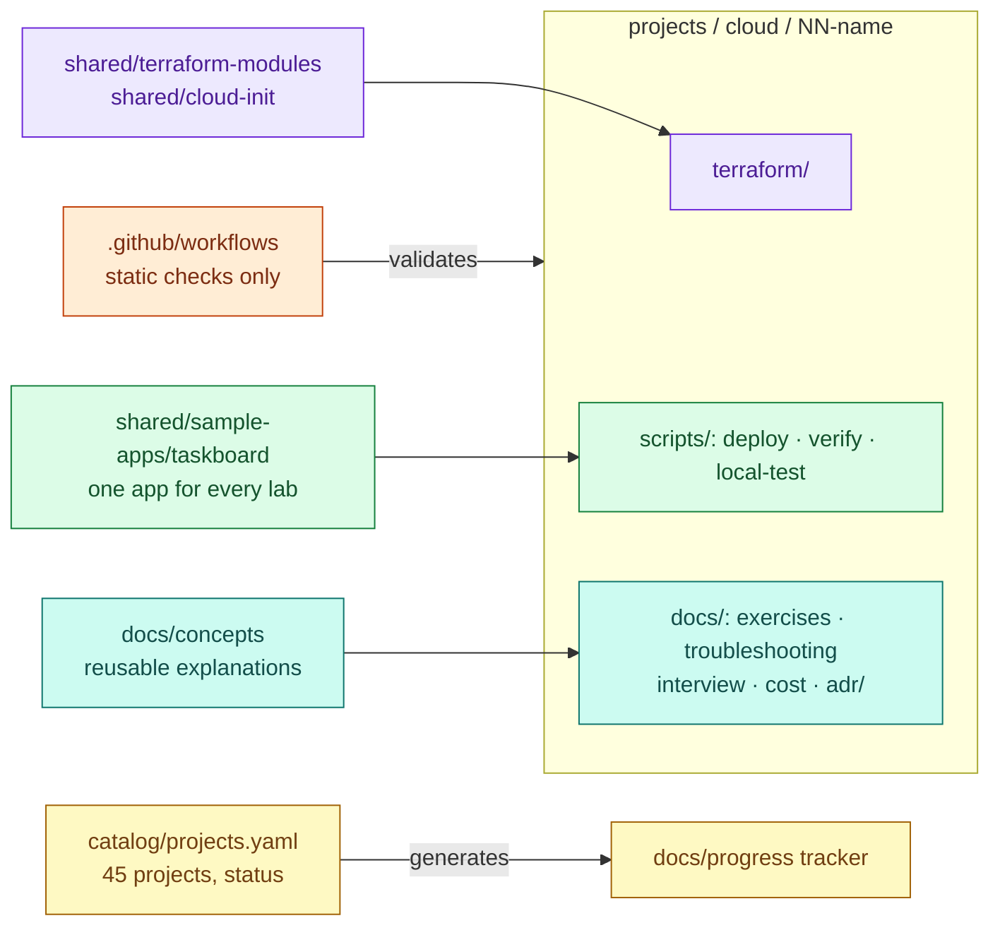

# DevOps & SRE Engineering Labs

Hands-on, production-inspired labs for DevOps, Platform and Site Reliability Engineering on **AWS,
Azure and Google Cloud**. Every lab is deployable code plus the material to understand it: colourful
Mermaid architectures, Architecture Decision Records, cost estimates, troubleshooting playbooks,
failure drills and interview preparation.

> **Status (2026-11-09):** 3 of 45 projects implemented (AWS 01–03). They pass static checks and local
> container tests; **none has been deployed to a cloud account yet**. See the
> [implementation tracker](docs/progress/implementation-tracker.md) for exact per-project status.

## Who this is for

| You are | Start with |
|---|---|
| New to Linux, containers or cloud | [Beginner path](docs/learning-paths/README.md#beginner) → [AWS 01](projects/aws/01-linux-server-engineering/) |
| A developer or ops engineer moving into DevOps | [Intermediate path](docs/learning-paths/README.md#intermediate) |
| An engineer preparing for SRE / platform interviews | [Interview preparation](docs/interview-preparation/README.md) |
| Comparing clouds | [Cloud service mapping](docs/cloud-comparisons/service-mapping.md) |

New here? Read [Start here](docs/start-here.md) (10 minutes).

## How the repository works



- **One sample application** — [Taskboard](shared/sample-apps/taskboard/) (FastAPI + PostgreSQL/SQLite +
  static frontend) — is deployed by every lab, so you compare platforms, not apps.
- **Each lab is self-contained**: Terraform, scripts, and a `docs/` folder with the same structure
  everywhere ([conventions](docs/conventions.md)).
- **Concepts are written once** in [docs/concepts/](docs/concepts/) and linked from labs.

## Project catalog

15 engineering themes, each implemented separately on every cloud. Free-tier fit is assessed per
cloud in [catalog/projects.yaml](catalog/projects.yaml) and explained in
[Cost and free tier](docs/cost-and-free-tier.md).

| # | Theme | Level | Build | AWS | Azure | GCP |
|---|---|---|---|---|---|---|
| 01 | Linux Server Engineering | Beginner | 4 h | [✅ implemented](projects/aws/01-linux-server-engineering/) · free tier | planned | planned |
| 02 | Dockerized Application on Cloud VM | Beginner | 3 h | [✅ implemented](projects/aws/02-dockerized-app-on-vm/) · free tier | planned | planned |
| 03 | Multi-Service Docker Application | Beginner | 4 h | [✅ implemented](projects/aws/03-multi-service-docker-app/) · free tier | planned | planned |
| 04 | Terraform Networking Foundations | Intermediate | 5 h | planned | planned | planned |
| 05 | Highly Available Server Application | Intermediate | 5 h | planned | planned | planned |
| 06 | Secure CI/CD and Container Registry | Intermediate | 5 h | planned | planned | planned |
| 07 | Managed Kubernetes Foundations | Intermediate | 6 h | planned | planned | planned |
| 08 | Kubernetes Networking and Autoscaling | Intermediate | 6 h | planned | planned | planned |
| 09 | Helm and Argo CD GitOps | Advanced | 6 h | planned | planned | planned |
| 10 | Stateful Kubernetes Workloads | Advanced | 6 h | planned | planned | planned |
| 11 | Prometheus, Grafana and Alertmanager | Advanced | 6 h | planned | planned | planned |
| 12 | Centralized Logging with Elastic Stack | Advanced | 6 h | planned | planned | planned |
| 13 | Distributed Tracing | Advanced | 5 h | planned | planned | planned |
| 14 | SRE Failure and Recovery Lab | Advanced | 6 h | planned | planned | planned |
| 15 | Production-Inspired DevOps/SRE Capstone | Advanced | 12 h | planned | planned | planned |

Build times are first attempts including exercises. Rebuilds take 15–30 minutes.

### Status definitions

| Status | Meaning |
|---|---|
| planned | In the catalog only; no files yet |
| implemented | Code, docs, ADRs, cost, troubleshooting and interview material exist; `scripts/catalog.py validate` and static checks pass |
| local test passed | The container/stack part ran on local Docker and its test script passed (no cloud involved) |
| deployment-tested | Deployed to a real account, `verify.sh` passed, destroyed — with date and region recorded |

## Prerequisites

| Tool | Version used | Needed for |
|---|---|---|
| Terraform | ≥ 1.9 (tested 1.15) | All cloud labs |
| AWS CLI v2 | current | AWS labs, preflight, cleanup check |
| Docker Engine + Compose v2 | Engine ≥ 25 (tested 29.1, Compose 5.1) | Labs 02+, local tests, linters |
| OpenSSH client, rsync, curl, jq | any recent | Deploy and verify scripts |
| Python 3.11+ | tested 3.12 | App tests, catalog validation |
| Node.js 20+ | tested 20 | Mermaid validation (optional locally) |

Plus a cloud account you control. Use a **dedicated lab account**, not one that hosts anything important.

## Before you deploy anything

- **Nothing deploys automatically.** CI only runs static checks. You run `terraform apply` yourself.
- **Set a budget alert first:** [Cost and free tier → budget alarm](docs/cost-and-free-tier.md#1-set-a-budget-alarm-before-the-first-deploy).
- **Free tier is not a guarantee.** AWS changed its free tier for accounts created on or after
  2025-07-15 (credit-based Free plan); older accounts keep the 12-month legacy offer. Labs AWS 01–03
  are designed to fit both, using one `t3.micro` with `cpu_credits = "standard"`.
- **Destroy after every session:** `terraform -chdir=terraform destroy`, then
  `shared/scripts/aws-find-lab-resources.sh` to confirm nothing tagged remains.
- **Security defaults:** SSH and app ports are open only to the CIDRs you set (`0.0.0.0/0` is rejected
  for SSH), IMDSv2 is enforced, disks are encrypted, secrets are generated on the host and git-ignored.

## Learning paths and interview preparation

- [Learning paths](docs/learning-paths/README.md) — beginner, intermediate, advanced, interview, and
  role-based routes (DevOps, Senior DevOps, SRE, Cloud, Platform, Kubernetes engineer).
- [Interview index](docs/interview-preparation/README.md) — every question by technology, cloud,
  difficulty and scenario.
- [Concept guides](docs/concepts/README.md) — Linux, Docker, networking, TLS, Terraform, EC2.
- [Reference links](docs/reference-links.md) — official documentation used across labs.

## Validating changes locally

```bash
scripts/validate.sh              # everything that can run locally (uses Docker for missing linters)
scripts/validate.sh terraform    # one group: terraform | cloudinit | shell | docker | yaml | compose | mermaid | links | catalog | app | secrets
```

The same checks run in [GitHub Actions](.github/workflows/validate.yml) with read-only permissions.

## Contributing

See [CONTRIBUTING.md](CONTRIBUTING.md) for the project standard, the definition of done and how to
record a real deployment test. Use the [project template](docs/templates/project-readme.md) for new
labs.

## License

[MIT](LICENSE)
