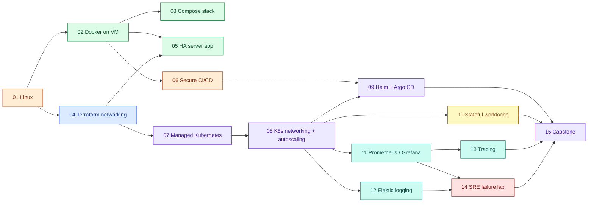

# Roadmap architecture: how the 15 themes build on each other

The same dependency graph applies to every cloud. A project's `depends_on` in
[catalog/projects.yaml](../../catalog/projects.yaml) follows these edges.

## What carries forward

| Artefact | Introduced | Reused by |
|---|---|---|
| Taskboard app (`/healthz`, `/readyz`, `/metrics`, JSON logs) | shared | every lab; `/metrics` scraped in 11, JSON logs parsed in 12, instrumented in 13 |
| `lab-network`, `lab-host` modules | AWS 01 | AWS 02–03; replaced by the full network module in AWS 04 |
| Docker host cloud-init | AWS 02 | AWS 03 |
| Hardened container profile | AWS 02 | AWS 03 Compose anchor → Kubernetes `securityContext` in 08 |
| Health-gated rollout + rollback | AWS 02 | ALB health checks (05), Kubernetes rolling updates (08), Argo CD (09) |
| Two-tier network isolation | AWS 03 | private subnets (04), NetworkPolicy (08) |
| Backup / restore drill | AWS 03 | volume snapshots (10), DR in capstone (15) |
| Failure-injection pattern (opt-in, self-reverting) | AWS 01 | AWS 03 drills, SRE lab (14) |

## Extension points

The layout is designed so new tracks fit without restructuring:

| Future track | Where it plugs in |
|---|---|
| DevSecOps (SBOM, signing, policy-as-code) | Extends 06 and 09; new concept guides; new catalog entries numbered 16+ |
| Advanced platform engineering (internal developer platform) | Builds on 09 and 15 |
| Service mesh | Builds on 08 and 13 |
| FinOps | Each `cost.md` already records rates and formulas; a FinOps track aggregates them |
| AI infrastructure (GPU node pools, model serving) | Builds on 07, 08 and 11 |

New tracks get new catalog entries and directories under `projects/<cloud>/`; nothing existing moves.
