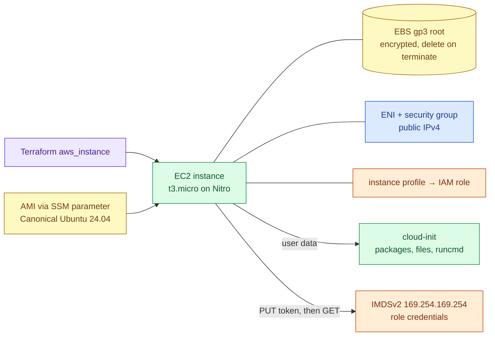

# Amazon EC2 fundamentals for lab hosts

> Used in: [AWS 01–03](../../projects/aws/) through the shared [lab-host module](../../shared/terraform-modules/aws/lab-host/main.tf)

## What it is

EC2 provides virtual machines ("instances") on the AWS Nitro hypervisor. An instance combines an
**AMI** (boot image), an **instance type** (vCPU/RAM/network), **EBS volumes** (block storage), one or
more **ENIs** (network interfaces with security groups), an optional **instance profile** (IAM role)
and **user data** (first-boot configuration, run by cloud-init).

## Why it is needed

Every higher-level AWS compute service (ECS on EC2, EKS nodes, Auto Scaling groups) is built from these
parts. Misunderstanding them causes the most common lab and production surprises: changing public IPs,
surprise bills, credential theft through metadata, and throttled CPUs.

## How it works



| Topic | What to know | Lab setting |
|---|---|---|
| Burstable CPU | T3 earns credits below baseline and spends them above it. `unlimited` mode bills surplus credits; `standard` throttles to baseline | `cpu_credits = "standard"` |
| Public IPv4 | Auto-assigned addresses change on stop/start; every public IPv4 address is billed hourly (free-tier allowance on legacy accounts) | one auto-assigned address |
| IMDSv2 | Session-token metadata access; hop limit controls whether containers can reach it | `http_tokens = "required"`, hop limit 1 |
| EBS | Billed per provisioned GB-month even while the instance is stopped | 20 GB gp3, encrypted |
| Instance profile | Temporary credentials for the role, rotated automatically | SSM core policy only |
| User data | Runs once at first boot via cloud-init; changing it requires replacement | `user_data_replace_on_change = true` |
| AMI lookup | Public SSM parameters always point at the latest image | `lifecycle { ignore_changes = [ami] }` |

## Where it is used in this repository

AWS 01 (hardened Linux host), AWS 02 (Docker host), AWS 03 (Compose host). Later projects replace single
instances with launch templates and Auto Scaling groups (AWS 05) and EKS node groups (AWS 07).

## Common mistakes

- Stopping instead of terminating to "save money" — EBS and Elastic IPs keep billing.
- Leaving T3 in `unlimited` mode on a free-tier account.
- Using IMDSv1 or hop limit 2 without need.
- Giving the instance role broad permissions "for convenience" — any process on the host can use them.
- Forgetting that free-tier hours are per account (or organization), not per instance.

## Troubleshooting commands

```bash
aws ec2 describe-instances --instance-ids <id> --query 'Reservations[0].Instances[0].[State.Name,PublicIpAddress,MetadataOptions.HttpTokens,CpuOptions]'
aws ec2 describe-instance-credit-specifications --instance-ids <id>
aws ec2 get-console-output --instance-id <id> --latest --output text | tail -n 40   # boot / cloud-init errors
aws ssm describe-instance-information --filters Key=InstanceIds,Values=<id>        # is the SSM agent online?
# on the host
cloud-init status --long; sudo cat /var/log/cloud-init-output.log | tail -n 40
```

## References

- [EC2 User Guide](https://docs.aws.amazon.com/AWSEC2/latest/UserGuide/)
- [Burstable performance instances](https://docs.aws.amazon.com/AWSEC2/latest/UserGuide/burstable-performance-instances.html)
- [Instance metadata service](https://docs.aws.amazon.com/AWSEC2/latest/UserGuide/configuring-instance-metadata-service.html)
- [Find Ubuntu AMIs with SSM parameters](https://documentation.ubuntu.com/aws/aws-how-to/instances/find-ubuntu-images/)
- [AWS Free Tier](https://aws.amazon.com/free/)
