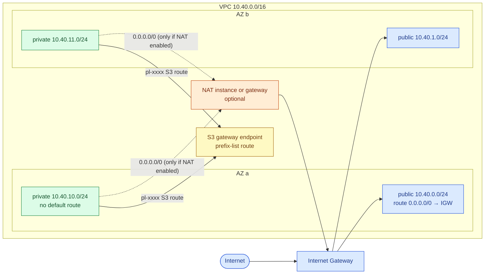

# AWS VPC design: subnets, routing, NAT, endpoints and firewalls

> Used in: [AWS 04](../../projects/aws/04-terraform-networking-foundations/) · [AWS 05](../../projects/aws/05-highly-available-server-app/) · shared [vpc module](../../shared/terraform-modules/aws/vpc/main.tf)

## What it is

A VPC is a private, regional IPv4 (and optionally IPv6) network. You divide it into **subnets**, each in
exactly one Availability Zone. A subnet is "public" or "private" only because of its **route table**:
public subnets have a `0.0.0.0/0` route to an **Internet Gateway**; private subnets do not, and reach the
internet (if at all) through **NAT**. **Endpoints** give private access to AWS services without the
internet. **Security groups** (stateful, per interface) and **network ACLs** (stateless, per subnet)
filter traffic.

## Why it is needed

Every later lab — load balancers, Kubernetes nodes, databases — lands in these subnets. Mistakes here
show up as outages (no route), exposure (database reachable from the internet), or bills (NAT data
processing). A deliberate layout makes the blast radius and the cost visible.

## How it works



| Building block | Key facts | Cost |
|---|---|---|
| Route table | Longest prefix wins; the `local` VPC route cannot be removed | free |
| Internet Gateway | Horizontally scaled, no bandwidth limit, one per VPC | free |
| NAT Gateway | Managed, per-AZ, scales to 100 Gbps; zonal — one AZ outage breaks others that route through it | hourly + per GB processed |
| NAT instance | An EC2 instance with `source_dest_check = false` and masquerading | instance hours (free-tier eligible) |
| S3 / DynamoDB gateway endpoint | Route-table entry to a prefix list; same-region only | free |
| Interface endpoint (PrivateLink) | ENI in your subnet for SSM, ECR, STS, etc. | hourly per AZ + per GB |
| Security group | Stateful, allow-only, can reference other SGs | free |
| Network ACL | Stateless, ordered allow/deny rules per subnet; return traffic must be allowed | free |

**Security-group references:** a rule "allow 5432 from `app-sg`" admits any interface that carries
`app-sg`, whatever its IP. Tiers stay correct as Auto Scaling replaces instances — CIDR-based rules would
not.

**Stateless NACLs:** an outbound HTTPS request leaves on port 443, but the reply arrives on an ephemeral
port (1024–65535). A NACL without an inbound ephemeral-port rule silently breaks every outbound
connection — a classic incident.

## Where it is used in this repository

| Lab | Use |
|---|---|
| AWS 04 | Builds the layout; proves routing with a bastion → private host path per NAT mode |
| AWS 05 | Load balancer in public subnets, app tier SG fed by the web SG, RDS in private subnets with the db SG |
| AWS 07+ | EKS nodes and pods in private subnets (planned) |

## Common mistakes

- One NAT Gateway for all AZs, then an AZ outage takes down egress for every AZ (or cross-AZ data charges).
- Private subnets that "work" only because instances got public IPs.
- Overlapping CIDRs that later block VPC peering or Transit Gateway.
- Forgetting ephemeral ports in NACLs.
- Paying NAT data processing for S3 traffic that a free gateway endpoint would carry.

## Troubleshooting commands

```bash
aws ec2 describe-route-tables --filters Name=vpc-id,Values=<vpc> --query 'RouteTables[].{id:RouteTableId,routes:Routes[].[DestinationCidrBlock||DestinationPrefixListId,GatewayId||NatGatewayId||NetworkInterfaceId]}'
aws ec2 describe-security-group-rules --filters Name=group-id,Values=<sg> --output table
aws ec2 describe-network-acls --filters Name=vpc-id,Values=<vpc> --query 'NetworkAcls[].Entries'
aws ec2 describe-vpc-endpoints --filters Name=vpc-id,Values=<vpc>
# on a host
ip route; curl -s -m 5 https://checkip.amazonaws.com; curl -s -o /dev/null -w '%{http_code}\n' https://s3.<region>.amazonaws.com/
```

## References

- [How Amazon VPC works](https://docs.aws.amazon.com/vpc/latest/userguide/how-it-works.html)
- [NAT gateways](https://docs.aws.amazon.com/vpc/latest/userguide/vpc-nat-gateway.html) · [NAT instances](https://docs.aws.amazon.com/vpc/latest/userguide/VPC_NAT_Instance.html)
- [Gateway endpoints](https://docs.aws.amazon.com/vpc/latest/privatelink/gateway-endpoints.html)
- [Network ACLs](https://docs.aws.amazon.com/vpc/latest/userguide/vpc-network-acls.html) · [Security group rules](https://docs.aws.amazon.com/vpc/latest/userguide/security-group-rules.html)
