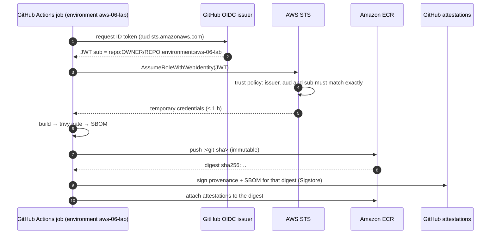

# CI/CD supply-chain security: OIDC, digests, scanning, SBOMs and provenance

> Used in: [AWS 06](../../projects/aws/06-secure-cicd-container-registry/) · [aws-06-delivery workflow](../../.github/workflows/aws-06-delivery.yml) · see also [container security](container-security.md)

## What it is

The set of controls that make sure what runs in production is exactly what was built from reviewed
source, by an authorised pipeline, and checked on the way:

| Control | Question it answers |
|---|---|
| **OIDC federation** | How does the pipeline get cloud credentials without storing secrets? |
| **Environment approvals** | Who allowed this release to production? |
| **Vulnerability gate** | Does the image contain known, fixable vulnerabilities? |
| **SBOM** (software bill of materials) | What exactly is inside the image? |
| **Provenance attestation** | Which workflow, commit and runner built this image? |
| **Immutable tags + deploy by digest** | Is the thing we deploy byte-for-byte the thing we tested? |

## Why it is needed

Long-lived access keys in CI secrets leak (logs, forks, compromised dependencies) and never expire.
Mutable tags let a different image appear under a tested name. Without an SBOM nobody can answer "are we
affected by CVE-X?" in minutes. Attacks such as compromised build tools or poisoned dependencies target
exactly these gaps.

## How it works



- **OIDC:** the cloud trusts GitHub's identity provider. The trust policy's `sub` condition decides
  which repository, branch or environment may assume the role. Pinning it to an **environment** means
  the environment's protection rules (required reviewers, branch restrictions) become the gate.
- **Digests:** a digest is the SHA-256 of the image manifest. Deploying `repo@sha256:…` guarantees the
  bytes; deploying `repo:tag` trusts whoever can push tags. Immutable tags remove tag overwrites;
  digests remove the question entirely.
- **Vulnerability gates** fail builds on *fixable* HIGH/CRITICAL findings (`--ignore-unfixed`), so the
  gate is actionable rather than permanently red.
- **SBOM** (CycloneDX or SPDX) lists every package and version; stored with the release it answers "where
  do we run library X?" without rescanning.
- **Provenance** (SLSA build provenance, signed with Sigstore) proves which workflow run produced a
  digest. `gh attestation verify oci://<image> --owner <org>` checks it.

## Where it is used in this repository

AWS 06 builds the whole chain; AWS 09 (GitOps) will consume the same digests; the scan gate caught real
findings while building AWS 06 (pip's vendored `urllib3`/`msgpack` and a Debian `zlib1g` fix), which led
to removing pip from the runtime image and applying Debian security updates at build time.

## Common mistakes

- Trust policies with `sub = repo:OWNER/REPO:*` — any branch, any PR workflow can assume the role.
- Missing `aud` condition, or trusting the GitHub provider account-wide for every role.
- Scanning one image and pushing a rebuilt one.
- `latest` or mutable tags in deployment manifests.
- `pull_request_target` workflows that check out and run untrusted code with secrets or cloud roles.
- Treating a green scan as "secure": scanners know only published CVEs.

## Troubleshooting commands

```bash
aws iam get-role --role-name lab06-gha-push --query Role.AssumeRolePolicyDocument
aws ecr describe-images --repository-name lab06/taskboard-api --query 'imageDetails[].[imageTags[0],imageDigest,imagePushedAt]' --output table
aws ecr describe-image-scan-findings --repository-name lab06/taskboard-api --image-id imageDigest=<digest> --query imageScanFindings.findingSeverityCounts
gh attestation verify oci://<account>.dkr.ecr.<region>.amazonaws.com/lab06/taskboard-api@<digest> --owner <github-owner>
docker buildx imagetools inspect <repo>@<digest>
```

## References

- [GitHub: OpenID Connect in Amazon Web Services](https://docs.github.com/actions/security-for-github-actions/security-hardening-your-deployments/configuring-openid-connect-in-amazon-web-services)
- [GitHub: Using environments for deployment](https://docs.github.com/actions/managing-workflow-runs-and-deployments/managing-deployments/managing-environments-for-deployment)
- [GitHub artifact attestations](https://docs.github.com/actions/security-for-github-actions/using-artifact-attestations)
- [SLSA build provenance](https://slsa.dev/spec/v1.0/provenance) · [CycloneDX](https://cyclonedx.org/)
- [Amazon ECR image scanning](https://docs.aws.amazon.com/AmazonECR/latest/userguide/image-scanning.html)
