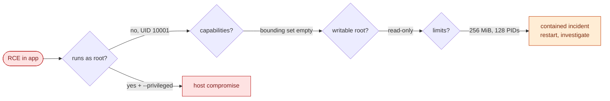

# Container security and runtime hardening

> Used in: [AWS 02](../../projects/aws/02-dockerized-app-on-vm/) (run profile, exercise 3) · [AWS 03](../../projects/aws/03-multi-service-docker-app/) (`x-hardening`) · [docker-daemon.json](../../shared/cloud-init/docker-daemon.json)

## What it is

A container is a Linux process isolated by namespaces and limited by cgroups. Its security depends on
what the image contains, which user it runs as, which kernel features it can use (capabilities,
syscalls, LSM profiles), what it can write, and what host resources are mounted into it.

## Why it is needed

All containers share the host kernel. Default settings are designed for compatibility, not least
privilege. A remote-code-execution bug in one container should not become control of the host.

## How it works

| Layer | Control | Lab setting |
|---|---|---|
| Image | Small base, no build tools, scanned | multi-stage `python:3.13-slim-trixie` |
| Identity | Non-root `USER`, fixed UID | 10001 (API), 101 (NGINX), 70 (PostgreSQL) |
| Privileges | `--cap-drop ALL`, `no-new-privileges` | both, every service |
| Filesystem | `--read-only`, tmpfs for scratch | read-only root, `/tmp` tmpfs `noexec` |
| Kernel surface | default seccomp, AppArmor `docker-default` | kept (never `--privileged`) |
| Resources | memory, CPU, PID limits | 256 MiB / 0.5–0.8 CPU / 128 PIDs for the API |
| Network | publish only the edge; internal networks | only the proxy publishes in AWS 03 |
| Daemon | `live-restore`, log rotation, `icc: false`, default `no-new-privileges` | `docker-daemon.json` |
| Host access | no Docker socket mounts | none (except the local-only scanner exercise) |



## Common mistakes

- `--privileged` or mounting `/var/run/docker.sock` to "make it work" — both equal root on the host.
- Adding users to the `docker` group on shared machines.
- Relying on `USER` alone (`docker run --user 0` overrides it).
- No memory limit: one container can trigger the host OOM killer for everything.
- Scanning images once instead of continuously (new CVEs appear daily).

## Troubleshooting commands

```bash
docker inspect -f '{{.Config.User}} ro={{.HostConfig.ReadonlyRootfs}} caps={{.HostConfig.CapDrop}} sec={{.HostConfig.SecurityOpt}}' <ctr>
docker exec <ctr> grep -E 'CapEff|CapBnd|NoNewPrivs|Seccomp' /proc/1/status
docker stats --no-stream
docker run --rm -v /var/run/docker.sock:/var/run/docker.sock aquasec/trivy:0.75.0 image --severity HIGH,CRITICAL <image>
```

## References

- [Docker Engine security](https://docs.docker.com/engine/security/) · [Seccomp profiles](https://docs.docker.com/engine/security/seccomp/) · [Rootless mode](https://docs.docker.com/engine/security/rootless/)
- [OWASP Docker Security Cheat Sheet](https://cheatsheetseries.owasp.org/cheatsheets/Docker_Security_Cheat_Sheet.html)
- [CIS Docker Benchmark](https://www.cisecurity.org/benchmark/docker)
