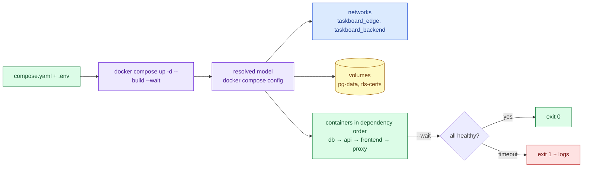

# Docker Compose

> Used in: [AWS 03](../../projects/aws/03-multi-service-docker-app/) ([compose.yaml](../../projects/aws/03-multi-service-docker-app/stack/compose.yaml))

## What it is

Compose describes a multi-container application — services, networks, volumes, secrets and their
relationships — in one YAML file, and reconciles the Docker daemon to match it (`docker compose up`).
Everything it creates is scoped to a **project** name and labelled.

## Why it is needed

A multi-service app run by hand needs a dozen `docker network create` / `docker run` commands in the
right order with the right flags. Compose makes that declarative, reviewable and repeatable — the same
file runs on a laptop and on a server.

## How it works



Key features used in AWS 03:

| Feature | Purpose |
|---|---|
| `x-` extension fields + YAML anchors | One hardening block merged into every service |
| `${VAR:-default}` interpolation from `.env` | Same file locally (high ports) and on the VM |
| `depends_on: condition: service_healthy, restart: true` | Health-ordered start-up; restart dependants when Compose restarts the dependency |
| `networks: internal: true` | Database tier without internet access |
| `secrets: file:` | Password as a file under `/run/secrets` (bind mount without Swarm) |
| `deploy.resources.limits` | CPU, memory and PID limits (honoured without Swarm in Compose v2) |
| `up --wait` | Block until healthchecks pass — used by deploy and test scripts |

## Common mistakes

- Treating `depends_on` as a runtime guarantee (it orders start-up only).
- `docker compose down -v` in production — `-v` deletes named volumes, i.e. the database.
- Putting secrets in `environment:` or committing `.env`.
- Relying on container names instead of service names.
- Expecting Compose to reschedule containers if the host dies (it cannot — single host).

## Troubleshooting commands

```bash
docker compose config                       # what Compose will actually do
docker compose ps -a
docker compose logs --tail 50 <service>
docker compose events
docker compose exec <service> sh
docker compose up -d --force-recreate --no-deps <service>
```

## References

- [Compose file reference](https://docs.docker.com/reference/compose-file/)
- [Startup order](https://docs.docker.com/compose/how-tos/startup-order/) · [Secrets](https://docs.docker.com/compose/how-tos/use-secrets/) · [Networking](https://docs.docker.com/compose/how-tos/networking/)
