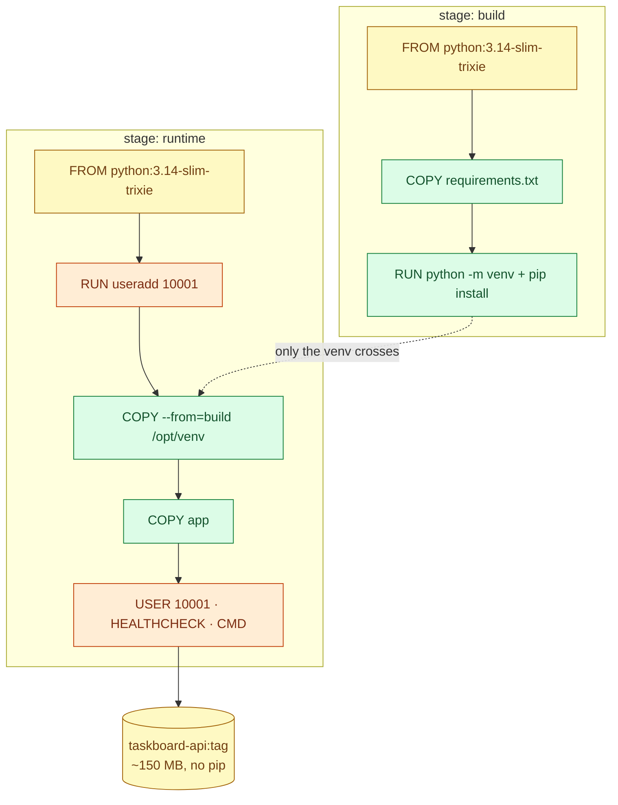

# Docker images, layers and multi-stage builds

> Used in: [Taskboard Dockerfiles](../../shared/sample-apps/taskboard/) · [AWS 02](../../projects/aws/02-dockerized-app-on-vm/) (exercises 1–2) · [AWS 03](../../projects/aws/03-multi-service-docker-app/)

## What it is

An image is an ordered stack of read-only filesystem layers plus metadata (entrypoint, user, env,
labels, healthcheck). A Dockerfile is the recipe; BuildKit executes it, caching each step. A container
adds one thin writable layer on top of the image.

## Why it is needed

Images make the application and its userland one immutable, versioned artefact. Building them well
decides how fast CI is, how large pulls are, and how many vulnerabilities you ship.

## How it works



- **Cache keys:** `COPY`/`ADD` use file checksums; `RUN` uses the command text and the parent layer. The
  first changed step invalidates every later step.
- **Ordering rule:** least-changing first — base, OS packages, dependency manifest, install, code.
- **Multi-stage:** build tools and caches stay in earlier stages; the final stage copies only results.
- **`.dockerignore`** keeps the context small and keeps `.env`, `.git` and tests out of the image.
- **Tags vs digests:** tags move; `image@sha256:...` does not. Deploy by digest when provenance matters.

## Where it is used in this repository

| Image | Notes |
|---|---|
| `taskboard-api` | Two stages, venv copied, UID 10001, Python-based `HEALTHCHECK`, `--no-access-log` (app logs JSON itself) |
| `taskboard-frontend` | `nginx-unprivileged`, static files, security headers |
| `taskboard-proxy` (AWS 03) | Adds `openssl` and a `/docker-entrypoint.d/` hook for the certificate |

## Common mistakes

- `COPY . .` before installing dependencies (every code change reinstalls everything).
- `apt-get update` in a separate `RUN` (stale cached package index).
- Secrets in `ARG`/`ENV` or copied files — they persist in layers and history.
- Shell-form `CMD` (`CMD uvicorn ...`): `/bin/sh` becomes PID 1 and swallows SIGTERM.
- Using `latest` for deployments.

## Troubleshooting commands

```bash
docker build --progress=plain -t img:dev .       # see which steps are CACHED
docker history img:dev --no-trunc
docker image inspect img:dev --format '{{.Config.User}} {{json .Config.Healthcheck}}'
docker run --rm -it --entrypoint sh img:dev
docker builder prune -f; docker system df
```

## References

- [Dockerfile reference](https://docs.docker.com/reference/dockerfile/) · [Build cache](https://docs.docker.com/build/cache/) · [Multi-stage builds](https://docs.docker.com/build/building/multi-stage/)
- [Docker build best practices](https://docs.docker.com/build/building/best-practices/)
