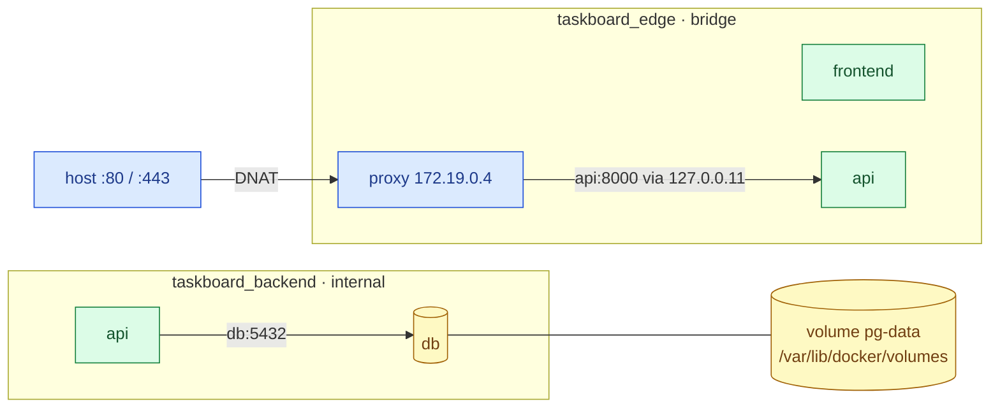

# Docker networking and storage

> Used in: [AWS 02](../../projects/aws/02-dockerized-app-on-vm/) (port publishing, named volume) · [AWS 03](../../projects/aws/03-multi-service-docker-app/) (two networks, embedded DNS, PostgreSQL volume)

## What it is

**Networking:** each container gets its own network namespace connected to a bridge. User-defined
bridges provide name-based discovery via Docker's embedded DNS (`127.0.0.11`). Published ports
(`-p 80:8000`) are DNAT rules from the host to the container.

**Storage:** the container's writable layer disappears with the container. **Named volumes** are
Docker-managed directories under `/var/lib/docker/volumes`; **bind mounts** map a host path; **tmpfs**
mounts live in memory.

## Why it is needed

Services must find each other without hard-coded IPs, only the right ports should be reachable, and
data must outlive container replacement.

## How it works



| Choice | Use when | Watch out for |
|---|---|---|
| Default `bridge` | Never for multi-container apps | No DNS by name; `icc: false` blocks traffic here |
| User-defined bridge | Services on one host | Names resolve only on shared networks |
| `internal: true` | Tiers that need no internet (databases) | No package downloads from inside |
| `--network host` | Rare performance cases | No isolation; port clashes |
| Named volume | Databases, app state | Deleted by `docker volume rm` / `prune --volumes` |
| Bind mount | Config you edit on the host | Host ownership vs container UID |
| tmpfs | Scratch space with `--read-only` | Counts toward memory |

## Common mistakes

- Publishing database ports "for debugging" and forgetting them.
- Expecting `ufw` to filter published ports (it does not — see [firewalls](linux-networking-firewalls.md)).
- Storing data in the container layer, then losing it on `docker rm`.
- Using IPs instead of service names; caching DNS forever in proxies.

## Troubleshooting commands

```bash
docker network ls; docker network inspect <net> --format '{{.Internal}} {{range .Containers}}{{.Name}} {{.IPv4Address}} {{end}}'
docker exec <ctr> cat /etc/resolv.conf
docker exec <ctr> nslookup <service> 127.0.0.11
docker port <ctr>
docker volume ls; docker volume inspect <vol>
docker system df -v
```

## References

- [Docker networking overview](https://docs.docker.com/engine/network/) · [Bridge networks](https://docs.docker.com/engine/network/drivers/bridge/)
- [Volumes](https://docs.docker.com/engine/storage/volumes/) · [Bind mounts](https://docs.docker.com/engine/storage/bind-mounts/) · [tmpfs](https://docs.docker.com/engine/storage/tmpfs/)
