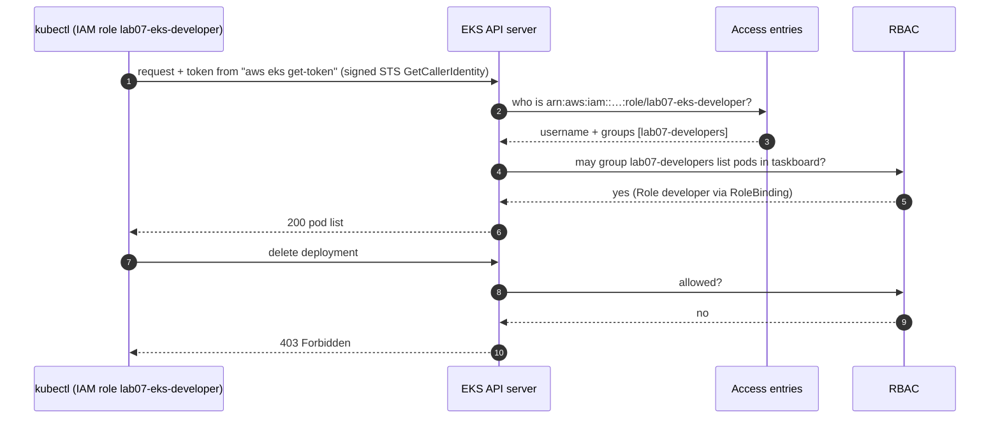
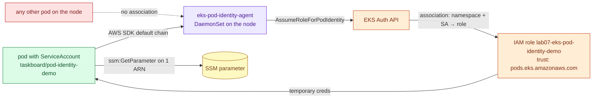

# Amazon EKS access and identity: access entries, RBAC and Pod Identity

> Used in: [AWS 07](../../projects/aws/07-managed-kubernetes-foundations/) · see also [Kubernetes core concepts](kubernetes-core-concepts.md)

## What it is

Two directions of identity meet in an EKS cluster:

| Direction | Question | EKS mechanism |
|---|---|---|
| Humans/CI → Kubernetes | Which IAM principal may call the Kubernetes API, and as whom? | **Access entries** (EKS API) map an IAM role/user to Kubernetes groups and/or EKS access policies; Kubernetes **RBAC** decides what those groups may do |
| Pods → AWS | Which AWS permissions does a pod get? | **EKS Pod Identity** (or the older IRSA) maps a ServiceAccount to an IAM role |

## Why it is needed

Without them people share one admin kubeconfig, and pods borrow the node's IAM role — so every pod on a
node can do whatever any pod on that node needs. Both are least-privilege failures with a cluster-wide
blast radius.

## How it works





- **Authentication mode `API`** uses only access entries; the legacy `aws-auth` ConfigMap is ignored.
  `bootstrap_cluster_creator_admin_permissions = false` means even the creator needs an explicit entry.
- **EKS access policies** (`AmazonEKSClusterAdminPolicy`, `AmazonEKSViewPolicy`, …) are managed
  permission sets; **Kubernetes groups** on an access entry hand authorisation to your own RBAC.
- **Pod Identity** needs the `eks-pod-identity-agent` add-on, a role trusting `pods.eks.amazonaws.com`
  (`sts:AssumeRole` + `sts:TagSession`), and an association (namespace + ServiceAccount → role). No
  annotations or OIDC provider per cluster, unlike IRSA.

## Where it is used in this repository

AWS 07: admin and developer access entries, `k8s/base/rbac-developer.yaml`, the Pod Identity demo Job.
The node role still carries `AmazonEKS_CNI_Policy` (ADR-0003 in AWS 07 explains the tradeoff).

## Common mistakes

- Using the *assumed-role session* ARN in an access entry instead of the role ARN.
- Granting `AmazonEKSClusterAdminPolicy` to every human.
- Pods relying on the node role (IMDS hop limit 2) instead of Pod Identity.
- Forgetting `sts:TagSession` in the Pod Identity trust policy.
- RBAC bound to a group name that no access entry produces (typos fail silently as "Forbidden").

## Troubleshooting commands

```bash
aws eks list-access-entries --cluster-name <c>
aws eks describe-access-entry --cluster-name <c> --principal-arn <arn>
aws eks list-associated-access-policies --cluster-name <c> --principal-arn <arn>
kubectl auth whoami
kubectl auth can-i --list -n taskboard
aws eks list-pod-identity-associations --cluster-name <c>
kubectl logs -n kube-system -l app.kubernetes.io/name=eks-pod-identity-agent --tail 20
```

## References

- [EKS access entries](https://docs.aws.amazon.com/eks/latest/userguide/access-entries.html)
- [EKS Pod Identity](https://docs.aws.amazon.com/eks/latest/userguide/pod-identities.html)
- [Kubernetes RBAC](https://kubernetes.io/docs/reference/access-authn-authz/rbac/)
- [EKS Best Practices — Identity and access management](https://docs.aws.amazon.com/eks/latest/best-practices/identity-and-access-management.html)
