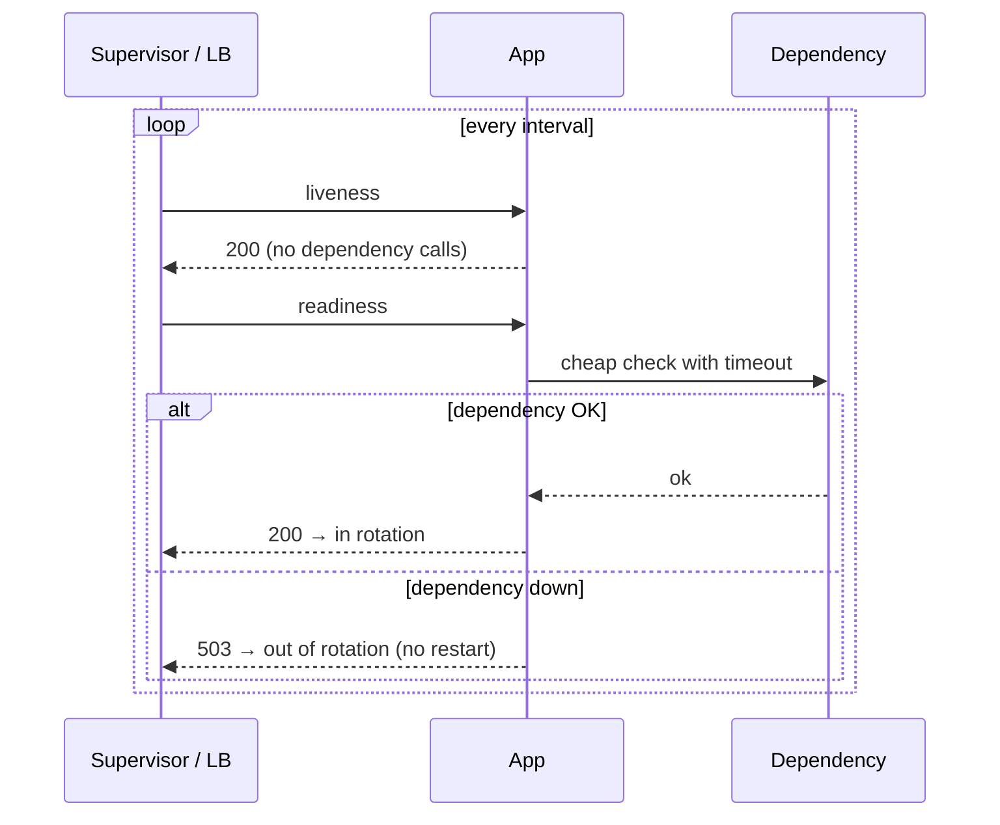

# Health checks: liveness, readiness and restart policies

> Used in: [Taskboard API](../../shared/sample-apps/taskboard/api/app/main.py) (`/healthz`, `/readyz`) · [AWS 02](../../projects/aws/02-dockerized-app-on-vm/) (health-gated rollout) · [AWS 03](../../projects/aws/03-multi-service-docker-app/) (`depends_on: service_healthy`)

## What it is

Automated probes that tell a supervisor (systemd, Docker, a load balancer, Kubernetes) whether a
process is alive and whether it should receive traffic.

| Probe | Question | Taskboard endpoint | Correct reaction to failure |
|---|---|---|---|
| Liveness | Is the process stuck beyond recovery? | `/healthz` — never touches dependencies | Restart the process |
| Readiness | Can it serve requests right now? | `/readyz` — checks the database with a 3 s timeout | Stop sending traffic, do **not** restart |
| Startup | Has slow initialisation finished? | (Kubernetes, AWS 08) | Delay liveness checks |

## Why it is needed

Without probes, failures are discovered by users. With badly designed probes, a dependency outage
causes restart storms that turn a partial outage into a full one.

## How it works



Supervisors in this repository:

| Supervisor | Acts on | Notes |
|---|---|---|
| systemd (AWS 01) | Process exit | `Restart=on-failure`, start limits |
| Docker (AWS 02) | Process exit | `HEALTHCHECK` only sets a status — Docker does not restart unhealthy containers |
| Compose (AWS 03) | Health status at start-up | `depends_on: condition: service_healthy` orders start-up only |
| Deploy script (AWS 02) | Health status after rollout | Rolls back if not healthy within ~60 s |
| Load balancer / Kubernetes (AWS 05, 08) | Readiness and liveness continuously | Removes targets, restarts pods |

## Common mistakes

- Liveness that checks the database (restart storm during DB outages).
- Probes with no timeout, or timeouts longer than the interval.
- Health endpoints that do expensive work or require authentication.
- Assuming Docker restarts `unhealthy` containers.
- Logging every probe request (noise; the API skips `/healthz` in request logs).

## Troubleshooting commands

```bash
curl -s -w ' %{http_code} %{time_total}s\n' http://127.0.0.1:8000/healthz
curl -s -w ' %{http_code}\n' http://127.0.0.1:8000/readyz
docker inspect -f '{{json .State.Health}}' <ctr> | jq '.Status, .Log[-3:]'
docker compose ps --format '{{.Service}} {{.Health}}'
systemctl show -p NRestarts <unit>
```

## References

- [Dockerfile HEALTHCHECK](https://docs.docker.com/reference/dockerfile/#healthcheck)
- [Kubernetes probes](https://kubernetes.io/docs/concepts/configuration/liveness-readiness-startup-probes/)
- [Google SRE book — Handling overload](https://sre.google/sre-book/handling-overload/)
