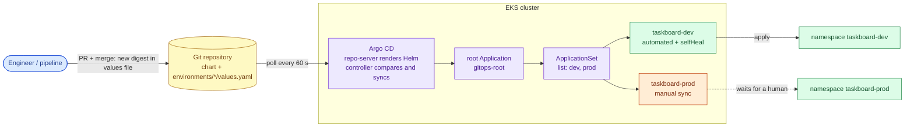

# Helm and GitOps with Argo CD

> Used in: [AWS 09](../../projects/aws/09-helm-argocd-gitops/) · [Taskboard Helm chart](../../shared/helm-charts/taskboard/) · see also [CI/CD supply-chain security](cicd-supply-chain-security.md)

## What it is

**Helm** packages Kubernetes manifests as a *chart*: templates plus default values, rendered per
installation with environment-specific values and validated by an optional JSON schema. **GitOps** makes
a Git repository the single source of truth for what runs; an in-cluster agent — **Argo CD** — continuously
compares the cluster with Git and reconciles the difference (sync), reporting drift (OutOfSync) and health.

## Why it is needed

AWS 07/08 deployed with `kubectl apply` from a laptop: whoever ran it last decided what was running, there
was no record of why, and a manual `kubectl edit` changed production silently. With GitOps every change is a
reviewed commit, rollback is `git revert`, drift is visible or automatically undone, and nobody needs
cluster-admin credentials to deploy.

## How it works



| Concept | Meaning |
|---|---|
| Chart / values / schema | Templates + defaults + `values.schema.json` that rejects invalid input before anything renders |
| Release | One rendered installation (`helm upgrade --install`, or Argo CD rendering on your behalf) |
| Application | Argo CD object: *source* (repo, path, revision, values) → *destination* (cluster, namespace) |
| App of apps | One root Application whose manifests create further Applications |
| ApplicationSet | Generates Applications from a list, Git directories, clusters, … |
| AppProject | Guard rails: allowed source repos, destinations and resource kinds |
| Sync / OutOfSync / Healthy | Desired vs live state, and whether live resources are working |
| Prune / self-heal | Delete resources removed from Git / revert manual changes |
| Pull model | The cluster pulls from Git; CI never needs cluster credentials |

## Where it is used in this repository

AWS 09 bootstraps Argo CD and a root Application with Terraform, then everything else comes from
`projects/aws/09-helm-argocd-gitops/gitops/root` and `environments/`. The chart lives in
`shared/helm-charts/taskboard` so later labs reuse it.

## Common mistakes

- Putting image *tags* in Git — the repository no longer describes what runs. Pin digests (the chart's
  schema enforces it).
- Auto-sync with prune on production without review gates.
- Editing resources by hand in a self-healed namespace and wondering why changes vanish.
- Secrets in values files in Git (use a secret manager / External Secrets, not base64).
- One giant Application for everything: one bad manifest blocks every sync.
- Charts with logic so dynamic that `helm template` output cannot be reviewed.

## Troubleshooting commands

```bash
helm lint shared/helm-charts/taskboard -f projects/aws/09-helm-argocd-gitops/environments/dev/values.yaml
helm template taskboard shared/helm-charts/taskboard -f projects/aws/09-helm-argocd-gitops/environments/prod/values.yaml | less
kubectl -n argocd get applications
kubectl -n argocd get application taskboard-dev -o jsonpath='{.status.conditions}'
kubectl -n argocd logs deploy/argocd-repo-server --tail 30
kubectl -n argocd logs statefulset/argocd-application-controller --tail 30
```

## References

- [Helm documentation](https://helm.sh/docs/) · [Chart best practices](https://helm.sh/docs/chart_best_practices/) · [Values schema](https://helm.sh/docs/topics/charts/#schema-files)
- [Argo CD documentation](https://argo-cd.readthedocs.io/) · [ApplicationSet](https://argo-cd.readthedocs.io/en/stable/operator-manual/applicationset/) · [Multiple sources](https://argo-cd.readthedocs.io/en/stable/user-guide/multiple_sources/)
- [OpenGitOps principles](https://opengitops.dev/)
