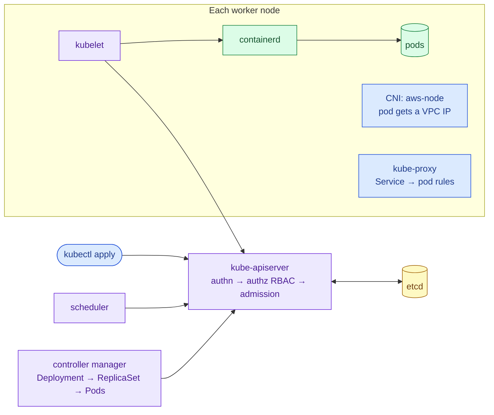

# Kubernetes core concepts: control plane, nodes and the objects you deploy

> Used in: [AWS 07](../../projects/aws/07-managed-kubernetes-foundations/) · later Kubernetes labs (planned) · see also [health checks](health-checks.md) and [container security](container-security.md)

## What it is

Kubernetes is a control loop around a database. You declare desired state as objects (a Deployment with
two replicas); controllers continuously compare it with reality and act until they match. The **control
plane** (API server, etcd, scheduler, controller manager) stores and reconciles state; **nodes** run a
kubelet that starts containers through a container runtime, plus networking agents.

## Why it is needed

AWS 03 ran four containers on one host with Compose; AWS 05 rebuilt instances to get high availability.
Kubernetes generalises both: it schedules containers across many machines, restarts and reschedules
them, rolls out new versions, and gives every service a stable name — for any workload, through one API.

## How it works



| Object | Purpose | In AWS 07 |
|---|---|---|
| Namespace | Scope for names, RBAC and policies | `taskboard`, Pod Security `restricted` |
| Pod | One or more containers sharing network and volumes | Taskboard API |
| Deployment → ReplicaSet | Desired replicas + rolling updates of stateless pods | `taskboard`, 2 replicas |
| Service (ClusterIP) | Stable virtual IP + DNS name in front of pods matching a selector | `taskboard.taskboard.svc` |
| ConfigMap / Secret | Configuration injected as env or files | `taskboard`, `pod-identity-demo` |
| ServiceAccount | Identity of a pod for the Kubernetes API (and, with Pod Identity, AWS) | `pod-identity-demo` |
| Job | Run to completion | Pod Identity demo |
| Role / RoleBinding | Namespaced permissions for users, groups, service accounts | `developer` → group `lab07-developers` |
| DaemonSet | One pod per node | `aws-node`, `kube-proxy`, `eks-pod-identity-agent` (add-ons) |

**Request path for `kubectl apply`:** authentication (on EKS: IAM via an access entry) → authorisation
(RBAC) → admission (Pod Security, quotas, webhooks) → persisted in etcd → controllers create pods → the
scheduler picks a node by requests, affinity and spread constraints → kubelet starts containers and runs
probes.

## Where it is used in this repository

AWS 07 deploys these objects on EKS. The container runtime profile from AWS 02 maps one-to-one to the
pod `securityContext`; AWS 03's two networks become NetworkPolicies and AWS 05's ALB health checks become
readiness probes in later labs.

## Common mistakes

- No resource requests: the scheduler packs pods blindly and nodes run out of memory.
- Liveness probes that check dependencies (restart storms) — see [health checks](health-checks.md).
- `latest` image tags with `imagePullPolicy: IfNotPresent` — nodes run different versions.
- Granting `cluster-admin` to people who need read access to one namespace.
- Expecting `kubectl delete pod` to "fix" a CrashLoopBackOff caused by configuration.

## Troubleshooting commands

```bash
kubectl get pods -n taskboard -o wide
kubectl describe pod -n taskboard <pod>          # Events: scheduling, image pulls, probe failures
kubectl logs -n taskboard <pod> --previous       # logs of the crashed container
kubectl get events -n taskboard --sort-by=.lastTimestamp | tail
kubectl auth can-i --list -n taskboard
kubectl explain deployment.spec.strategy
```

## References

- [Kubernetes components](https://kubernetes.io/docs/concepts/overview/components/)
- [Workloads](https://kubernetes.io/docs/concepts/workloads/) · [Services](https://kubernetes.io/docs/concepts/services-networking/service/)
- [Pod Security Standards](https://kubernetes.io/docs/concepts/security/pod-security-standards/) · [RBAC](https://kubernetes.io/docs/reference/access-authn-authz/rbac/)
