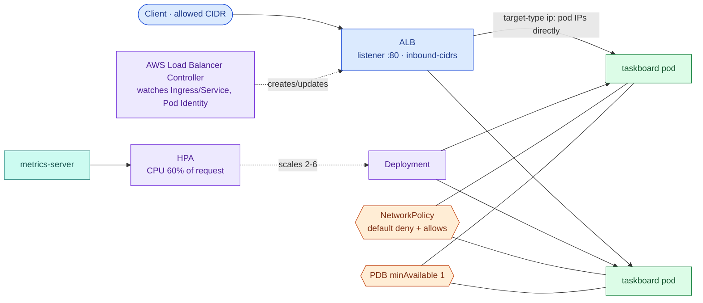

# Kubernetes traffic, isolation and scaling: Services, Ingress, NetworkPolicy, HPA, PDB

> Used in: [AWS 08](../../projects/aws/08-kubernetes-networking-autoscaling/) · builds on [Kubernetes core concepts](kubernetes-core-concepts.md) and [load balancing and autoscaling](load-balancing-and-autoscaling.md)

## What it is

| Object | Job |
|---|---|
| **Service** (ClusterIP / NodePort / LoadBalancer) | Stable virtual IP and DNS name for a changing set of pods; kube-proxy programs the node to forward to ready endpoints |
| **Ingress** + controller | L7 routing from outside the cluster; on AWS the Load Balancer Controller turns an Ingress into an ALB |
| **NetworkPolicy** | Pod-level firewall rules by label, namespace or CIDR; enforced by the CNI (VPC CNI network policy agent on EKS) |
| **HorizontalPodAutoscaler** | Changes a Deployment's replica count from metrics (CPU utilisation relative to *requests*) |
| **PodDisruptionBudget** | Limits how many pods voluntary disruptions (drains, upgrades) may take down at once |
| **RollingUpdate strategy** | `maxSurge` / `maxUnavailable` decide how a rollout trades speed for capacity |

## Why it is needed

AWS 07 reached the app with `kubectl port-forward` — fine for one engineer, useless for users. Real
traffic needs an entry point, pods need protection from each other (a compromised pod should not reach
everything), and capacity must follow load without dropping requests during deploys or node maintenance.

## How it works



- **ALB target types:** `instance` sends to a NodePort on every node, then kube-proxy forwards (extra hop,
  source IP lost, health checks of nodes); `ip` registers pod IPs directly (possible because VPC CNI pod IPs
  are real VPC addresses) — faster drains, accurate health checks, and NetworkPolicy sees the ALB's IPs.
- **HPA math:** `desired = ceil(current × currentUtilisation / target)`. Utilisation is measured against the
  CPU *request*, so wrong requests mean wrong scaling. Scale-down waits for a stabilisation window.
- **NetworkPolicy semantics:** pods are non-isolated until a policy selects them; once selected, only
  traffic matching *some* policy is allowed (policies are additive). Egress default-deny blocks DNS unless
  you allow it.
- **PDB vs HPA vs rollout:** a drain evicts pods only while the PDB stays satisfied; `maxUnavailable: 0`
  means rollouts add capacity before removing it; the HPA must own `replicas` (do not set it in manifests).

## Where it is used in this repository

AWS 08 adds these objects on top of AWS 07's base with kustomize; AWS 09 packages them into a Helm chart.

## Common mistakes

- Setting `spec.replicas` in a manifest that an HPA manages — every apply resets the scale.
- HPA on pods without CPU requests (`<unknown>` targets).
- Default-deny egress without a DNS allow rule.
- `minAvailable` equal to the replica count — drains block forever.
- Deleting the cluster or VPC while an Ingress still owns an ALB (orphaned, billed load balancer).
- `target-type: instance` with `externalTrafficPolicy` surprises (double hops, lost client IPs).

## Troubleshooting commands

```bash
kubectl describe ingress -n taskboard taskboard          # events from the controller
kubectl logs -n kube-system deploy/aws-load-balancer-controller --tail 50
kubectl get hpa -n taskboard -w
kubectl describe hpa -n taskboard taskboard              # conditions: AbleToScale, ScalingActive
kubectl get pdb -n taskboard
kubectl get networkpolicy -n taskboard
kubectl get endpointslices -n taskboard
```

## References

- [Kubernetes Services](https://kubernetes.io/docs/concepts/services-networking/service/) · [Ingress](https://kubernetes.io/docs/concepts/services-networking/ingress/) · [Network policies](https://kubernetes.io/docs/concepts/services-networking/network-policies/)
- [Horizontal Pod Autoscaling](https://kubernetes.io/docs/tasks/run-application/horizontal-pod-autoscale/) · [Disruptions and PDBs](https://kubernetes.io/docs/concepts/workloads/pods/disruptions/)
- [AWS Load Balancer Controller](https://kubernetes-sigs.github.io/aws-load-balancer-controller/latest/) · [Ingress annotations](https://kubernetes-sigs.github.io/aws-load-balancer-controller/latest/guide/ingress/annotations/)
- [EKS: network policies with the VPC CNI](https://docs.aws.amazon.com/eks/latest/userguide/cni-network-policy.html)
