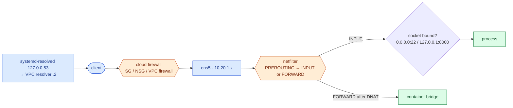

# Linux networking, DNS, ports and firewalls

> Used in: [AWS 01](../../projects/aws/01-linux-server-engineering/) (exercise 3) · [AWS 02](../../projects/aws/02-dockerized-app-on-vm/) (ufw bypass) · [AWS 03](../../projects/aws/03-multi-service-docker-app/) (container networks)

## What it is

The set of layers a packet crosses to reach a process: interfaces and routes, cloud firewalls
(security groups, NACLs), the host firewall (netfilter, managed by `ufw`/`nftables`/`iptables`), and a
listening socket bound to an address and port. DNS turns names into the addresses those packets use.

## Why it is needed

"It does not connect" has many possible causes at different layers. Knowing the order of the layers —
and which tool shows each — turns guessing into a short checklist.

## How it works



- **Timeout vs refused:** a timeout means a filter dropped packets (SG, NACL, host firewall, wrong
  route). *Connection refused* means the host answered with RST — nothing listens on that port.
- **Bind address:** `127.0.0.1:8000` is reachable only from the host; `0.0.0.0:8000` from every interface.
- **Stateful firewalls** (SG, ufw) allow return traffic automatically; **stateless** NACLs do not.
- **Docker** inserts DNAT and FORWARD rules for published ports, so `ufw`'s INPUT rules do not apply to
  container traffic.
- **DNS on Ubuntu:** applications query the stub `127.0.0.53` (`systemd-resolved`), which forwards to
  the VPC resolver (VPC CIDR base + 2, e.g. `10.20.0.2`). Containers on user-defined networks use
  Docker's resolver `127.0.0.11`.

## Where it is used in this repository

| Lab | Use |
|---|---|
| AWS 01 | SG + ufw, loopback-bound API, `lab-fault dns` blocks port 53 |
| AWS 02 | Published port 80 bypasses ufw; the SG is the effective control |
| AWS 03 | Two Docker networks; `internal: true` backend has no route out |

## Common mistakes

- Debugging the app when the SG never let the packet in.
- Opening the host firewall but binding the service to `127.0.0.1` (or the reverse).
- Trusting ufw on a Docker host.
- Hard-coding resolver IPs instead of using the platform resolver.

## Troubleshooting commands

```bash
ip -br addr; ip route; ip -s link
sudo ss -tlnp                                   # listening TCP sockets and processes
nc -vz -w 3 <host> <port>                       # timeout vs refused
sudo ufw status verbose; sudo nft list ruleset | less
sudo iptables -t nat -S DOCKER; sudo iptables -S DOCKER-USER
resolvectl status; resolvectl query example.com; dig +short example.com
sudo tcpdump -ni any port 8000 -c 20
```

## References

- [Ubuntu: firewalls (ufw)](https://documentation.ubuntu.com/server/how-to/security/firewalls/)
- [Docker: packet filtering and firewalls](https://docs.docker.com/engine/network/packet-filtering-firewalls/)
- [Amazon VPC security groups](https://docs.aws.amazon.com/vpc/latest/userguide/vpc-security-groups.html) · [Amazon DNS server](https://docs.aws.amazon.com/vpc/latest/userguide/AmazonDNS-concepts.html)
- [systemd-resolved(8)](https://www.freedesktop.org/software/systemd/man/latest/systemd-resolved.service.html)
