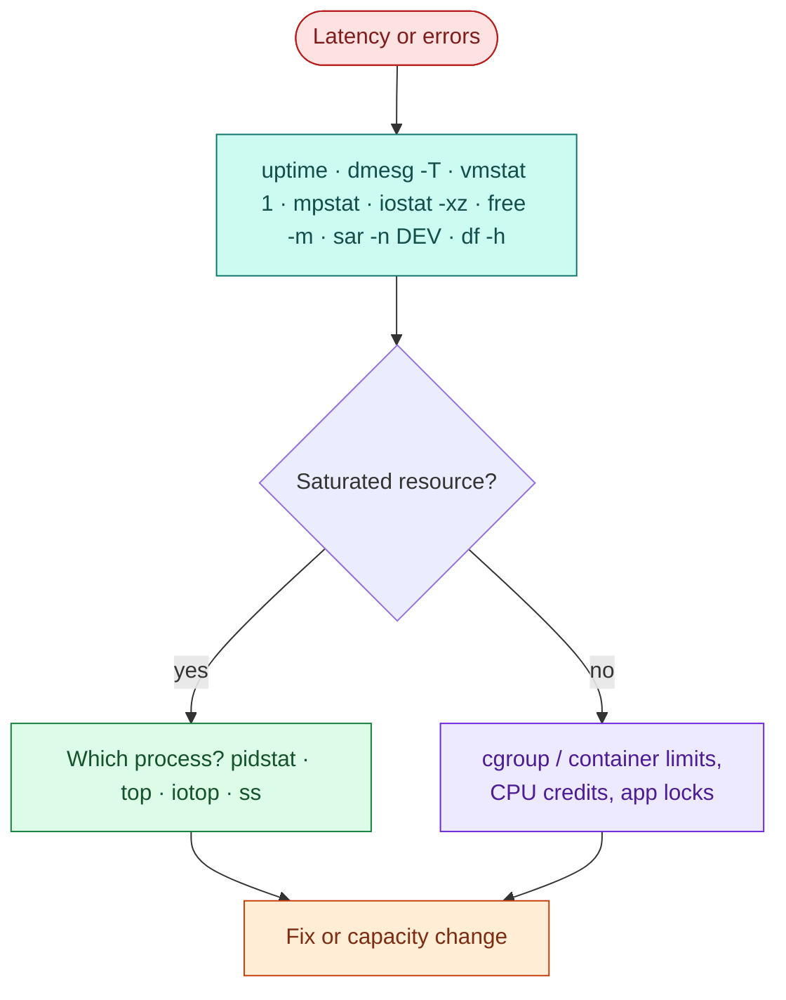

# Linux performance and resource troubleshooting (USE method)

> Used in: [AWS 01](../../projects/aws/01-linux-server-engineering/) (exercise 6, `lab-fault`) · [AWS 02](../../projects/aws/02-dockerized-app-on-vm/) (container limits) · [AWS 03](../../projects/aws/03-multi-service-docker-app/) (504 diagnosis)

## What it is

A systematic way to find the bottleneck on a host: for every resource (CPU, memory, disk, network,
and limits such as file descriptors or cgroup quotas) check **U**tilisation, **S**aturation and
**E**rrors — Brendan Gregg's USE method.

## Why it is needed

Under incident pressure people jump to the first plausible cause. USE is a short, complete checklist
that finds the constrained resource in minutes, and it works on any Linux host, VM or Kubernetes node.

## How it works

| Resource | Utilisation | Saturation | Errors |
|---|---|---|---|
| CPU | `mpstat -P ALL 1` (`%usr+%sys`) | run queue `vmstat 1` `r` > vCPUs; `/proc/pressure/cpu`; `%steal` | `dmesg` (MCE, throttling) |
| Memory | `free -m` (available) | swap in/out `vmstat` `si/so`; `/proc/pressure/memory` | OOM kills in `dmesg -T` |
| Disk | `iostat -xz 1` `%util` | `aqu-sz`, `await`; `/proc/pressure/io` | `dmesg` I/O errors; `df -h`, `df -i` |
| Network | `sar -n DEV 1` | drops, `ss -ti` retransmits | `ip -s link` errors |
| Limits | cgroup `memory.current` / `memory.max` | `cpu.stat` `nr_throttled` | `EMFILE`, `ENOSPC` in app logs |



**Cloud specifics:** burstable instances (AWS T3/T4g, Azure B-series, GCP shared-core e2) have a
baseline CPU. When the credit balance is empty, the hypervisor throttles to baseline and `%steal`
rises — the instance is slow without any process looking busy.

## Where it is used in this repository

- AWS 01 `lab-fault cpu|memory|disk` drills and the [playbook](../../projects/aws/01-linux-server-engineering/docs/troubleshooting.md).
- AWS 02–03 container memory/CPU/PID limits (cgroup v2) and OOM diagnosis.

## Common mistakes

- Reading load average as CPU usage (Linux load includes tasks in uninterruptible I/O sleep).
- Looking only at `df -h` and missing inode exhaustion (`df -i`) or deleted-but-open files (`lsof +L1`).
- Raising limits without evidence instead of finding the consumer.
- Ignoring `%steal` and CPU credits on burstable instances.

## Troubleshooting commands

```bash
uptime; dmesg -T | tail; vmstat 1 5; mpstat -P ALL 1 3; pidstat 1 3
iostat -xz 1 3; free -m; cat /proc/pressure/{cpu,memory,io}
sar -n DEV 1 3; ss -s; ss -ti | head
df -h; df -i; sudo lsof +L1 | head
cat /sys/fs/cgroup/system.slice/taskboard.service/memory.events
```

## References

- [The USE Method — Brendan Gregg](https://www.brendangregg.com/usemethod.html)
- [Linux PSI (pressure stall information)](https://docs.kernel.org/accounting/psi.html)
- [AWS burstable performance instances](https://docs.aws.amazon.com/AWSEC2/latest/UserGuide/burstable-performance-instances.html)
