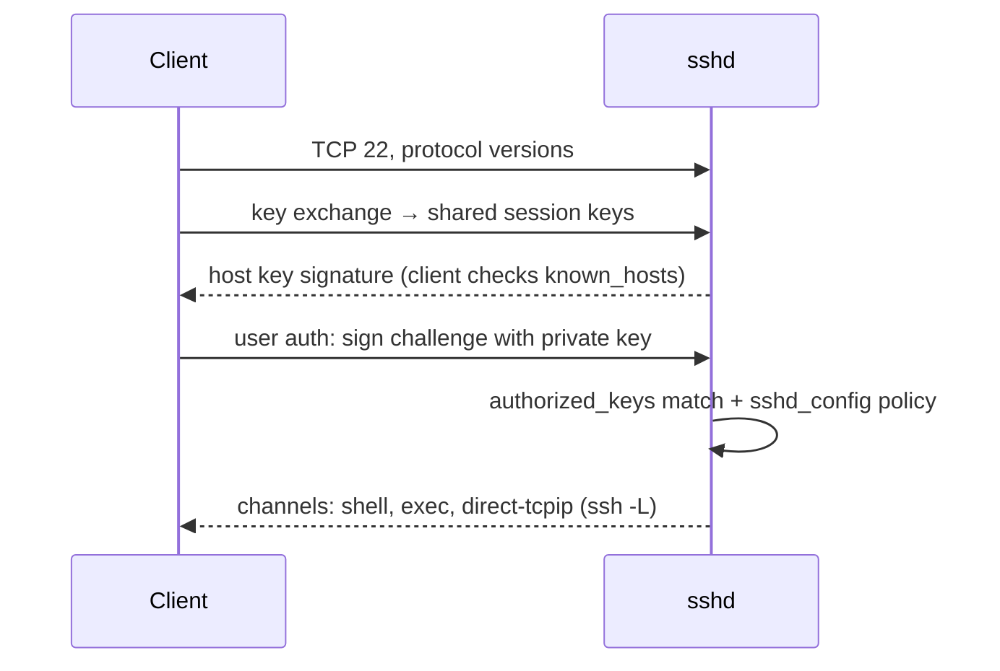

# SSH: authentication, configuration and tunnels

> Used in: [AWS 01](../../projects/aws/01-linux-server-engineering/) · [AWS 02](../../projects/aws/02-dockerized-app-on-vm/) (Docker over SSH) · [AWS 03](../../projects/aws/03-multi-service-docker-app/)

## What it is

SSH (Secure Shell) is an encrypted protocol for remote shells, command execution, file transfer and
port forwarding. OpenSSH provides the client (`ssh`) and the server (`sshd`).

## Why it is needed

Servers have no keyboard. SSH gives authenticated, encrypted access over untrusted networks, and its
forwarding features let you reach services that are deliberately *not* exposed (this repository binds
admin services to `127.0.0.1` and reaches them through tunnels).

## How it works



- **Host keys** (`/etc/ssh/ssh_host_*`) prove the server's identity; the client stores them in
  `~/.ssh/known_hosts`. A changed key triggers `REMOTE HOST IDENTIFICATION HAS CHANGED`.
- **User keys**: the server stores the public key in `~/.ssh/authorized_keys`; the private key never
  leaves the client.
- **Configuration precedence:** `sshd` reads `/etc/ssh/sshd_config`, whose first line includes
  `sshd_config.d/*.conf` in lexical order. For most keywords the **first value wins**, so a drop-in
  named `10-...` overrides Ubuntu's `50-cloud-init.conf` and `60-cloudimg-settings.conf`.
- **Forwarding:** `ssh -L 8000:127.0.0.1:8000 host` opens a local port whose connections sshd opens
  on the server side. `AllowTcpForwarding local` permits this and nothing else.

## Where it is used in this repository

| Lab | Use |
|---|---|
| AWS 01 | Hardened drop-in [10-lab-hardening.conf](../../projects/aws/01-linux-server-engineering/files/10-lab-hardening.conf): keys only, `AllowGroups ssh-users`, no root; API reached through `ssh -L` |
| AWS 02 | `DOCKER_HOST=ssh://ubuntu@ip` tunnels the Docker API over SSH |
| AWS 03 | `rsync` over SSH ships the Compose stack |

## Common mistakes

- Opening port 22 to `0.0.0.0/0` (the shared `lab-host` module rejects it).
- Editing `sshd_config` and assuming it applies — check `sshd -T`, the effective configuration.
- Restarting sshd without `sshd -t` first, or without a second session open.
- Wrong permissions: `~/.ssh` must be `0700` and `authorized_keys` `0600`, or `StrictModes` refuses them.
- Answering `yes` to a changed host key without understanding why it changed.

## Troubleshooting commands

```bash
ssh -v user@host                                # which keys are offered, why auth fails
sudo sshd -t                                    # syntax check before restart
sudo sshd -T | grep -Ei 'passwordauth|permitroot|allowgroups'
sudo journalctl -u ssh -n 50 --no-pager         # server-side reason (LogLevel VERBOSE)
ssh-keygen -R <host>                            # remove a stale known_hosts entry (after verifying!)
ssh-keygen -lf /etc/ssh/ssh_host_ed25519_key.pub   # fingerprint to compare out of band
```

## References

- [sshd_config(5)](https://man.openbsd.org/sshd_config) · [ssh(1)](https://man.openbsd.org/ssh)
- [Ubuntu Server: OpenSSH](https://documentation.ubuntu.com/server/how-to/security/openssh-server/)
- [Mozilla OpenSSH guidelines](https://infosec.mozilla.org/guidelines/openssh)
