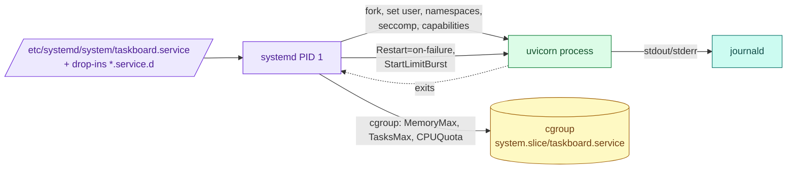

# systemd: services, restart policy, sandboxing and journald

> Used in: [AWS 01](../../projects/aws/01-linux-server-engineering/) ([taskboard.service](../../shared/linux-service/taskboard.service)) · every VM lab (Docker, sshd, unattended-upgrades are systemd units)

## What it is

systemd is PID 1 on modern Linux: it starts and supervises services (units), manages their cgroups,
collects their logs (journald) and handles timers, sockets and mounts.

## Why it is needed

Services must start at boot in the right order, restart after crashes, be limited in what they can
use and touch, and leave logs you can query after the fact. Doing that with shell scripts is fragile.

## How it works



- **Unit types:** `Type=exec` reports started once the binary is executed; `notify` waits for the
  process to signal readiness; `oneshot` for scripts.
- **Restart policy:** `Restart=on-failure` restarts after non-zero exit or signal; `StartLimitBurst=5`
  within `StartLimitIntervalSec=60` stops endless loops (`start-limit-hit`).
- **Drop-ins:** `systemctl edit <unit>` writes `/etc/systemd/system/<unit>.d/override.conf` — the
  vendor unit stays untouched; `systemctl cat` shows the merged result.
- **Sandboxing:** `ProtectSystem=strict`, `StateDirectory=`, `PrivateTmp`, `NoNewPrivileges`,
  `CapabilityBoundingSet=`, `SystemCallFilter=`, `RestrictAddressFamilies=`. Score them with
  `systemd-analyze security <unit>`.
- **journald** stores structured logs; `Storage=persistent` keeps them across reboots.

## Where it is used in this repository

| Lab | Use |
|---|---|
| AWS 01 | Hardened unit for the API, `lab-fault crashloop` drill, journald size caps, `systemd-run` timers for automatic fault revert |
| AWS 02–03 | `docker.service` with `live-restore`; containers restart through Docker's own policy instead |

## Common mistakes

- Editing a unit without `systemctl daemon-reload`.
- `Restart=always` without start limits: a broken config restarts forever and floods the journal.
- Sandboxing everything at once and then not knowing which option broke the service.
- Running the service as root because "it needs to write a file" — use `StateDirectory=`.

## Troubleshooting commands

```bash
systemctl status taskboard --no-pager
journalctl -u taskboard -b --no-pager | tail -n 50
systemctl show -p NRestarts,Result,ExecMainStatus,MemoryCurrent taskboard
systemctl cat taskboard
systemd-analyze security taskboard
systemctl --failed
systemctl reset-failed taskboard
```

## References

- [systemd.service(5)](https://www.freedesktop.org/software/systemd/man/latest/systemd.service.html) · [systemd.exec(5)](https://www.freedesktop.org/software/systemd/man/latest/systemd.exec.html) · [systemd.resource-control(5)](https://www.freedesktop.org/software/systemd/man/latest/systemd.resource-control.html)
- [journalctl(1)](https://www.freedesktop.org/software/systemd/man/latest/journalctl.html)
