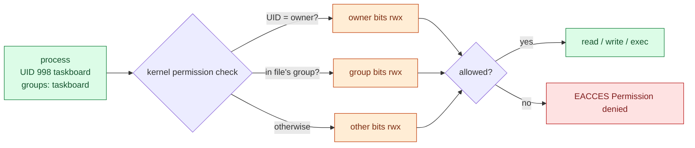

# Linux users, groups, sudo and permissions

> Used in: [AWS 01](../../projects/aws/01-linux-server-engineering/) (exercises 1–2) · [AWS 02](../../projects/aws/02-dockerized-app-on-vm/) (UID 10001, `docker` group) · [AWS 03](../../projects/aws/03-multi-service-docker-app/) (secret file permissions)

## What it is

Every process runs as a user (UID) with a primary group and supplementary groups. Every file has an
owner, a group and permission bits for owner/group/others. `sudo` lets permitted users run commands as
another user, normally root, according to `/etc/sudoers` and `/etc/sudoers.d/*`.

## Why it is needed

Least privilege: a compromised service account should not be able to rewrite its own code, read other
users' data or administer the host. Groups let you grant access by role instead of per person.

## How it works



- Only **one** class applies — owner, then group, then other. An owner with `r--` cannot write even if
  "other" has `rw-`.
- Directories: `r` lists names, `w` creates/deletes entries, `x` traverses. `namei -l <path>` shows
  every directory on the path.
- Special bits: **setuid** (run as file owner), **setgid** on directories (new files inherit the
  group), **sticky** (only owners can delete their files, as in `/tmp`).
- **Capabilities** split root's power; containers and systemd units can drop them (see
  [container-security](container-security.md), [linux-systemd](linux-systemd.md)).

## Where it is used in this repository

| Lab | Use |
|---|---|
| AWS 01 | `taskboard` system user with `nologin`; code `root:taskboard 0640`; `ssh-users` group gates SSH; `%ops` sudo drop-in |
| AWS 02 | Image runs as fixed UID/GID 10001 so volume ownership is predictable |
| AWS 03 | PostgreSQL runs as UID 70; secret file `0644` inside a `0700` directory |

## Common mistakes

- `chmod -R 777` to "fix" an error — it hides the real cause and opens the files to everyone.
- Editing `/etc/sudoers` directly instead of a validated drop-in (`visudo -cf /etc/sudoers.d/50-ops`).
- Forgetting group membership only applies to **new** logins (`id` in the old session will not show it).
- Bind-mounting a host directory into a container that runs as a different UID.
- Treating the `docker` group as harmless — it is root-equivalent.

## Troubleshooting commands

```bash
id alice; getent group ssh-users
namei -l /var/lib/taskboard/taskboard.db
stat -c '%A %U:%G %n' <file>
sudo -l -U alice
sudo visudo -c
find / -xdev -perm -4000 -type f 2>/dev/null       # setuid binaries
```

## References

- [Ubuntu: user management](https://documentation.ubuntu.com/server/how-to/security/user-management/)
- [sudoers(5)](https://www.sudo.ws/docs/man/sudoers.man/) · [chmod(1)](https://man7.org/linux/man-pages/man1/chmod.1.html) · [capabilities(7)](https://man7.org/linux/man-pages/man7/capabilities.7.html)
