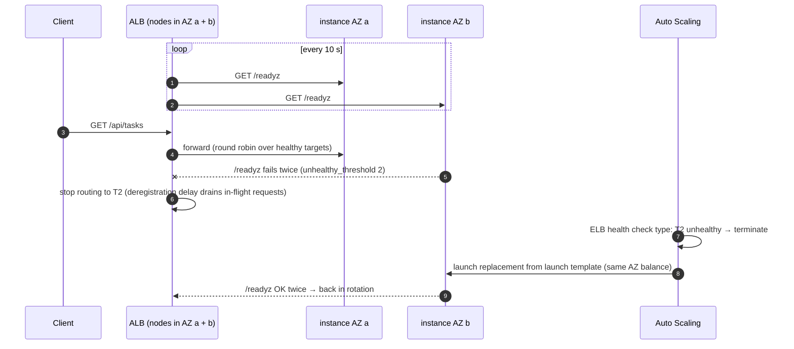

# Load balancing, health checks and autoscaling

> Used in: [AWS 05](../../projects/aws/05-highly-available-server-app/) · see also [health checks](health-checks.md) and [AWS VPC design](aws-vpc-design.md)

## What it is

A **load balancer** spreads requests across a pool of targets and stops sending traffic to targets
that fail health checks. An **Auto Scaling group** (ASG) keeps a desired number of identical instances
running from a **launch template**, replaces unhealthy ones, and changes the count with **scaling
policies**. Together they turn "a server" into "a service that survives the loss of servers".

## Why it is needed

One instance is one failure domain: a crash, a reboot for patches, an AZ incident, or a bad deploy is a
full outage (AWS 02's rollout had seconds of downtime for exactly this reason). Spreading identical,
stateless instances across AZs behind a load balancer removes that single point of failure and lets
capacity follow demand.

## How it works



| Concept | What to know | AWS 05 setting |
|---|---|---|
| Health check path | Use readiness: remove targets that cannot serve | `/readyz`, every 10 s, 2 failures → unhealthy |
| Fail open | If **all** targets are unhealthy, an ALB routes to all of them rather than none | Visible in the `db-reboot` drill |
| Deregistration delay | Time to finish in-flight requests before a target leaves | 30 s |
| ASG health check type | `EC2` replaces only stopped/impaired instances; `ELB` also replaces those failing the LB check | `ELB`, grace 300 s |
| Target tracking | Keeps a metric near a target (like a thermostat) | average CPU 50% |
| Instance refresh | Rolling replacement after a launch template change, keeping a healthy minimum | min healthy 50%, auto rollback |
| Stateless instances | Anything stored on an instance disappears on replacement | data in RDS, config in user data, secret in SSM |

## Where it is used in this repository

AWS 05 (ALB + ASG + RDS). Later: Kubernetes Services, readiness probes and the HPA (AWS 08) implement the
same ideas one layer up.

## Common mistakes

- Liveness-style health checks (`/healthz`) on the load balancer: instances that cannot reach the
  database keep receiving traffic.
- Health check grace periods shorter than boot time → the ASG kills instances before they finish
  booting, forever.
- Storing sessions or files on instances, then losing them at scale-in.
- `min_size = 1` and calling it highly available.
- Scaling on a metric that does not reflect load (e.g. memory on a CPU-bound app).

## Troubleshooting commands

```bash
aws elbv2 describe-target-health --target-group-arn <tg> --query 'TargetHealthDescriptions[].[Target.Id,TargetHealth.State,TargetHealth.Reason]' --output table
aws autoscaling describe-scaling-activities --auto-scaling-group-name <asg> --max-items 5
aws autoscaling describe-instance-refreshes --auto-scaling-group-name <asg>
aws cloudwatch get-metric-statistics --namespace AWS/ApplicationELB --metric-name HTTPCode_Target_5XX_Count \
  --dimensions Name=LoadBalancer,Value=<app/name/id> --start-time <iso> --end-time <iso> --period 60 --statistics Sum
```

## References

- [Application Load Balancer target group health checks](https://docs.aws.amazon.com/elasticloadbalancing/latest/application/target-group-health-checks.html)
- [Amazon EC2 Auto Scaling user guide](https://docs.aws.amazon.com/autoscaling/ec2/userguide/)
- [Target tracking scaling policies](https://docs.aws.amazon.com/autoscaling/ec2/userguide/as-scaling-target-tracking.html)
- [Instance refresh](https://docs.aws.amazon.com/autoscaling/ec2/userguide/asg-instance-refresh.html)
