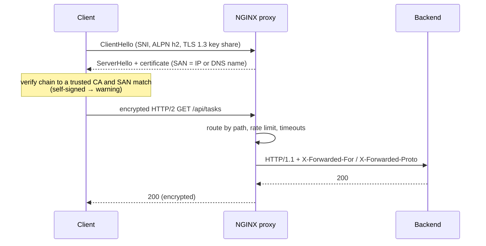

# Reverse proxies and TLS termination

> Used in: [AWS 03](../../projects/aws/03-multi-service-docker-app/) ([nginx.conf](../../projects/aws/03-multi-service-docker-app/stack/proxy/nginx.conf))

## What it is

A **reverse proxy** accepts client connections and forwards requests to backend services. **TLS
termination** means the proxy holds the certificate and private key, decrypts traffic, and talks to
backends over a private network. A **certificate** binds a public key to names (Subject Alternative
Names, SANs) and is signed by a CA that clients trust — or by itself (self-signed).

## Why it is needed

One hardened entry point instead of many exposed services; one place for TLS configuration, routing,
rate limits, timeouts, request size limits and access logs.

## How it works



Settings in this repository and why:

| Setting | Reason |
|---|---|
| `ssl_protocols TLSv1.2 TLSv1.3` | Older versions have known weaknesses |
| ECDSA P-256 key, 30-day self-signed cert, SAN = public IP | Free, automatic, matches how users connect |
| `ssl_session_tickets off` | Avoids long-lived ticket keys weakening forward secrecy |
| `resolver 127.0.0.11 valid=10s` + variables in `proxy_pass` | Re-resolve backends after recreation (no stale IP 502s) |
| `proxy_connect_timeout 2s`, `proxy_read_timeout 10s` | Fail fast instead of piling up connections |
| `limit_req ... rate=20r/s burst=40` → 429 | Protects the API from bursts and simple abuse |
| `client_max_body_size 64k` | API payloads are tiny |
| No HSTS | Not meaningful with a self-signed cert on an IP; dangerous to get wrong on a real domain |

## Where it is used in this repository

AWS 03 (NGINX container). AWS 05 replaces it with an AWS ALB + ACM certificate; Kubernetes labs use an
Ingress/Gateway controller with the same concepts.

## Common mistakes

- Trusting `X-Forwarded-For` from anyone (only trust it from your proxy).
- Static `proxy_pass http://name` in Docker/Kubernetes setups with changing IPs.
- Missing timeouts → 504s after 60 s defaults and exhausted workers.
- Certificates without the right SAN (CN alone is ignored by modern clients).
- Letting certificates expire — monitor expiry (AWS 11 Blackbox exporter).

## Troubleshooting commands

```bash
echo | openssl s_client -connect host:443 -servername host 2>/dev/null | openssl x509 -noout -subject -dates -ext subjectAltName
curl -vk https://host/ -o /dev/null 2>&1 | grep -E 'SSL connection|ALPN|HTTP/'
docker compose exec proxy nginx -t
docker compose logs proxy | jq -c 'select(.status >= 500) | {uri, status, upstream, urt}'
```

## References

- [NGINX proxy module](https://nginx.org/en/docs/http/ngx_http_proxy_module.html) · [SSL module](https://nginx.org/en/docs/http/ngx_http_ssl_module.html) · [limit_req](https://nginx.org/en/docs/http/ngx_http_limit_req_module.html)
- [Mozilla SSL Configuration Generator](https://ssl-config.mozilla.org/)
- [RFC 8446 — TLS 1.3](https://www.rfc-editor.org/rfc/rfc8446)
