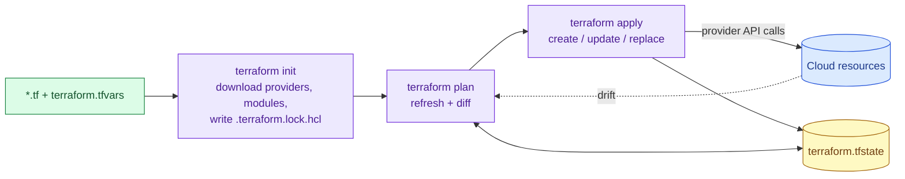

# Terraform fundamentals

> Used in: every cloud lab (`projects/*/*/terraform/`) · shared modules in [shared/terraform-modules](../../shared/terraform-modules/)

## What it is

Terraform is a declarative Infrastructure-as-Code tool. You describe the desired resources in HCL;
Terraform compares that description with its **state** (what it created) and the real cloud, then
plans and applies the difference through **providers** (plugins that call cloud APIs).

## Why it is needed

Click-built infrastructure cannot be reviewed, reproduced or reliably deleted. Code can be versioned,
reviewed in pull requests, validated in CI, applied identically in every account, and destroyed
completely — essential for labs that must leave no billable resources behind.

## How it works



| Building block | Purpose | Example in this repo |
|---|---|---|
| Provider + `default_tags` | API access; tags every resource | `Repository`, `Project`, `Owner` tags used by the cleanup finder |
| Variables with `validation` | Inputs that fail fast | `allowed_ssh_cidrs` rejects `0.0.0.0/0`; free-tier instance types only |
| Modules | Reusable groups of resources | `lab-network`, `lab-host` |
| Data sources | Read existing information | Ubuntu AMI from an SSM parameter |
| Outputs | Values for scripts and humans | `public_ip`, `ssh_command` |
| `lifecycle` | Control replacement | `ignore_changes = [ami]` |
| Lock file | Pins exact provider versions and checksums | `.terraform.lock.hcl` committed |

**State:** AWS 01–03 use local state (one learner, short-lived). AWS 04 introduces remote state in S3
with locking, required as soon as more than one person or pipeline applies.

## Common mistakes

- Running `apply` without reading the plan. Always `plan -out` then `apply <planfile>`.
- Committing `terraform.tfstate` or `terraform.tfvars` (both git-ignored here: state contains secrets
  and IDs).
- Changing resources in the console, then being surprised by drift.
- Unpinned provider versions, so a new major version breaks the code.
- Deleting a state file before `destroy` — Terraform then forgets resources that still bill.

## Troubleshooting commands

```bash
terraform fmt -check -recursive
terraform validate
terraform plan -out=tf.plan && terraform show tf.plan | less
terraform state list; terraform state show module.host.aws_instance.host
terraform apply -replace=module.host.aws_instance.host     # force rebuild of one resource
TF_LOG=DEBUG terraform plan 2> debug.log                     # provider-level errors
```

## References

- [Terraform language](https://developer.hashicorp.com/terraform/language) · [CLI](https://developer.hashicorp.com/terraform/cli)
- [AWS provider docs](https://registry.terraform.io/providers/hashicorp/aws/latest/docs)
- [Dependency lock file](https://developer.hashicorp.com/terraform/language/files/dependency-lock)
