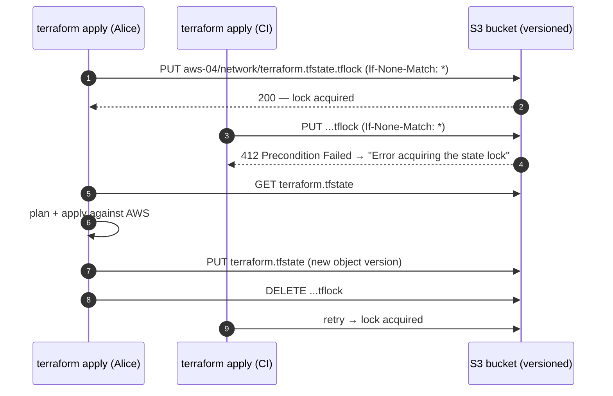

# Terraform remote state and locking

> Used in: [AWS 04](../../projects/aws/04-terraform-networking-foundations/) (bootstrap + network stacks) · [AWS 05](../../projects/aws/05-highly-available-server-app/) · see also [Terraform fundamentals](terraform-fundamentals.md)

## What it is

**State** is Terraform's record of which real objects it manages and their last known attributes.
A **backend** decides where state lives. **Remote state** stores it in a shared, durable place (S3 here);
**locking** ensures only one run changes it at a time.

## Why it is needed

With local state, a second engineer — or a CI job — cannot see what exists and will try to create it
again, or destroy what it does not know about. Two simultaneous applies against the same state can
corrupt it. A laptop failure loses the only map of your infrastructure. Remote state with versioning and
locking solves all three.

## How it works



- **S3 native locking** (`use_lockfile = true`, Terraform ≥ 1.10) creates `<key>.tflock` with a
  conditional write, so no DynamoDB table is needed. Older setups used DynamoDB; that option is
  deprecated.
- **Versioning** keeps every previous state file: restoring an older object version is the rollback for
  a corrupted or wrongly edited state.
- **Partial backend configuration:** `backend "s3" { key = "..." }` in code, the rest in
  `backend.hcl` passed with `-backend-config`, so one codebase can target different accounts.
- **Bootstrap problem:** the bucket that stores state must itself be created first — by a small stack
  with local state (AWS 04 `terraform/bootstrap`), by hand, or by an account-vending pipeline.
- State can contain secrets (database passwords, private keys). Encrypt it, block public access,
  restrict IAM, and prefer write-only attributes or external secret stores (AWS 05 uses write-only
  attributes so the DB password never enters state).

## Where it is used in this repository

| Stack | Backend | Key |
|---|---|---|
| AWS 01–03 | local | — |
| AWS 04 bootstrap | local (creates the bucket) | — |
| AWS 04 network | S3 + lock file | `aws-04/network/terraform.tfstate` |
| AWS 05 | S3 + lock file | `aws-05/app/terraform.tfstate` |

## Common mistakes

- Deleting a stuck lock without checking that the other run is really dead (`terraform force-unlock`
  is for crashed runs only).
- One state for everything: every plan touches everything, and one mistake has the widest blast radius.
- Editing state by hand instead of `terraform state mv/rm` or `import`/`moved` blocks.
- Destroying the state bucket before the stacks that live in it.
- `terraform_remote_state` across teams, coupling them to each other's state layout (prefer published
  outputs, SSM parameters or data sources).

## Troubleshooting commands

```bash
terraform init -backend-config=backend.hcl -reconfigure      # point at a different backend
terraform init -migrate-state                                  # move local state into S3
terraform state list
terraform force-unlock <LOCK_ID>                               # only after confirming no run is active
aws s3api list-object-versions --bucket <bucket> --prefix aws-04/network/terraform.tfstate
aws s3api get-object --bucket <bucket> --key aws-04/network/terraform.tfstate --version-id <id> old.tfstate
```

## References

- [S3 backend](https://developer.hashicorp.com/terraform/language/backend/s3)
- [State locking](https://developer.hashicorp.com/terraform/language/state/locking) · [Sensitive data in state](https://developer.hashicorp.com/terraform/language/state/sensitive-data)
- [Ephemeral values and write-only arguments](https://developer.hashicorp.com/terraform/language/manage-sensitive-data/write-only)
