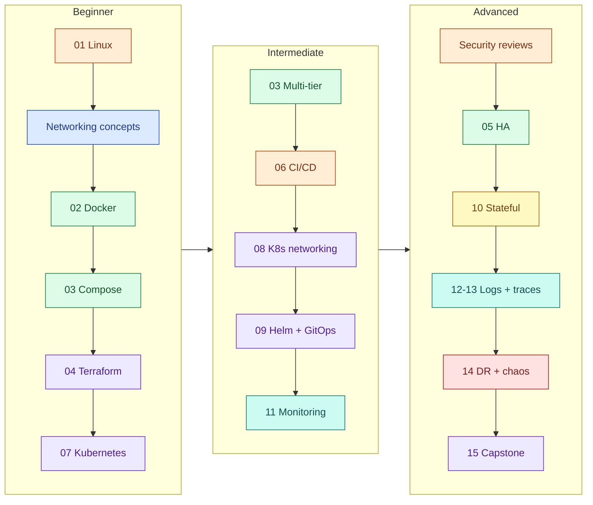

# Learning paths

Each path is an ordered list of labs and concept guides. Items marked *planned* are in the
[catalog](../../catalog/projects.yaml) but not built yet; the path still shows where they fit.
Labs link to their AWS implementation; Azure and GCP versions of the same theme follow the same order.

## Beginner

Linux → Networking → Docker → Terraform → Basic cloud → Kubernetes

| Step | Do | Read | Outcome |
|---|---|---|---|
| 1 | [AWS 01 Linux Server Engineering](../../projects/aws/01-linux-server-engineering/) | [SSH](../concepts/linux-ssh.md), [users & permissions](../concepts/linux-users-permissions.md), [systemd](../concepts/linux-systemd.md) | Operate and harden a server |
| 2 | AWS 01 exercises 3, 6, 9 | [Networking & firewalls](../concepts/linux-networking-firewalls.md), [USE method](../concepts/linux-performance-troubleshooting.md) | Diagnose network and resource problems |
| 3 | [AWS 02 Dockerized app](../../projects/aws/02-dockerized-app-on-vm/) | [Images](../concepts/docker-images-and-builds.md), [container security](../concepts/container-security.md) | Build and run hardened containers |
| 4 | [AWS 03 Multi-service app](../../projects/aws/03-multi-service-docker-app/) | [Compose](../concepts/docker-compose.md), [reverse proxy & TLS](../concepts/reverse-proxy-and-tls.md) | Run a multi-tier stack with TLS and backups |
| 5 | AWS 04 Terraform networking *(planned)* | [Terraform fundamentals](../concepts/terraform-fundamentals.md) | Reusable network foundation with remote state |
| 6 | AWS 07 Managed Kubernetes *(planned)* | — | First cluster |

## Intermediate

Multi-tier architecture → CI/CD → Kubernetes → Helm → GitOps → Monitoring

| Step | Do | Focus |
|---|---|---|
| 1 | [AWS 03](../../projects/aws/03-multi-service-docker-app/) — attempts 3–5 of the repeat practice | Design tiers and isolation yourself |
| 2 | AWS 05 Highly available server app *(planned)* | Load balancing, autoscaling |
| 3 | AWS 06 Secure CI/CD *(planned)* | OIDC, scanning, provenance |
| 4 | AWS 07–08 Kubernetes *(planned)* | Cluster, probes, HPA, NetworkPolicy |
| 5 | AWS 09 Helm + Argo CD *(planned)* | GitOps delivery |
| 6 | AWS 11 Prometheus/Grafana *(planned)* | SLIs, alerts |

## Advanced

Security → Reliability → Stateful workloads → Observability → Disaster recovery → Capstone

| Step | Do | Focus |
|---|---|---|
| 1 | Security review of AWS 01–03: challenge every ADR's security section | Threat modelling |
| 2 | AWS 05 + 14 *(planned)* | Failure domains, recovery |
| 3 | AWS 10 *(planned)* | Snapshots, restore drills |
| 4 | AWS 11–13 *(planned)* | Metrics, logs, traces together |
| 5 | AWS 14 *(planned)* | Chaos experiments, postmortems |
| 6 | AWS 15 Capstone *(planned)* | Architecture review end to end |

## Interview preparation

Choose role → review concepts → study architecture → solve failure scenarios → mock interviews.

1. Pick your role below.
2. Review the listed concept guides until you can explain each without notes.
3. Redraw the lab architecture diagrams from memory.
4. Run the lab's failure drills and answer: symptom → proof → fix.
5. Answer the lab's interview questions aloud, under 3 minutes each, then the follow-ups.

| Role | Focus labs (implemented now) | Questions to master | Planned additions |
|---|---|---|---|
| DevOps Engineer | AWS 02, 03 | [Docker layers](../../projects/aws/02-dockerized-app-on-vm/docs/interview.md#q2-intermediate--how-do-docker-layers-and-the-build-cache-work-and-how-do-you-write-a-dockerfile-that-builds-fast), [bad deploy recovery](../../projects/aws/02-dockerized-app-on-vm/docs/interview.md#q6-scenario--a-deploy-broke-production-on-a-single-docker-host-walk-me-through-recovery-and-prevention), [secrets](../../projects/aws/03-multi-service-docker-app/docs/interview.md#q5-intermediate--how-do-you-handle-secrets-in-a-compose-deployment) | 04, 06, 09 |
| Senior DevOps Engineer | AWS 02, 03 (all ADRs) | [registry vs SSH builds](../../projects/aws/02-dockerized-app-on-vm/docs/interview.md#q7-advanced--why-does-this-lab-build-images-on-the-vm-over-ssh-instead-of-pushing-to-a-registry-when-is-that-wrong), [when to leave Compose](../../projects/aws/03-multi-service-docker-app/docs/interview.md#q7-advanced--when-would-you-move-this-stack-off-compose-and-to-what) | 05, 06, 15 |
| Site Reliability Engineer | AWS 01, 03 | [slow server](../../projects/aws/01-linux-server-engineering/docs/interview.md#q2-intermediate--a-linux-server-is-slow-how-do-you-troubleshoot-it), [liveness vs readiness](../../projects/aws/02-dockerized-app-on-vm/docs/interview.md#q5-intermediate--liveness-vs-readiness-why-does-taskboard-have-both-healthz-and-readyz), [DB recovery RPO/RTO](../../projects/aws/03-multi-service-docker-app/docs/interview.md#q6-scenario--the-database-volume-is-corrupted-walk-through-recovery-and-what-rporto-you-can-promise) | 11, 14 |
| Cloud Engineer | AWS 01 | [IMDSv2](../../projects/aws/01-linux-server-engineering/docs/interview.md#q7-advanced--what-is-imdsv2-and-why-does-this-lab-set-the-hop-limit-to-1), [SG vs host firewall](../../projects/aws/01-linux-server-engineering/docs/interview.md#q4-advanced--security-group-vs-host-firewall-why-both) | 04, 05 |
| Platform Engineer | AWS 02, 03 | [container hardening](../../projects/aws/02-dockerized-app-on-vm/docs/interview.md#q3-intermediate--how-do-you-harden-a-container-at-runtime), [service discovery](../../projects/aws/03-multi-service-docker-app/docs/interview.md#q2-intermediate--how-do-containers-in-a-compose-project-find-each-other) | 07, 09 |
| Kubernetes Engineer | AWS 02, 03 (foundations) | [containers vs VMs](../../projects/aws/02-dockerized-app-on-vm/docs/interview.md#q1-beginner--what-is-the-difference-between-a-container-and-a-virtual-machine), [depends_on](../../projects/aws/03-multi-service-docker-app/docs/interview.md#q3-intermediate--why-does-depends_on-not-guarantee-the-database-is-available) | 07, 08, 10 |
