# Start here

Ten minutes to understand how to use this repository.

## 1. What a lab gives you

Every lab is a small, real system you deploy, operate, break and explain:

```mermaid
flowchart LR
    read[Read README<br/>problem + architecture]:::obs --> local[Run local-test.sh<br/>free, when available]:::app
    local --> deploy[terraform apply<br/>+ deploy.sh]:::k8s
    deploy --> verify[verify.sh<br/>positive + negative checks]:::sec
    verify --> ex[Exercises + failure drills]:::risk
    ex --> explain[Interview questions<br/>+ challenge the ADRs]:::obs
    explain --> destroy[terraform destroy<br/>+ cleanup check]:::data
    destroy -.->|repeat with less guidance| deploy
    classDef obs fill:#ccfbf1,stroke:#0f766e,color:#134e4a
    classDef app fill:#dcfce7,stroke:#15803d,color:#14532d
    classDef k8s fill:#ede9fe,stroke:#6d28d9,color:#4c1d95
    classDef sec fill:#ffedd5,stroke:#c2410c,color:#7c2d12
    classDef risk fill:#fee2e2,stroke:#b91c1c,color:#7f1d1d
    classDef data fill:#fef9c3,stroke:#a16207,color:#713f12
```



## 2. Set up once

```bash
git clone <this-repo> && cd devops-sre-engineering-labs
ssh-keygen -t ed25519 -C labs                 # if you have no key yet
aws configure sso                             # or any credential method; avoid the root user
shared/scripts/aws-preflight.sh               # tools, identity, region, your public IP
```

Then create a budget alarm: [Cost and free tier](cost-and-free-tier.md#1-set-a-budget-alarm-before-the-first-deploy).

## 3. Pick a route

| Goal | Route |
|---|---|
| Learn from zero | [Beginner path](learning-paths/README.md#beginner) |
| Already comfortable with Linux and Docker | [Intermediate path](learning-paths/README.md#intermediate) |
| Interview in a few weeks | [Interview path](learning-paths/README.md#interview-preparation) and the [interview index](interview-preparation/README.md) |
| Compare clouds | [Service mapping](cloud-comparisons/service-mapping.md) |

## 4. Choosing a cloud

AWS labs are implemented first; Azure and GCP follow the same 15 themes (see the
[tracker](progress/implementation-tracker.md)). The application, the learning goals and most concepts
are identical across clouds, so after doing a theme on one cloud the second is mostly about the
differences listed in the [service mapping](cloud-comparisons/service-mapping.md).

## 5. Rules of the road

- Use a dedicated lab account. Never point these labs at production.
- Read every `terraform plan` before applying.
- Destroy at the end of every session and run the cleanup check.
- Failure drills only touch lab resources and are opt-in.
- If something in a lab is wrong or unclear, open an issue with the
  [lab feedback template](../.github/ISSUE_TEMPLATE/lab-feedback.yml).
