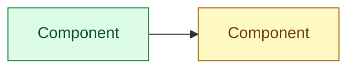

## Q<N> (<Beginner|Intermediate|Advanced|Scenario>) — <Question as the interviewer would ask it>

**Interview answer:** <3–5 sentences you could say in under a minute.>

**Walkthrough:** <explain the diagram step by step.>

**Depth:** <internals, numbers, configuration from the lab.>

**Tradeoffs / failure modes / security:** <what can go wrong and alternatives.>

**Commands:** <optional, from the lab.>

**Follow-ups:** <2–3 likely follow-up questions.>
