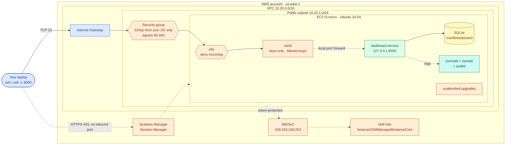
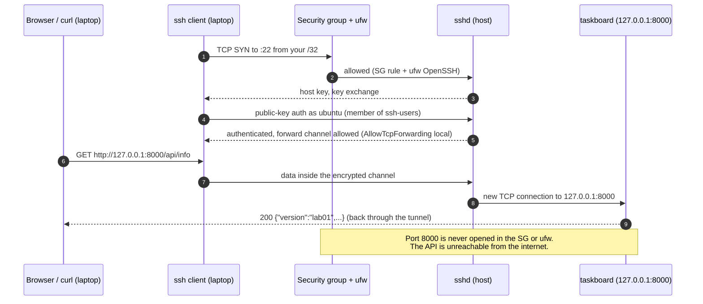
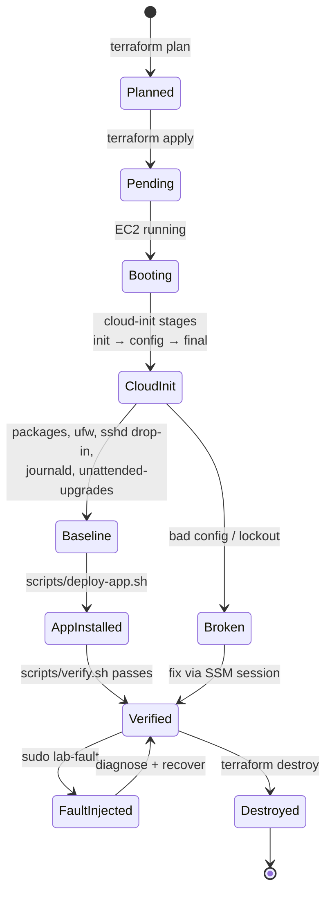

# AWS 01 — Linux Server Engineering

| | |
|---|---|
| **Project ID** | `aws-01` |
| **Cloud** | AWS (EC2, VPC, IAM, Systems Manager) |
| **Difficulty** | Beginner |
| **Build time** | 3–4 h first attempt (including [exercises](docs/exercises.md)) |
| **Rebuild time** | 20–30 min |
| **Free tier** | Fits: one `t3.micro`, 20 GB gp3, one public IPv4 — see [cost](docs/cost.md) |
| **Depends on** | None. Start here. |
| **Status** | Implemented · static checks passed · cloud-init schema and systemd unit verified offline · deployment **not tested** ([tracker](../../../docs/progress/implementation-tracker.md)) |

## The problem this lab solves

Every cloud platform still ends up on a Linux kernel. When a container will not start, a node is
`NotReady`, or an API is slow, the person who fixes it is the one who can read `journalctl`, spot a
full disk, explain why SSH rejected a key, and tell CPU steal from a busy process. Teams lose hours in
incidents because nobody can go one layer down.

This lab builds one deliberately hardened Ubuntu server and then makes you operate it: manage users and
sudo, read effective SSH config, run a sandboxed systemd service, use two firewalls, read logs, patch,
and break the host on purpose to practise diagnosis.

**Skills learned:** SSH key auth and sshd hardening · users, groups, sudo, permissions · systemd units and
sandboxing · journald · ufw vs security groups · DNS resolution on systemd-resolved · disk, memory and CPU
diagnosis (USE method) · unattended security patching · IMDSv2 · Session Manager.

**Expected outcome:** a running host that passes `sudo host-audit`, the Taskboard API running as a
hardened systemd service reachable only through an SSH tunnel, and the ability to diagnose six
injected failures.

## Architecture



| Component | Why it is there | Defined in |
|---|---|---|
| VPC, public subnet, IGW, route table | Smallest network that gives the host internet access without a billed NAT Gateway | [shared lab-network](../../../shared/terraform-modules/aws/lab-network/main.tf) |
| Security group | Cloud-level stateful firewall: SSH only from your IP, egress only 80/443 | [shared lab-host](../../../shared/terraform-modules/aws/lab-host/main.tf) |
| ufw | Host-level firewall. Second layer if the SG is ever opened by mistake | [cloud-init](terraform/cloud-init.yaml.tftpl) |
| sshd drop-in | Keys only, no root, `AllowGroups ssh-users`, limited forwarding | [10-lab-hardening.conf](files/10-lab-hardening.conf) |
| `taskboard.service` | The shared sample API under a systemd sandbox, bound to loopback | [shared taskboard.service](../../../shared/linux-service/taskboard.service) |
| journald / sysstat / auditd | Persistent logs, historical CPU/memory/disk data (`sar`), audit trail | [journald-lab.conf](files/journald-lab.conf) |
| unattended-upgrades | Daily security patches, manual reboots | [52-lab-unattended-upgrades](files/52-lab-unattended-upgrades) |
| IAM role + SSM | Shell access that needs no open port, and a recovery path if SSH breaks | [shared lab-host](../../../shared/terraform-modules/aws/lab-host/main.tf) |
| IMDSv2, hop limit 1 | Instance credentials only with a session token; blocks SSRF credential theft | [shared lab-host](../../../shared/terraform-modules/aws/lab-host/main.tf) |
| `host-audit`, `lab-fault` | Verifiable security posture; opt-in, self-reverting failure injection | [files/](files/) |

### Request path through the SSH tunnel



### Provisioning lifecycle



## Concepts used

| Concept | Where in this lab | Guide |
|---|---|---|
| SSH authentication and sshd config precedence | sshd drop-in, tunnel | [linux-ssh](../../../docs/concepts/linux-ssh.md) |
| Users, groups, sudo, permissions | Exercises 1–2, `taskboard` system user | [linux-users-permissions](../../../docs/concepts/linux-users-permissions.md) |
| systemd units, restart policy, sandboxing | `taskboard.service` | [linux-systemd](../../../docs/concepts/linux-systemd.md) |
| Network, DNS, ports, firewalls | SG + ufw, systemd-resolved | [linux-networking-firewalls](../../../docs/concepts/linux-networking-firewalls.md) |
| Logs, CPU, memory, disk diagnosis | Exercises 5–7, `lab-fault` | [linux-performance-troubleshooting](../../../docs/concepts/linux-performance-troubleshooting.md) |
| EC2 basics: AMIs, EBS, IMDS, CPU credits | Shared `lab-host` module | [aws-ec2-fundamentals](../../../docs/concepts/aws-ec2-fundamentals.md) |
| Terraform workflow | `terraform/` | [terraform-fundamentals](../../../docs/concepts/terraform-fundamentals.md) |

Architecture decisions: [ADR-0001 access model](docs/adr/0001-ssh-keys-with-ssm-fallback.md) ·
[ADR-0002 OS and app runtime](docs/adr/0002-ubuntu-lts-native-systemd-service.md).

## Deploy

### 1. Preflight

```bash
cd projects/aws/01-linux-server-engineering
../../../shared/scripts/aws-preflight.sh          # tools, identity, region, your public IP
ls ~/.ssh/id_ed25519.pub || ssh-keygen -t ed25519 -C lab01
```

Set a budget alert first if you have not: [cost-and-free-tier](../../../docs/cost-and-free-tier.md#1-set-a-budget-alarm-before-the-first-deploy).

### 2. Configure

```bash
cp terraform/terraform.tfvars.example terraform/terraform.tfvars
# edit allowed_ssh_cidrs = ["<your-ip>/32"], owner, and instance_type if your account needs t2.micro
```

| Variable | Default | Notes |
|---|---|---|
| `aws_region` | `us-east-1` | Any region; prices differ |
| `instance_type` | `t3.micro` | Validated against free-tier eligible types |
| `root_volume_gb` | `20` | 8–30 GB |
| `ssh_public_key_path` | `~/.ssh/id_ed25519.pub` | |
| `allowed_ssh_cidrs` | — (required) | `0.0.0.0/0` is rejected by validation |

### 3. Apply

```bash
terraform -chdir=terraform init
terraform -chdir=terraform plan -out=lab01.tfplan     # review: expect 16 resources to add
terraform -chdir=terraform apply lab01.tfplan
```

Expected outputs:

```text
instance_id    = "i-0abc..."
public_ip      = "54.x.x.x"
ssh_command    = "ssh ubuntu@54.x.x.x"
ssm_command    = "aws ssm start-session --region us-east-1 --target i-0abc..."
tunnel_command = "ssh -N -L 8000:127.0.0.1:8000 ubuntu@54.x.x.x"
```

### 4. Install the application and verify

```bash
scripts/deploy-app.sh     # waits for cloud-init, copies the API, installs the systemd service
scripts/verify.sh         # positive and negative checks; exits non-zero on any failure
```

`verify.sh` passes only if all of these hold:

| Check | Expected |
|---|---|
| Key-based SSH | succeeds |
| `cloud-init status` | `status: done` |
| `sudo host-audit` on the host | `audit passed` |
| `curl 127.0.0.1:8000/api/info` on the host | JSON with `"version":"lab01"` |
| Password authentication | `Permission denied (publickey)` |
| `root@` login | refused |
| `http://<public-ip>:8000` from the internet | times out |

Use the tunnel to reach the API from your laptop:

```bash
ssh -N -L 8000:127.0.0.1:8000 ubuntu@$(terraform -chdir=terraform output -raw public_ip) &
curl -s http://127.0.0.1:8000/api/info
curl -s -X POST http://127.0.0.1:8000/api/tasks -H 'content-type: application/json' -d '{"title":"rotate ssh keys"}'
```

### 5. Work through the exercises

[docs/exercises.md](docs/exercises.md) has nine modules (users → permissions → networking → systemd → logs →
resources → patching → hardening → failure drills). Each ends with an expected result you can check.

### 6. Clean up

```bash
terraform -chdir=terraform destroy                     # type 'yes'
../../../shared/scripts/aws-find-lab-resources.sh      # must report no tagged resources
```

Stopping the instance is **not** cleanup: the EBS volume still bills, and under the legacy free tier the
stopped hours do not consume your 750 instance hours but the disk does consume your 30 GB-month.

## Troubleshooting, cost and interview material

- [Troubleshooting playbook](docs/troubleshooting.md) — 8 incidents with diagnostics and prevention
- [Cost estimate](docs/cost.md) — formula, free-tier fit, assumptions
- [Interview preparation](docs/interview.md) — 7 questions with diagrams and follow-ups

## Repeat practice

| Attempt | Goal | Guidance |
|---|---|---|
| 1 | Guided build | Follow this README and every exercise step by step |
| 2 | Reduced guidance | Deploy from memory using only the command blocks; do exercises 4–9 without reading the "Expected" lines first |
| 3 | Rebuild from objectives | Without the repo's `files/`, write your own sshd drop-in and systemd unit until `host-audit` passes |
| 4 | Failure drills | Have someone else run `sudo lab-fault <scenario>` without telling you which; diagnose using only the [playbook](docs/troubleshooting.md) method |
| 5 | Defend the design | Answer the [interview questions](docs/interview.md) aloud in under 3 minutes each, then argue against the [ADRs](docs/adr/) |

### Self-assessment

- [ ] I can explain why `10-lab-hardening.conf` wins over Ubuntu's `60-cloudimg-settings.conf`.
- [ ] I can add a user who can SSH and sudo, and a user who can do neither, and prove both.
- [ ] I can read `systemd-analyze security taskboard` and explain three of its findings.
- [ ] I can show the packet path from my laptop to sshd and name both firewalls.
- [ ] I can find which process fills a disk, including deleted-but-open files.
- [ ] I can tell CPU saturation from CPU credit throttling on a T3 instance.
- [ ] I recovered from an SSH lockout using Session Manager.
- [ ] I destroyed the lab and confirmed no tagged resources remain.

**Done when:** `scripts/verify.sh` passes, all six `lab-fault` scenarios were diagnosed and reverted,
the self-assessment is complete, and `aws-find-lab-resources.sh` reports nothing.

## References

- [Ubuntu Server documentation — OpenSSH](https://documentation.ubuntu.com/server/how-to/security/openssh-server/)
- [sshd_config(5)](https://man.openbsd.org/sshd_config)
- [systemd.exec(5) — sandboxing](https://www.freedesktop.org/software/systemd/man/latest/systemd.exec.html)
- [Amazon EC2 instance metadata (IMDSv2)](https://docs.aws.amazon.com/AWSEC2/latest/UserGuide/configuring-instance-metadata-service.html)
- [Burstable performance instances — standard mode](https://docs.aws.amazon.com/AWSEC2/latest/UserGuide/burstable-performance-instances-standard-mode.html)
- [AWS Systems Manager Session Manager](https://docs.aws.amazon.com/systems-manager/latest/userguide/session-manager.html)
- [cloud-init module reference](https://cloudinit.readthedocs.io/en/latest/reference/modules.html)
