# AWS 01 — Hands-on exercises

Run these on the lab host (`ssh ubuntu@<public_ip>`). Each module ends with an **Expected** result you
can check. Modules build on each other; do them in order on the first attempt.

```mermaid
flowchart LR
    m1[1 Users & sudo]:::sec --> m2[2 Permissions]:::sec --> m3[3 Network, DNS<br/>& firewalls]:::net
    m3 --> m4[4 systemd]:::app --> m5[5 Logs]:::obs --> m6[6 CPU, memory,<br/>disk]:::obs
    m6 --> m7[7 Patching]:::sec --> m8[8 Hardening<br/>review]:::sec --> m9[9 Failure<br/>drills]:::risk
    classDef sec fill:#ffedd5,stroke:#c2410c,color:#7c2d12
    classDef net fill:#dbeafe,stroke:#1d4ed8,color:#1e3a8a
    classDef app fill:#dcfce7,stroke:#15803d,color:#14532d
    classDef obs fill:#ccfbf1,stroke:#0f766e,color:#134e4a
    classDef risk fill:#fee2e2,stroke:#b91c1c,color:#7f1d1d
```



> Keep a second SSH session open while changing SSH, sudo or firewall settings. If you lock yourself
> out anyway, use the `ssm_command` output (Session Manager needs no open port).

## 1. Users, groups and sudo

Goal: one operator who can SSH and use sudo, one auditor who can SSH but not sudo, one service account
that can do neither.

```bash
sudo groupadd --system ops
sudo useradd --create-home --shell /bin/bash --groups ssh-users,ops alice
sudo useradd --create-home --shell /bin/bash --groups ssh-users bob

# sudo rules live in drop-ins; always validate with visudo -c before trusting them
echo '%ops ALL=(ALL:ALL) ALL' | sudo tee /etc/sudoers.d/50-ops
sudo chmod 0440 /etc/sudoers.d/50-ops
sudo visudo -c

# give alice and bob your key (in real life each person has their own)
for u in alice bob; do
  sudo install -d -m 0700 -o "$u" -g "$u" /home/$u/.ssh
  sudo install -m 0600 -o "$u" -g "$u" ~/.ssh/authorized_keys /home/$u/.ssh/authorized_keys
done
sudo passwd alice      # sudo for %ops asks for the user's password
```

From your laptop: `ssh alice@<ip> sudo -l` and `ssh bob@<ip> sudo -l`.

**Expected:** alice lists `(ALL : ALL) ALL`; bob gets `Sorry, user bob may not run sudo`.
`ssh taskboard@<ip>` fails because `taskboard` is not in `ssh-users` and has `/usr/sbin/nologin`.

Explain: why `ubuntu` has `NOPASSWD` (`/etc/sudoers.d/90-cloud-init-users`) and why removing it in
production is reasonable once you have another admin path (SSM).

## 2. File permissions and ownership

```bash
ls -l /opt/taskboard/app/app/          # root:taskboard, 0640 files
sudo -u taskboard cat /opt/taskboard/app/app/main.py | head -n 3   # readable by the service
sudo -u taskboard touch /opt/taskboard/app/app/x.py                # must fail
namei -l /var/lib/taskboard/taskboard.db                           # every directory on the path
stat -c '%A %U:%G %n' /etc/shadow /etc/sudoers.d/50-ops
find / -xdev -perm -4000 -type f 2>/dev/null                       # setuid binaries
```

Create a shared drop folder where members of `ops` can write but only the owner can delete their files:

```bash
sudo install -d -m 3770 -o root -g ops /srv/ops-drop   # 3 = setgid (2) + sticky (1)
```

**Expected:** `touch` as `taskboard` fails with `Permission denied`. New files in `/srv/ops-drop` get group
`ops`; bob cannot even list it; alice cannot delete a file created by another ops member.

## 3. Networking, DNS, ports and firewalls

```bash
ip -br addr; ip route                     # 10.20.1.x/24, default via 10.20.1.1
resolvectl status | sed -n '1,25p'        # upstream = VPC resolver (10.20.0.2)
dig +short amazon.com; dig @10.20.0.2 +short amazon.com
sudo ss -tlnp                             # who listens where
sudo ufw status verbose
sudo nft list ruleset | head -n 40        # ufw rules rendered as nftables
```

Experiment: open port 8000 on ufw only, and test from your laptop:

```bash
sudo ufw allow 8000/tcp
curl -m 5 http://<public_ip>:8000/healthz   # from laptop: still times out
sudo ufw delete allow 8000/tcp
```

**Expected:** still a timeout, for two independent reasons — the security group has no 8000 rule, and the
API binds `127.0.0.1`. Name both. Then explain which one you would see in `ss -tlnp` and which one only in
the AWS console or `aws ec2 describe-security-groups`.

## 4. Processes and systemd

```bash
systemctl status taskboard
systemctl cat taskboard                    # unit + drop-ins actually in effect
systemd-analyze security taskboard | tail -n 20
ps -o pid,user,rss,cmd -C uvicorn
sudo cat /proc/$(systemctl show -p MainPID --value taskboard)/status | grep -E 'Cap|NoNewPrivs|Seccomp'
```

Change a setting with a drop-in instead of editing the unit:

```bash
sudo systemctl edit taskboard              # add: [Service] Environment=LOG_LEVEL=DEBUG
sudo systemctl restart taskboard
systemctl show -p Environment taskboard
sudo systemctl revert taskboard            # remove your drop-in
```

**Expected:** exposure score below 3.0 ("OK"); `CapEff: 0000000000000000`, `NoNewPrivs: 1`, `Seccomp: 2`.
Explain what `ProtectSystem=strict` + `StateDirectory=` do together.

## 5. Logs

```bash
journalctl -u taskboard -n 20 --no-pager -o cat | jq -c 'select(.msg=="request")' | head
journalctl -u ssh --since "1 hour ago" | grep -E 'Accepted|Failed|Invalid'
journalctl -p warning -b --no-pager | tail
journalctl --disk-usage
sudo ausearch -m USER_LOGIN --start today | tail -n 5
last -n 5; lastb -n 5 2>/dev/null | head
```

**Expected:** JSON request logs for your tunnel traffic; `Accepted publickey for ubuntu` lines; journal
usage capped by `SystemMaxUse=300M`. Explain why the journal is persistent here (`Storage=persistent`)
and what you lose after a reboot without it.

## 6. CPU, memory and disk

Use the USE method (Utilisation, Saturation, Errors) per resource:

```bash
uptime; nproc
mpstat 1 5                 # %usr %sys %iowait %steal
vmstat 1 5                 # r (run queue), si/so (swap), wa
free -m; cat /proc/pressure/memory
iostat -xz 1 3             # %util, await
df -h; df -i               # blocks AND inodes
sar -u -s 00:00:00 | tail  # history from sysstat
```

**Expected:** an idle t3.micro shows `%steal` near 0 and load near 0. Write down your baseline; module 9
compares against it.

## 7. Patching

```bash
apt list --upgradable 2>/dev/null | head
systemctl list-timers 'apt-daily*'
sudo unattended-upgrade --dry-run --debug 2>&1 | tail -n 20
cat /var/log/unattended-upgrades/unattended-upgrades.log 2>/dev/null | tail
[ -f /var/run/reboot-required ] && cat /var/run/reboot-required.pkgs
```

If a reboot is required, do it the safe way and verify:

```bash
sudo systemctl reboot
# from laptop, after ~60 s
ssh ubuntu@<ip> 'uptime; systemctl is-active taskboard; uname -r'
```

**Expected:** the service comes back on its own (`enabled`), the kernel version changes if a kernel
update was pending, and the public IP stays the same (reboot ≠ stop/start).

## 8. Hardening review

```bash
sudo host-audit
sudo sshd -T | grep -Ei 'passwordauth|permitroot|allowgroups|maxauthtries|allowtcpforwarding'
ls /etc/ssh/sshd_config.d/
TOKEN=$(curl -s -X PUT http://169.254.169.254/latest/api/token -H 'X-aws-ec2-metadata-token-ttl-seconds: 60')
curl -s -H "X-aws-ec2-metadata-token: $TOKEN" http://169.254.169.254/latest/meta-data/iam/info
```

Try to weaken SSH and see which file wins:

```bash
echo 'PasswordAuthentication yes' | sudo tee /etc/ssh/sshd_config.d/99-weak.conf
sudo sshd -T | grep -i passwordauthentication     # still "no": first value wins
sudo rm /etc/ssh/sshd_config.d/99-weak.conf
```

**Expected:** `host-audit` passes; the IAM info shows only the `lab01-linux-host-role` instance profile.
Name three things `host-audit` does **not** check that a CIS benchmark would.

## 9. Failure drills

Run one at a time. Before reading the playbook, write down your hypothesis from symptoms alone.

| Run | Watch with | Playbook entry |
|---|---|---|
| `sudo lab-fault cpu` | `top`, `mpstat 1` | [High CPU / credit throttling](troubleshooting.md#5-server-is-slow-high-cpu-or-cpu-credit-throttling) |
| `sudo lab-fault memory` | `free -m`, `dmesg -T \| grep -i oom` | [OOM kill](troubleshooting.md#6-process-killed-by-the-oom-killer) |
| `sudo lab-fault disk` | `df -h`, `journalctl -p err` | [Disk full](troubleshooting.md#4-no-space-left-on-device) |
| `sudo lab-fault crashloop` | `systemctl status taskboard` | [Crash loop](troubleshooting.md#3-service-in-a-crash-loop-or-start-limit-hit) |
| `sudo lab-fault kill` | `journalctl -u taskboard -f` | [Crash loop](troubleshooting.md#3-service-in-a-crash-loop-or-start-limit-hit) |
| `sudo lab-fault dns` | `resolvectl query amazon.com`, `sudo apt update` | [DNS failure](troubleshooting.md#7-dns-resolution-fails) |

Revert with `sudo lab-fault revert` (disk, crashloop and dns also revert themselves after 10 minutes).

**Expected:** for each drill you can state the symptom, the command that proved the cause, and the fix,
in that order. That three-part answer is what interviewers look for.
