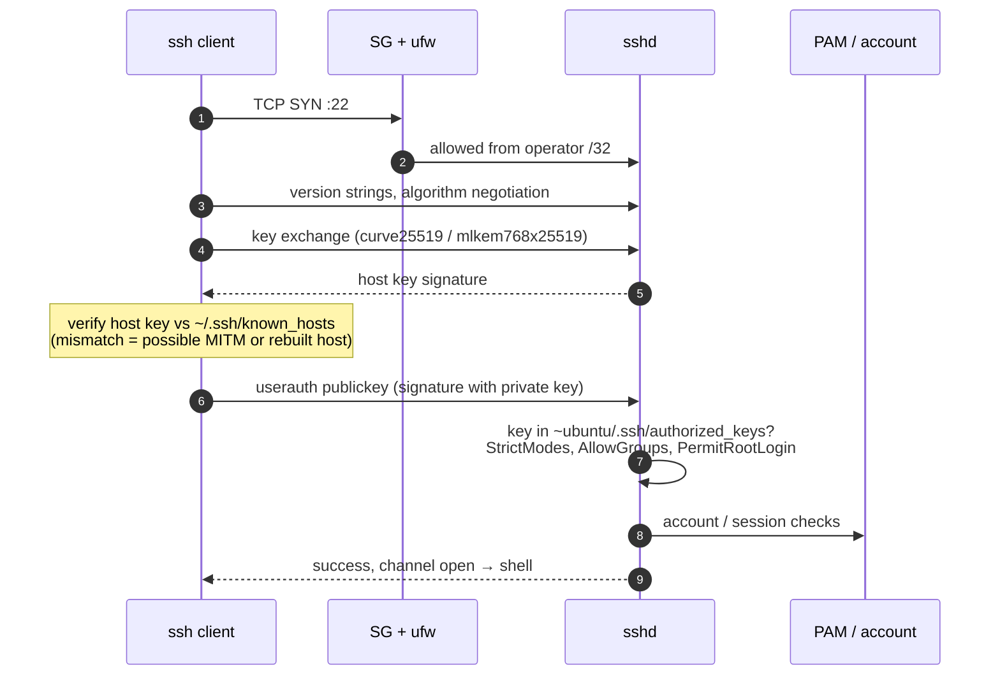
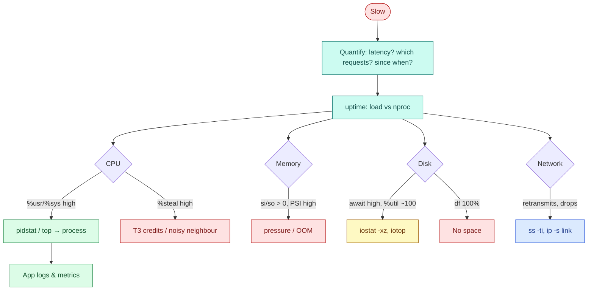
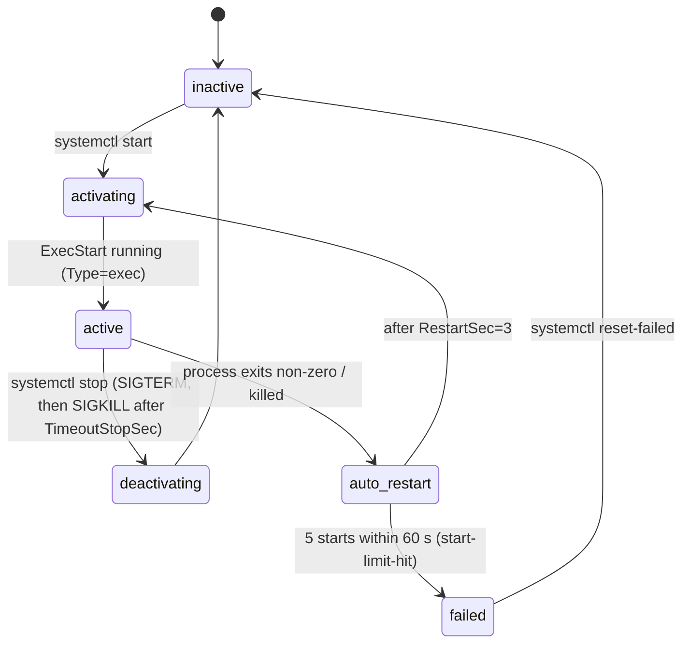
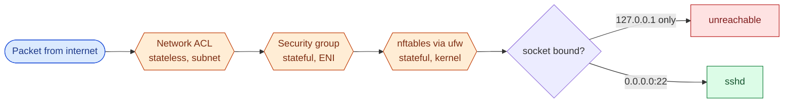
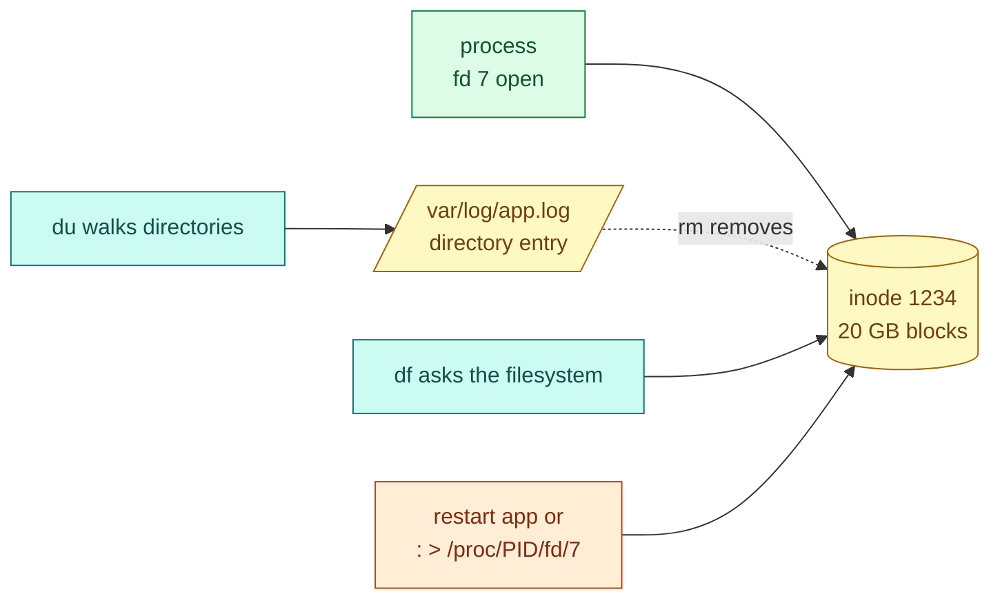
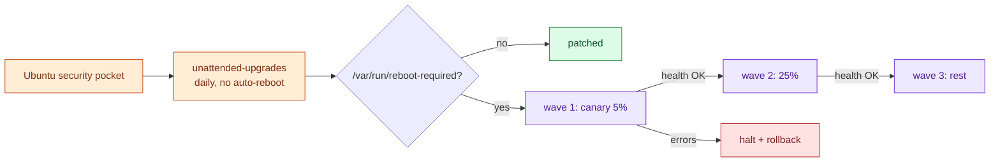
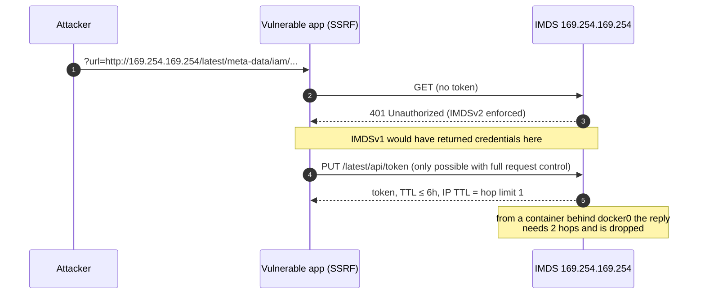

# AWS 01 — Interview preparation

Seven questions, from beginner to scenario. Answer each aloud first, then compare.
Index of all questions: [interview index](../../../../docs/interview-preparation/README.md).

---

## Q1 (Beginner) — What happens when you run `ssh ubuntu@server`?

**Interview answer:** The client opens TCP 22, both sides agree on algorithms and run a key exchange
that produces session keys, the client verifies the server's host key against `known_hosts`, and then
the user authenticates — here with a public key, by signing a challenge with the private key. sshd then
checks its policy (AllowGroups, PermitRootLogin) and starts a shell under that user.

**Walkthrough:** steps 1–2 are networking (timeouts happen here); 3–5 establish an encrypted channel
before any credential is sent; 6 is the client protecting itself from impersonation; 7–8 is the server
deciding who you are and whether policy allows you; 9 is session setup.

**Depth:** the private key never leaves the client — the server only verifies a signature with the
stored public key. Host keys protect the client; user keys protect the server. sshd reads
`sshd_config` and then `sshd_config.d/*.conf` in lexical order and keeps the **first** value for most
keywords, which is why this lab's drop-in is named `10-…`. Verify with `sshd -T`, never by reading files.

**Tradeoffs and security:** keys beat passwords against brute force but are hard to revoke at scale —
SSH certificates (short-lived, signed by a CA) or Session Manager (IAM-based, logged) solve that.

**Follow-ups:** What does `StrictHostKeyChecking=accept-new` change? How would you rotate keys for 200
servers? What is agent forwarding and why is it disabled here?

---

## Q2 (Intermediate) — A Linux server "is slow". How do you troubleshoot it?

**Interview answer:** I confirm the symptom with a number, then go resource by resource with the USE
method — utilisation, saturation and errors for CPU, memory, disk and network — starting with cheap
commands (`uptime`, `vmstat 1`, `mpstat`, `iostat -xz`, `free`, `df`), and only then look at the
application. On cloud VMs I also check for steal time and burst credits.

**Walkthrough:** each branch is a resource with its own saturation signal. Load average alone is
ambiguous on Linux: it counts tasks in uninterruptible sleep (usually I/O), so high load with idle CPU
points at disk.

**Depth:** `vmstat 1` gives run queue (`r` > vCPUs = CPU saturation), swap in/out, and `wa`. `/proc/pressure/*`
(PSI) shows the share of time tasks stalled on a resource — the most direct saturation metric.
`%steal` on a T3 in standard mode with zero credits means the hypervisor is throttling to baseline.

**Commands:** `mpstat -P ALL 1`, `pidstat -d 1`, `iostat -xz 1`, `sar -q` for history (sysstat is
installed in this lab).

**Follow-ups:** Load is 8 on a 2-vCPU box but CPU is 90% idle — what now? How do you prove it is not
the network?

---

## Q3 (Intermediate) — How does systemd keep a service running, and how would you harden one?

**Interview answer:** A unit declares how to start the process and what to do when it exits.
`Restart=on-failure` restarts after a crash; `StartLimitBurst`/`StartLimitIntervalSec` stop a crash loop
from running forever. Hardening uses the same unit: run as an unprivileged user, drop all capabilities,
make the filesystem read-only except a state directory, filter system calls, and cap memory and tasks
with cgroups.

**Walkthrough:** the `auto_restart → failed` edge is the safety valve. Without it a broken config
restarts forever, flooding logs and hiding the first error.

**Depth:** sandbox options used in [taskboard.service](../files/taskboard.service): `ProtectSystem=strict`
(whole FS read-only) + `StateDirectory=taskboard` (one writable, owned directory),
`CapabilityBoundingSet=` (no capabilities), `NoNewPrivileges` (setuid binaries cannot elevate),
`SystemCallFilter=@system-service`, `RestrictAddressFamilies`, `MemoryMax=300M`. `systemd-analyze security`
scores the result.

**Tradeoffs:** every restriction can break something (e.g. `MemoryDenyWriteExecute` breaks JITs). Add
them one at a time and test.

**Follow-ups:** Difference between `Restart=always` and `on-failure`? `Type=simple` vs `exec` vs
`notify`? How do you override a vendor unit without editing it?

---

## Q4 (Advanced) — Security group vs host firewall: why both?

**Interview answer:** They sit at different layers and fail differently. The security group is enforced
by the AWS network, outside the instance, so a compromised host cannot change it; it is stateful and
allow-only. The host firewall (ufw/nftables) runs in the kernel, can express deny rules and per-process
or loopback policy, and still protects the host if someone opens the SG by mistake. Defence in depth
means a single misconfiguration does not expose the service.

**Walkthrough:** a packet must pass the NACL (default allow-all here), the SG, the host firewall, and
then find a socket listening on that address. This lab adds a fourth control — binding the API to
loopback — so even with both firewalls open, port 8000 is unreachable.

**Depth:** SGs are stateful: return traffic is allowed automatically. NACLs are stateless: you must
allow ephemeral return ports. Docker publishes ports by inserting its own nftables/iptables rules that
bypass ufw — a common surprise in project 02.

**Follow-ups:** Why restrict SG egress? How would you audit SG rules across 50 accounts?

---

## Q5 (Scenario) — `df` says the disk is 100% full but `du` adds up to 40%. What is happening?

**Interview answer:** Space is held by files that were deleted while a process still had them open —
classic with log files removed by `rm` instead of rotated. The directory entry is gone (so `du` cannot
see it) but the inode and blocks stay allocated until the last file descriptor closes. I find them with
`lsof +L1` and free the space by restarting the process or truncating through `/proc/<pid>/fd/<n>`.

**Walkthrough:** `du` and `df` measure different things — directory trees vs filesystem allocation. The
gap is exactly the deleted-open space.

**Other causes to rule out:** files hidden under a mount point (data written before a volume was
mounted), reserved blocks (5% for root on ext4), inode exhaustion (`df -i`).

**Commands:** `sudo lsof +L1`, `ls -l /proc/<pid>/fd | grep deleted`, `tune2fs -l /dev/nvme0n1p1 | grep
'Reserved block'`.

**Follow-ups:** How does `logrotate copytruncate` differ from `create`? How do you stop this happening
for container logs?

---

## Q6 (Scenario) — How do you keep 100 Linux servers patched without causing outages?

**Interview answer:** Automate security updates, but control reboots. Unattended-upgrades (or SSM Patch
Manager) applies security patches daily; kernel and libc updates need a reboot, which I roll out in
waves — canary, then a percentage, behind a load balancer that drains each host — with health checks
gating the next wave. For immutable fleets, rebuild the image and replace instances instead of patching
in place.

**Tradeoffs:** in-place patching is fast but servers drift; image replacement is consistent but needs
automation and stateless hosts (projects 05 and 07). Live-patching (Ubuntu Pro Livepatch) shortens the
reboot window for kernel CVEs but is not a full substitute.

**Follow-ups:** How do you report patch compliance? How do you handle a patch that breaks the app?

---

## Q7 (Advanced) — What is IMDSv2 and why does this lab set the hop limit to 1?

**Interview answer:** The instance metadata service hands out the instance role's temporary
credentials at `169.254.169.254`. With IMDSv1 any request works, so an SSRF bug in a web app can be
tricked into fetching credentials. IMDSv2 requires a `PUT` to get a session token first, which most SSRF
primitives cannot do. The hop limit of 1 means the token response cannot cross an extra network hop,
so containers on a bridge network cannot obtain credentials either.

**Walkthrough:** steps 2–3 show the main protection; step 6 explains the hop limit. `host-audit`
verifies step 3 on the real host.

**Tradeoff:** containers that legitimately need AWS credentials then need hop limit 2 or, better, their
own scoped credentials (EKS Pod Identity / IRSA in project 07).

**Follow-ups:** How would you enforce IMDSv2 organisation-wide (SCP on `ec2:MetadataHttpTokens`,
account-level default)? What other data does IMDS expose?
