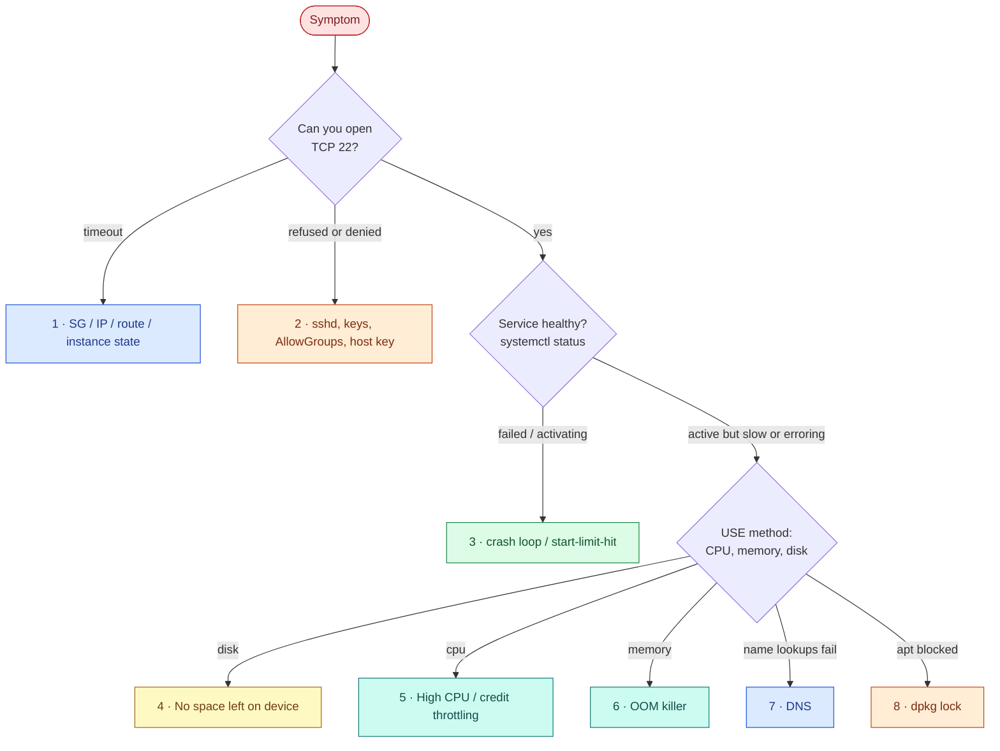

# AWS 01 — Troubleshooting playbook

Work from the outside in: can packets reach the host → does the service accept them → is the host
healthy enough to serve them.



---

## 1. `ssh: connect to host ... port 22: Connection timed out`

**Symptoms:** SSH hangs, then times out. Worked yesterday.

**Likely causes:** your public IP changed (home ISP, VPN, mobile hotspot) and no longer matches
`allowed_ssh_cidrs`; the instance was stopped and started, so its public IP changed; the instance is
not running.

**Diagnose:**

```bash
curl -s https://checkip.amazonaws.com                         # your IP now
terraform -chdir=terraform output -raw public_ip               # IP Terraform knows
aws ec2 describe-instances --instance-ids "$(terraform -chdir=terraform output -raw instance_id)" \
  --query 'Reservations[0].Instances[0].[State.Name,PublicIpAddress]' --output text
aws ec2 describe-security-groups --filters Name=group-name,Values=lab01-linux-host-sg \
  --query 'SecurityGroups[0].IpPermissions[].IpRanges[].CidrIp' --output text
nc -vz -w 5 <public_ip> 22
```

**What the results mean:** a timeout (not "refused") means packets are dropped before reaching sshd —
the SG, a missing route, or a stopped instance. "Connection refused" would mean the host answered but
nothing listens on 22.

**Resolve:** update `allowed_ssh_cidrs` and `terraform apply`; if the IP changed after stop/start, run
`terraform refresh` (or `apply`) to update outputs.

**Prevent:** use Session Manager for access from changing networks; avoid stop/start, or attach an
Elastic IP to keep the address (billed like any public IPv4 address and counted against free-tier
IPv4 hours).

## 2. `Permission denied (publickey)`

**Symptoms:** TCP connects, authentication fails.

**Likely causes:** wrong key offered; user not in `ssh-users` (AllowGroups); wrong ownership or mode on
`~/.ssh` or `authorized_keys` (sshd `StrictModes`); logging in as `root` or `ec2-user` instead of `ubuntu`.

**Diagnose:**

```bash
ssh -v ubuntu@<ip> 2>&1 | grep -E 'Offering|Authentications that can continue|denied'
# on the host, through SSM if necessary:
sudo journalctl -u ssh -n 30 --no-pager      # "not allowed because none of user's groups are listed in AllowGroups"
id alice; namei -l /home/alice/.ssh/authorized_keys
sudo sshd -T | grep -Ei 'allowgroups|authenticationmethods'
```

**What the results mean:** `LogLevel VERBOSE` makes sshd log the exact reason and the key fingerprint.
`Authentication refused: bad ownership or modes` → fix permissions; `not allowed because ...
AllowGroups` → group membership.

**Resolve:** `usermod -aG ssh-users <user>`; `chmod 700 ~/.ssh; chmod 600 ~/.ssh/authorized_keys`; use
`-i ~/.ssh/id_ed25519`.

**Prevent:** manage users with configuration management; test logins from a second session before
closing the first.

## 3. Service in a crash loop or `start-limit-hit`

**Symptoms:** `/readyz` through the tunnel fails; `systemctl status taskboard` shows `activating
(auto-restart)` or `failed (Result: start-limit-hit)`.

**Likely causes:** bad configuration (environment, drop-in), missing dependency in the venv, port
already in use, sandbox blocking a path the process needs (`Read-only file system`).

**Diagnose:**

```bash
systemctl status taskboard --no-pager
journalctl -u taskboard -b --no-pager | tail -n 40
systemctl cat taskboard                 # look for unexpected drop-ins (e.g. 99-lab-fault.conf)
systemctl show -p NRestarts,Result,ExecMainStatus taskboard
sudo ss -tlnp 'sport = :8000'
```

**What the results mean:** `ValueError: Unsupported DATABASE_URL scheme` points at configuration;
`NRestarts` climbing means `Restart=on-failure` is working but the cause persists; `start-limit-hit`
means systemd gave up after 5 starts in 60 s on purpose.

**Resolve:** fix or remove the drop-in, then `systemctl daemon-reload && systemctl reset-failed
taskboard && systemctl restart taskboard`.

**Prevent:** use `systemctl edit` drop-ins (reviewable), validate config at startup, alert on
`NRestarts` (project 11).

## 4. `No space left on device`

**Symptoms:** writes fail, `apt` fails, journald logs `Failed to write entry`, the API returns 500 on
`POST`.

**Likely causes:** a large file (logs, dumps, `lab-fault disk`); a deleted file still held open by a
process; inode exhaustion from millions of small files.

**Diagnose:**

```bash
df -h /; df -i /
sudo du -xh --max-depth=2 / 2>/dev/null | sort -h | tail -n 15
sudo lsof +L1 2>/dev/null | head            # deleted but still open (space not freed)
journalctl --disk-usage
```

**What the results mean:** if `df` shows 95% but `du` totals far less, space is held by deleted-open
files — only restarting or truncating via `/proc/<pid>/fd/<n>` frees it. `df -i` at 100% with free blocks
means inodes, not bytes.

**Resolve:** remove the offending file (`sudo lab-fault revert` for the drill); `journalctl
--vacuum-size=200M`; restart the process holding deleted files.

**Prevent:** journald and Docker log caps, `logrotate`, a disk alert at 80% (project 11), separate volume
for data.

## 5. Server is slow: high CPU or CPU credit throttling

**Symptoms:** high latency; `top` shows a busy process — or nothing busy, yet everything is slow.

**Likely causes:** a CPU-bound process (`lab-fault cpu`); on T3 in **standard** credit mode, an empty
credit balance throttles the instance to its baseline (10% per vCPU for t3.micro at the time of
writing; confirm in the [credit table](https://docs.aws.amazon.com/AWSEC2/latest/UserGuide/burstable-credits-baseline-concepts.html)).

**Diagnose:**

```bash
top -o %CPU -n 1 | head -n 15
mpstat 1 5                     # high %steal with low %usr = hypervisor withholding CPU
pidstat -u 1 5
aws cloudwatch get-metric-statistics --namespace AWS/EC2 --metric-name CPUCreditBalance \
  --dimensions Name=InstanceId,Value=<id> --start-time "$(date -u -d '-3 hours' +%FT%TZ)" \
  --end-time "$(date -u +%FT%TZ)" --period 300 --statistics Average
```

**What the results mean:** high `%usr` → find the process. High `%steal` with credits at 0 → the
instance is being throttled to baseline; the process is not the problem, capacity is.

**Resolve:** stop the runaway process; wait for credits to accrue; for real workloads, choose a size
whose baseline covers steady load.

**Prevent:** alert on `CPUCreditBalance`; never switch lab instances to `unlimited` (it can bill surplus
credits).

## 6. Process killed by the OOM killer

**Symptoms:** the API restarts unexpectedly; `systemctl status` shows `status=9/KILL` or `oom-kill`.

**Likely causes:** host memory exhausted (1 GiB on t3.micro, no swap by default) or the unit's
`MemoryMax=300M` cgroup limit reached.

**Diagnose:**

```bash
sudo dmesg -T | grep -iE 'out of memory|oom-kill' | tail
journalctl -k -b | grep -i oom
systemctl show -p MemoryCurrent,MemoryMax,MemoryPeak taskboard
cat /proc/pressure/memory; free -m
```

**What the results mean:** `oom-kill:constraint=CONSTRAINT_MEMCG` with the taskboard cgroup → the unit
hit its own limit; `CONSTRAINT_NONE` → the whole host ran out.

**Resolve:** stop the memory hog; raise `MemoryMax` only with evidence; add a small swap file for
resilience: `sudo fallocate -l 1G /swapfile && sudo chmod 600 /swapfile && sudo mkswap /swapfile && sudo swapon /swapfile`.

**Prevent:** per-service memory limits so one process cannot take the host down; memory alerts.

## 7. DNS resolution fails

**Symptoms:** `Temporary failure in name resolution`; `apt update` fails; IP-based connections still work.

**Likely causes:** outbound UDP/TCP 53 blocked (`lab-fault dns`, host firewall change); broken
`/etc/resolv.conf` symlink; `systemd-resolved` stopped.

**Diagnose:**

```bash
resolvectl status | head -n 20
resolvectl query amazon.com
dig @127.0.0.53 amazon.com +time=2 +tries=1     # local stub
dig @10.20.0.2 amazon.com +time=2 +tries=1      # VPC resolver directly
ls -l /etc/resolv.conf                          # -> ../run/systemd/resolve/stub-resolv.conf
sudo ufw status numbered | grep -i 53
```

**What the results mean:** stub fails and direct fails → network path to the resolver is blocked; stub
fails but direct works → `systemd-resolved` problem; both work but the app fails → app-level caching or
wrong hostname.

**Resolve:** remove the deny rule (`sudo lab-fault revert`); `systemctl restart systemd-resolved`.

**Prevent:** treat firewall changes as code; monitor resolution from the host (Blackbox exporter,
project 11).

## 8. `Could not get lock /var/lib/dpkg/lock-frontend`

**Symptoms:** `apt install` fails right after boot.

**Likely causes:** cloud-init or `unattended-upgrades` is installing packages.

**Diagnose:**

```bash
cloud-init status
ps -ef | grep -E 'apt|dpkg|unattended' | grep -v grep
sudo lsof /var/lib/dpkg/lock-frontend
```

**Resolve:** wait (`cloud-init status --wait`; `systemd-run --property=After=apt-daily-upgrade.service
--wait true`). Never delete lock files — that can corrupt the dpkg database.

**Prevent:** scripts call `cloud-init status --wait` before using apt (as `deploy-app.sh` does).

---

### Recovering from an SSH lockout

```bash
terraform -chdir=terraform output -raw ssm_command | sh    # requires the Session Manager plugin
sudo rm /etc/ssh/sshd_config.d/<bad-file>.conf && sudo sshd -t && sudo systemctl restart ssh
```

If SSM is also unavailable, the lab host is disposable: `terraform apply -replace=module.host.aws_instance.host`.
