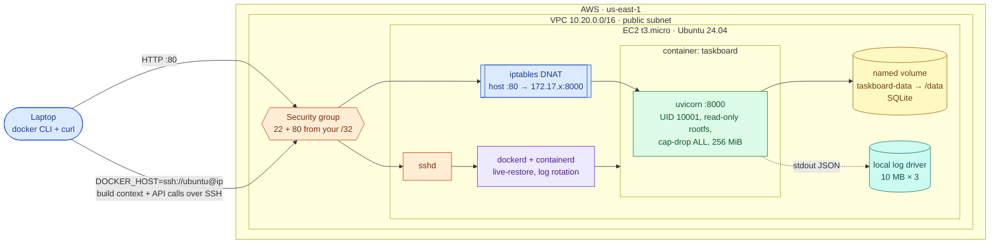
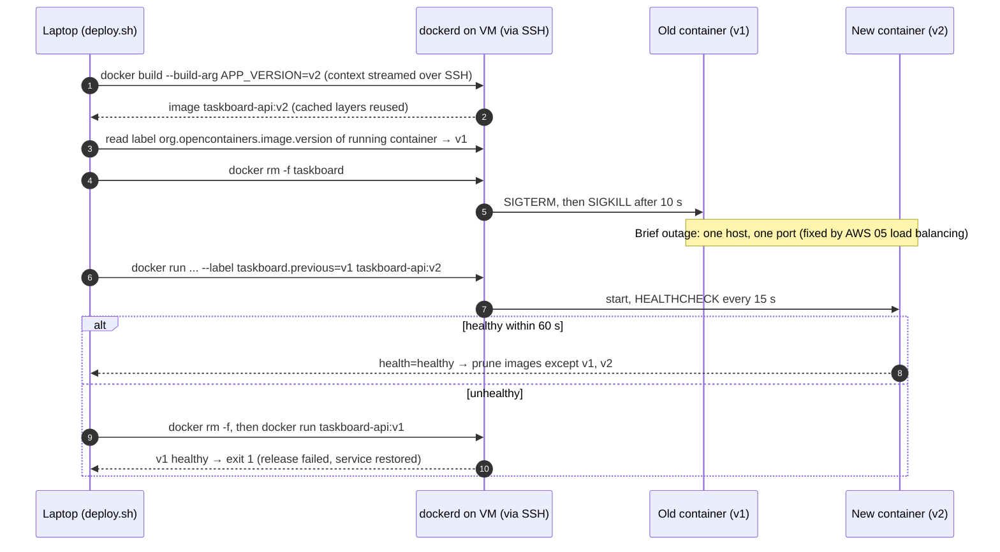
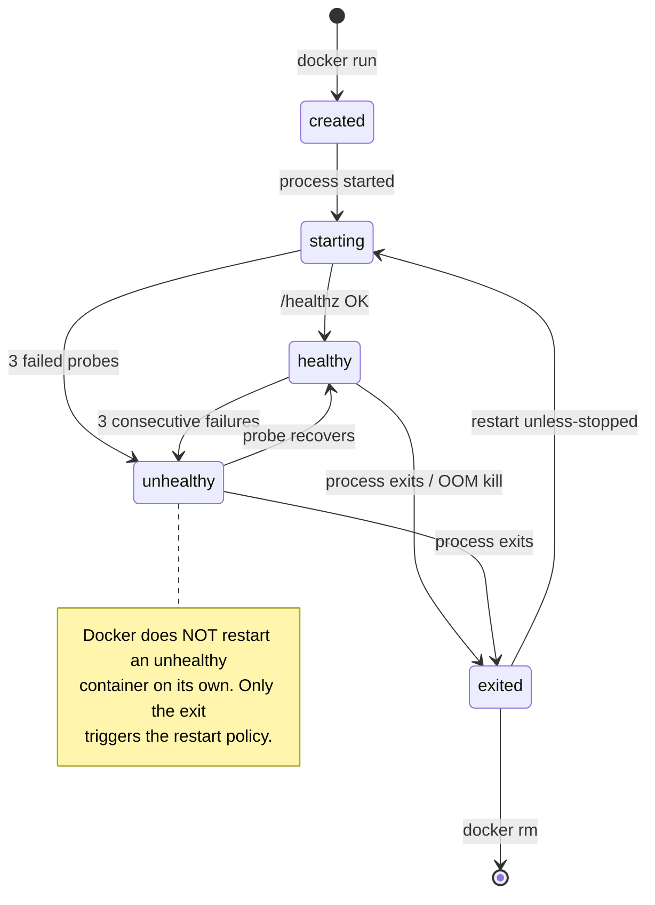

# AWS 02 — Dockerized Application on a Cloud VM

| | |
|---|---|
| **Project ID** | `aws-02` |
| **Cloud** | AWS (EC2, VPC, IAM, Systems Manager) |
| **Difficulty** | Beginner |
| **Build time** | 2–3 h first attempt (including [exercises](docs/exercises.md)) |
| **Rebuild time** | 15–20 min |
| **Free tier** | Fits: one `t3.micro`, 20 GB gp3, one public IPv4 — see [cost](docs/cost.md) |
| **Depends on** | [AWS 01](../01-linux-server-engineering/) (SSH, systemd, firewalls) |
| **Status** | Implemented · static checks passed · local container test passed · deployment **not tested** ([tracker](../../../docs/progress/implementation-tracker.md)) |

## The problem this lab solves

In AWS 01 the API ran from a Python venv built on the server. That works once, but every server ends up
slightly different: another Python patch level, another library version, a missing OS package. Rollback
means rebuilding the old venv. A container image fixes this by packaging the app *and* its userland into
one immutable, versioned artefact that runs the same on a laptop and on the VM.

This lab packages the shared Taskboard API with a multi-stage Dockerfile, runs it with a hardened
`docker run` profile on EC2, persists data on a named volume, and rolls out new versions with a health
gate and automatic rollback.

**Skills learned:** Dockerfile instructions and layer caching · multi-stage builds · non-root,
read-only, capability-free containers · bridge networking and port publishing · volumes vs bind mounts
· `HEALTHCHECK` and restart policies · log drivers and rotation · remote Docker daemons over SSH ·
image scanning.

**Expected outcome:** `http://<public-ip>/api/info` answers from a container that runs as UID 10001 with a
read-only root filesystem and no Linux capabilities; tasks survive container replacement; a failed
release rolls back by itself.

## Architecture



| Component | Why it is there | Defined in |
|---|---|---|
| Network + host | Same free-tier VPC and hardened EC2 host as AWS 01 | [shared modules](../../../shared/terraform-modules/) |
| Docker Engine (official apt repo) | Current, signed packages instead of Ubuntu's older `docker.io` | [shared cloud-init](../../../shared/cloud-init/ubuntu-docker-host.yaml.tftpl) |
| `daemon.json` | Log rotation, `live-restore`, `no-new-privileges` by default, no inter-container traffic on the default bridge | [docker-daemon.json](../../../shared/cloud-init/docker-daemon.json) |
| Taskboard image | Multi-stage build, non-root, `HEALTHCHECK`, OCI labels | [shared Dockerfile](../../../shared/sample-apps/taskboard/api/Dockerfile) |
| Runtime profile | `--read-only`, `--cap-drop ALL`, memory/CPU/PID limits, named volume | [taskboard-ctl.sh](scripts/taskboard-ctl.sh) |
| Rollout + rollback | Health-gated replace; previous version recorded as a container label | [taskboard-ctl.sh](scripts/taskboard-ctl.sh) |
| 1 GiB swap file | Lets builds survive on 1 GiB RAM | [shared cloud-init](../../../shared/cloud-init/ubuntu-docker-host.yaml.tftpl) |

### Release flow with automatic rollback



### Container lifecycle on the host



## Concepts used

| Concept | Where in this lab | Guide |
|---|---|---|
| Images, layers, cache, multi-stage builds | Shared Dockerfile | [docker-images-and-builds](../../../docs/concepts/docker-images-and-builds.md) |
| Container isolation and hardening | Runtime profile, `daemon.json` | [container-security](../../../docs/concepts/container-security.md) |
| Bridge networks, port publishing, volumes | `-p 80:8000`, `taskboard-data` | [docker-networking-and-storage](../../../docs/concepts/docker-networking-and-storage.md) |
| Liveness vs readiness, restart policies | `HEALTHCHECK`, `/healthz` vs `/readyz` | [health-checks](../../../docs/concepts/health-checks.md) |
| Firewalls (and why Docker bypasses ufw) | Exercise 4 | [linux-networking-firewalls](../../../docs/concepts/linux-networking-firewalls.md) |
| EC2 basics | Shared host module | [aws-ec2-fundamentals](../../../docs/concepts/aws-ec2-fundamentals.md) |

Architecture decisions: [ADR-0001 remote Docker over SSH, no registry](docs/adr/0001-docker-over-ssh-single-host.md) ·
[ADR-0002 base image](docs/adr/0002-python-slim-base-image.md).

## Deploy

### 1. Test locally first (free)

```bash
cd projects/aws/02-dockerized-app-on-vm
scripts/local-test.sh          # builds, runs the hardened profile on local Docker, 14 checks
```

### 2. Preflight and configure

```bash
../../../shared/scripts/aws-preflight.sh
cp terraform/terraform.tfvars.example terraform/terraform.tfvars   # set allowed_ssh_cidrs
```

| Variable | Default | Notes |
|---|---|---|
| `allowed_ssh_cidrs` | — (required) | Your `/32`; `0.0.0.0/0` rejected |
| `allowed_http_cidrs` | `[]` (= SSH CIDRs) | Widen only if you want others to reach port 80 |
| `instance_type` | `t3.micro` | Free-tier eligible types only |
| `root_volume_gb` | `20` | Images and build cache live here |

### 3. Apply and deploy

```bash
terraform -chdir=terraform init
terraform -chdir=terraform plan -out=lab02.tfplan     # expect 17 resources to add
terraform -chdir=terraform apply lab02.tfplan
scripts/deploy.sh                                      # builds ON the VM over SSH, health-gated
scripts/verify.sh
```

Expected `verify.sh` results:

| Check | Expected |
|---|---|
| `http://<ip>/healthz`, `/readyz` | 200 |
| Docker daemon | `local live-restore=true` |
| Container | `10001:10001 true [ALL] 268435456` (user, read-only, cap-drop, 256 MiB) |
| `http://<ip>:8000` | not reachable |
| ufw | WARN: port 80 works although ufw has no rule — explained in exercise 4 |

### 4. Release and roll back

```bash
scripts/deploy.sh v2                                           # new version
DOCKER_HOST=ssh://ubuntu@<ip> scripts/taskboard-ctl.sh rollback   # back to the previous one
DOCKER_HOST=ssh://ubuntu@<ip> scripts/taskboard-ctl.sh status
```

### 5. Exercises

[docs/exercises.md](docs/exercises.md): layers and cache, image size, hardening flags, the ufw bypass,
volumes, health checks, logs, scanning, and failure drills.

### 6. Clean up

```bash
terraform -chdir=terraform destroy
../../../shared/scripts/aws-find-lab-resources.sh
docker context ls          # remove any context you created in the exercises: docker context rm lab02
```

## Troubleshooting, cost and interview material

- [Troubleshooting playbook](docs/troubleshooting.md) — 7 incidents
- [Cost estimate](docs/cost.md)
- [Interview preparation](docs/interview.md) — 7 questions

## Repeat practice

| Attempt | Goal | Guidance |
|---|---|---|
| 1 | Guided build | Follow this README and the exercises |
| 2 | Reduced guidance | Run the container by hand with `docker run`, reproducing every flag in `taskboard-ctl.sh` from memory |
| 3 | Rebuild from objectives | Write your own Dockerfile for the API from scratch: multi-stage, non-root, healthcheck, < 200 MB. Compare with the shared one |
| 4 | Failure drills | Exercise 9 scenarios, chosen by someone else |
| 5 | Defend the design | Answer the [interview questions](docs/interview.md); argue for a registry-based flow against [ADR-0001](docs/adr/0001-docker-over-ssh-single-host.md) |

### Self-assessment

- [ ] I can explain which Dockerfile change invalidates which cached layers.
- [ ] I can explain why the final image contains no compiler and how much smaller it is.
- [ ] I can name what each `docker run` hardening flag prevents.
- [ ] I can explain why port 80 is reachable although ufw denies it, and two ways to fix that.
- [ ] I can explain the difference between `unhealthy` and `exited` for the restart policy.
- [ ] I recovered data after deleting the container, and know when data would be lost.
- [ ] I rolled back a bad release and can say why there was still downtime.

**Done when:** `local-test.sh` and `verify.sh` pass, a failed release rolled back automatically
(exercise 9), the self-assessment is complete, and cleanup shows no tagged resources.

## References

- [Dockerfile reference](https://docs.docker.com/reference/dockerfile/)
- [Docker build cache](https://docs.docker.com/build/cache/)
- [Docker Engine security](https://docs.docker.com/engine/security/)
- [Docker and iptables / packet filtering](https://docs.docker.com/engine/network/packet-filtering-firewalls/)
- [Configure the daemon (`daemon.json`)](https://docs.docker.com/reference/cli/dockerd/#daemon-configuration-file)
- [OWASP Docker Security Cheat Sheet](https://cheatsheetseries.owasp.org/cheatsheets/Docker_Security_Cheat_Sheet.html)
