# AWS 02 — Hands-on exercises

Exercises 1–3 work on your laptop (free). 4–9 need the VM: run `export DOCKER_HOST=$(terraform -chdir=terraform output -raw docker_host)`
first, or SSH in. Paths are relative to the repository root unless stated.

```mermaid
flowchart LR
    e1[1 Layers & cache]:::app --> e2[2 Multi-stage size]:::app --> e3[3 Hardening flags]:::sec
    e3 --> e4[4 Networking &<br/>ufw bypass]:::net --> e5[5 Volumes]:::data --> e6[6 Health checks]:::obs
    e6 --> e7[7 Logs]:::obs --> e8[8 Scanning]:::sec --> e9[9 Failure drills]:::risk
    classDef app fill:#dcfce7,stroke:#15803d,color:#14532d
    classDef sec fill:#ffedd5,stroke:#c2410c,color:#7c2d12
    classDef net fill:#dbeafe,stroke:#1d4ed8,color:#1e3a8a
    classDef data fill:#fef9c3,stroke:#a16207,color:#713f12
    classDef obs fill:#ccfbf1,stroke:#0f766e,color:#134e4a
    classDef risk fill:#fee2e2,stroke:#b91c1c,color:#7f1d1d
```



## 1. Layers and the build cache

```bash
cd shared/sample-apps/taskboard/api
docker build -t tb:cache1 .                       # cold build
docker history tb:cache1 --format 'table {{.CreatedBy}}\t{{.Size}}' | head -n 12
echo "# comment" >> app/main.py && docker build -t tb:cache2 .   # code change
git checkout app/main.py
echo "" >> requirements.txt && docker build -t tb:cache3 .       # dependency change
git checkout requirements.txt
```

**Expected:** the code change rebuilds only `COPY app ./app` (seconds; `pip install` shows `CACHED`).
The `requirements.txt` change re-runs `pip install` (slow). Explain why the Dockerfile copies
`requirements.txt` on its own before the code.

## 2. What multi-stage builds save

```bash
docker image ls taskboard-api:dev --format '{{.Size}}'
docker run --rm --entrypoint sh taskboard-api:dev -c 'command -v gcc pip || echo "no compiler, pip only in venv"'
docker run --rm --entrypoint sh taskboard-api:dev -c 'ls /opt/venv/lib/python3.14/site-packages | head'
```

**Expected:** ~160 MB final image. Build-stage artefacts (pip cache, wheels, build tools) are absent.
Name one thing that *is* still in the image that an attacker could use (`sh`, `python`) and what a
distroless image would change ([ADR-0002](adr/0002-python-slim-base-image.md)).

## 3. What each hardening flag prevents

Compare a default container with the lab profile (build `taskboard-api:dev` first, see the
[app README](../../../../shared/sample-apps/taskboard/README.md)):

```bash
docker run -d --name loose taskboard-api:dev
docker run -d --name tight --read-only --tmpfs /tmp:size=16m \
  --cap-drop ALL --security-opt no-new-privileges:true --memory 256m --pids-limit 128 taskboard-api:dev
for c in loose tight; do
  echo "== $c"
  docker exec "$c" grep -E 'CapEff|CapBnd|NoNewPrivs' /proc/1/status
  docker exec "$c" touch /srv/x
  docker exec -u 0 "$c" grep CapEff /proc/self/status      # what a root process would get
done
docker rm -f loose tight
```

**Expected** (verified locally with Docker 29):

| | `loose` | `tight` |
|---|---|---|
| `CapEff` of the app (UID 10001) | `0000000000000000` | `0000000000000000` |
| `CapBnd` (ceiling for any process) | `00000000a80425fb` (Docker default set) | `0000000000000000` |
| `NoNewPrivs` | `0` | `1` |
| `touch /srv/x` | `Permission denied` (file ownership) | `Read-only file system` |
| `CapEff` of a root process (`exec -u 0`) | `00000000a80425fb` | `0000000000000000` |

The non-root `USER` already empties the app's effective set, so why drop capabilities too? Because
anything that runs as root in that container — `docker exec -u 0`, `docker run --user 0`, or a
privilege-escalation bug — gets the bounding set. `--cap-drop ALL` makes that set empty, and
`no-new-privileges` stops setuid binaries from raising privileges. On the VM, `daemon.json` turns
`no-new-privileges` on for every container.

## 4. Networking and the ufw bypass (on the VM)

```bash
ssh ubuntu@<ip>
sudo ufw status                                  # only OpenSSH allowed
curl -s localhost/healthz                        # works
sudo iptables -t nat -L DOCKER -n                # DNAT tcp dpt:80 → 172.17.0.x:8000
sudo iptables -L FORWARD -n | head               # Docker's chains come before ufw's
docker network inspect bridge --format '{{range .Containers}}{{.Name}} {{.IPv4Address}}{{end}}'
```

From your laptop `curl http://<ip>/healthz` also works.

**Expected:** published ports are handled by DNAT in the `nat` table and accepted in the `DOCKER`
forward chain before ufw's `INPUT` rules are consulted — traffic to a container is *forwarded*, not
delivered to the host. The security group still protects you; ufw does not. Two fixes: publish on
loopback only (`-p 127.0.0.1:80:8000`) behind a host proxy, or add rules to the `DOCKER-USER` chain.

## 5. Volumes and data lifetime

```bash
curl -s -X POST http://<ip>/api/tasks -H 'content-type: application/json' -d '{"title":"survive me"}'
docker rm -f taskboard
docker volume inspect taskboard-data --format '{{.Mountpoint}}'
scripts/deploy.sh                                # recreate (same tag reuses the cached image)
curl -s http://<ip>/api/tasks                    # task is still there
```

Then on the VM: `sudo ls -l /var/lib/docker/volumes/taskboard-data/_data`.

**Expected:** the task survives because the database lives in the named volume, not the container's
writable layer. `docker volume rm taskboard-data` or `docker system prune --volumes` would delete it.
Explain when you would prefer a bind mount (config files you edit on the host) and why not for the DB
(ownership: the container runs as 10001).

## 6. Health checks and restart policy

```bash
docker inspect -f '{{json .State.Health}}' taskboard | jq '.Status, .Log[-1]'
docker exec taskboard kill 1                     # process exits → restart policy
sleep 5; docker inspect -f 'restarts={{.RestartCount}} status={{.State.Status}}' taskboard
docker events --since 2m --filter container=taskboard --format '{{.Time}} {{.Action}}'
```

**Expected:** `RestartCount` increments. Then answer: if `/healthz` started failing but the process
stayed up, would Docker restart it? (No — `unhealthy` is only a status. Orchestrators such as ECS or
Kubernetes act on it; plain Docker does not.)

## 7. Logs

```bash
docker logs --tail 5 taskboard
docker logs --since 5m taskboard | jq -c 'select(.route=="/api/tasks")'
docker info --format '{{.LoggingDriver}}'
sudo du -sh /var/lib/docker/containers/*/local-logs 2>/dev/null
```

**Expected:** JSON lines from the app, rotation at 10 MB × 3 files. Explain what fills the disk on a
host *without* `log-opts` (the default `json-file` driver grows without limit).

## 8. Scan the image

```bash
docker run --rm -v /var/run/docker.sock:/var/run/docker.sock aquasec/trivy:0.76.2 \
  image --severity HIGH,CRITICAL --ignore-unfixed taskboard-api:dev
```

**Expected:** a list of OS and Python package CVEs (the count changes daily). Decide for each HIGH:
fixed version available → rebuild with a newer base; not exploitable in this app → document it. Note
that mounting the Docker socket into the scanner gives it root on the host — fine for a local tool,
never for a long-running service.

## 9. Failure drills

| Drill | How | What you should observe |
|---|---|---|
| Bad release | Edit `shared/sample-apps/taskboard/api/app/main.py` so `healthz` raises an exception, then `scripts/deploy.sh broken` | `deploy` reports unhealthy and rolls back to the previous tag; `git checkout` the file afterwards |
| OOM | `docker update --memory 64m --memory-swap 64m taskboard` then send traffic | `docker inspect -f '{{.State.OOMKilled}}'` true, restart count rises |
| Disk pressure | `docker build` many tags; `docker system df` | Build cache and dangling images; `docker builder prune` |
| Daemon restart | `sudo systemctl restart docker` | Container keeps serving during the restart (`live-restore`) |
| Lost volume | `docker rm -f taskboard && docker volume rm taskboard-data` | Data gone — what backup would have prevented this? (AWS 03 adds `pg_dump`) |
