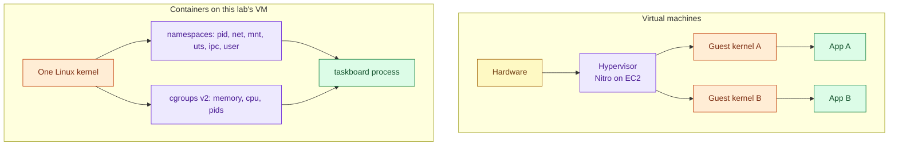
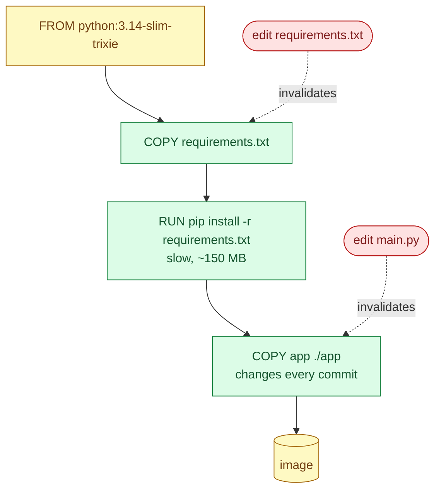
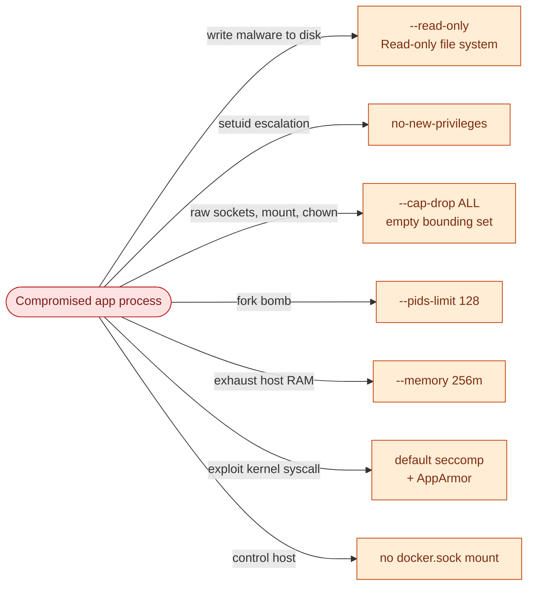
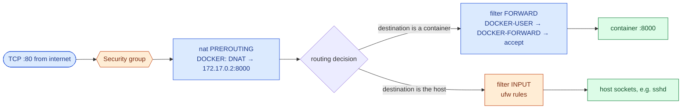
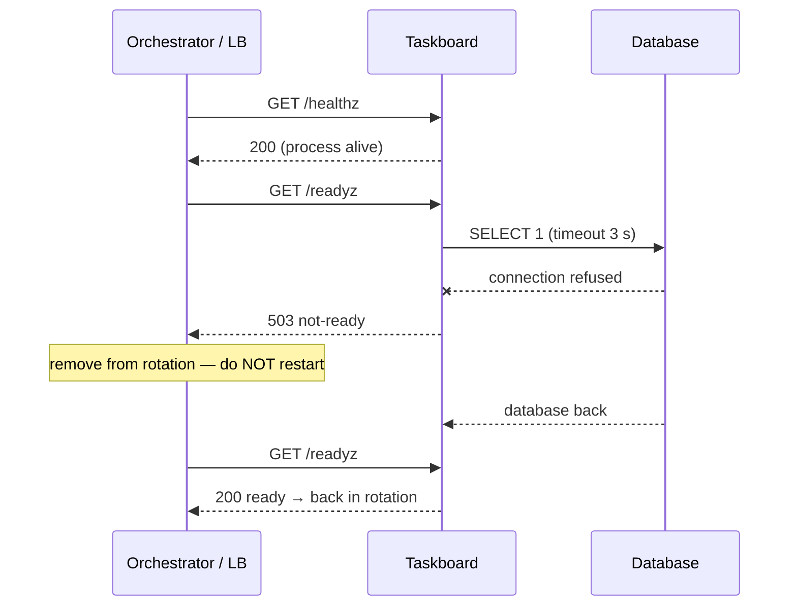
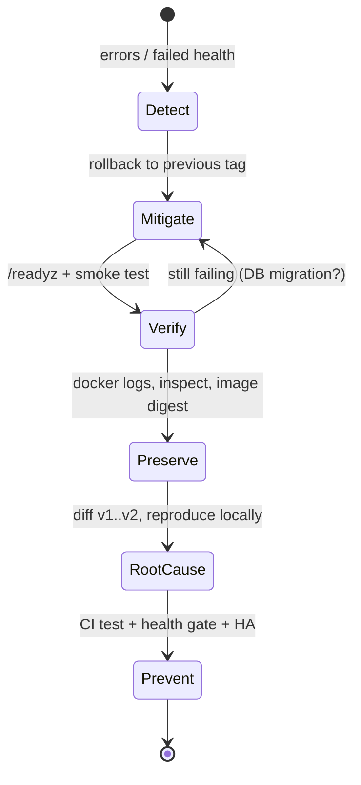
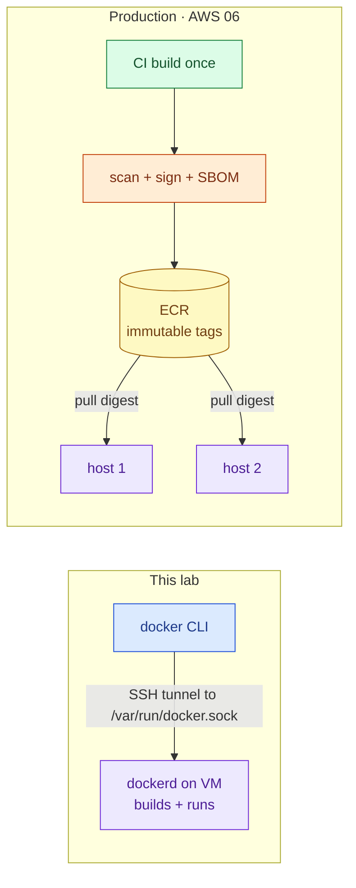

# AWS 02 — Interview preparation

Index of all questions: [interview index](../../../../docs/interview-preparation/README.md).

---

## Q1 (Beginner) — What is the difference between a container and a virtual machine?

**Interview answer:** A VM virtualises hardware: each VM runs its own kernel on a hypervisor. A
container is a normal Linux process that the host kernel isolates with namespaces (what it can see) and
cgroups (what it can use). Containers start in milliseconds and share the host kernel, which makes them
dense and fast — and means a kernel bug or a misconfiguration can affect every container on the host.

**Walkthrough:** in this lab both exist at once — the EC2 instance is a VM on the Nitro hypervisor,
and the taskboard container is a process inside it. `ps -ef` on the host shows `uvicorn` like any other
process.

**Depth:** namespaces give the process its own PID 1, network stack and mount table; cgroups enforce
`--memory 256m`. Seccomp, capabilities and LSMs (AppArmor on Ubuntu) further restrict syscalls.

**Follow-ups:** What is a "rootless" container? When would you choose a VM over a container for
isolation (multi-tenant untrusted code → microVMs like Firecracker)?

---

## Q2 (Intermediate) — How do Docker layers and the build cache work, and how do you write a Dockerfile that builds fast?

**Interview answer:** Each instruction produces a layer identified by its inputs. On rebuild Docker
reuses a cached layer until the first instruction whose inputs changed; everything after it rebuilds.
So I order instructions from least to most frequently changing: base image, OS packages, dependency
manifest, dependency install, then application code.

**Walkthrough:** editing code only rebuilds the last layer; editing dependencies re-runs `pip
install`. If the Dockerfile did `COPY . .` before `pip install`, every code change would reinstall all
dependencies.

**Depth:** `COPY` cache keys are file checksums, `RUN` keys are the command string (so `apt-get update`
in its own layer goes stale — combine it with `install`). `.dockerignore` keeps the build context small
and prevents secrets (`.env`, `.git`) from being sent to the daemon. In CI, BuildKit cache exports
(`--cache-to type=gha`) persist the cache between runners (project 06).

**Follow-ups:** Why is `latest` a bad tag for deployments? How do you make builds reproducible (pin
base image by digest, pin dependencies)?

---

## Q3 (Intermediate) — How do you harden a container at runtime?

**Interview answer:** Run as a non-root user, drop all capabilities and add back only what is needed,
set `no-new-privileges`, make the root filesystem read-only with a small tmpfs for scratch, limit memory,
CPU and PIDs, keep the default seccomp and AppArmor profiles, never mount the Docker socket, and publish
only the ports needed.

**Walkthrough:** each control answers one attacker move. None is sufficient alone; together they turn
an RCE in the app into a contained incident.

**Depth:** capabilities split root's power into ~40 units; Docker's default set still includes
`CHOWN`, `NET_RAW`, `SETUID` and others. The lab verified that the non-root app has an empty effective
set either way, but the bounding set is what limits a root process inside the container. User
namespaces (`userns-remap` or rootless Docker) map container root to an unprivileged host UID — the
next step up.

**Follow-ups:** Why is membership in the `docker` group equivalent to root? What does `--privileged`
actually grant?

---

## Q4 (Advanced) — Port 80 is reachable even though ufw denies it. Why?

**Interview answer:** Docker programs iptables directly. A published port is a DNAT rule in the `nat`
table's `PREROUTING` chain; the packet is then *forwarded* to the container's bridge IP, so it traverses
the `FORWARD` chain, where Docker's chains come first — ufw's `INPUT` rules never see it. The fix is to
filter in `DOCKER-USER`, publish on `127.0.0.1` behind a host proxy, or rely on the cloud firewall.

**Walkthrough:** the routing decision after DNAT decides which chain applies. ufw only manages INPUT
for host traffic, so it is bypassed for container traffic.

**Commands:** `sudo iptables -t nat -S DOCKER`, `sudo iptables -S FORWARD`, `sudo iptables -I DOCKER-USER -i ens5 ! -s 203.0.113.10 -j DROP`.

**Security concern:** many real incidents (exposed Redis/Elasticsearch) came from teams trusting ufw on
Docker hosts. Defence in depth with the cloud firewall saved this lab.

**Follow-ups:** What changes with `--network host`? With `userland-proxy: false`?

---

## Q5 (Intermediate) — Liveness vs readiness: why does Taskboard have both `/healthz` and `/readyz`?

**Interview answer:** Liveness answers "is this process stuck and should it be restarted?" Readiness
answers "should it receive traffic right now?" Taskboard's `/healthz` never touches the database, so a
database outage does not cause restarts that cannot fix it; `/readyz` checks the database so a load
balancer stops routing to an instance that cannot serve.

**Walkthrough:** if liveness also checked the database, every replica would restart in a loop during a
DB outage — turning a dependency failure into a full outage and a thundering herd on recovery.

**Depth:** Docker's `HEALTHCHECK` only sets a status; Docker does not restart unhealthy containers. ECS
and Kubernetes act on probes (projects 07–08).

**Follow-ups:** What should a startup probe do? How do you avoid health checks that are too aggressive?

---

## Q6 (Scenario) — A deploy broke production on a single Docker host. Walk me through recovery and prevention.

**Interview answer:** First restore service: roll back to the previous image tag — which requires that
it still exists locally or in a registry and that its version was recorded. Then confirm with health
checks and real requests, preserve the logs of the failed container, and only then investigate. To
prevent recurrence: test the image in CI with the same run profile, deploy with a health gate that
rolls back automatically, and remove the single-host downtime with a load balancer and two hosts.

**Walkthrough:** the loop from Verify back to Mitigate covers the hard case — a release that changed
data (a schema migration) cannot be fixed by an image rollback alone; it needs backward-compatible
migrations.

**Depth:** this lab implements the health gate and rollback in `taskboard-ctl.sh`; the downtime during
`docker rm` + `docker run` is the reason for AWS 05 (load balancer + multiple instances) and Kubernetes
rolling updates (AWS 08).

**Follow-ups:** How would you do blue/green on one host? What is the risk of `docker system prune` in
an incident?

---

## Q7 (Advanced) — Why does this lab build images on the VM over SSH instead of pushing to a registry? When is that wrong?

**Interview answer:** For one host and one learner it removes a service, IAM setup and cost, and shows
what `DOCKER_HOST` really does: the CLI is just an API client. It is wrong as soon as there is more than
one host or a need for provenance — each host would build its own, possibly different, image. Production
builds once in CI, scans and signs, pushes to a registry, and every host pulls the same digest.

**Security concern:** the `docker` group on the VM is root-equivalent, so SSH access as `ubuntu` already
equals root — acceptable on a disposable lab host, not on shared servers.

**Follow-ups:** What is an image digest and why deploy by digest? How would you give a CI runner access
to ECR without long-lived keys (OIDC, AWS 06)?
