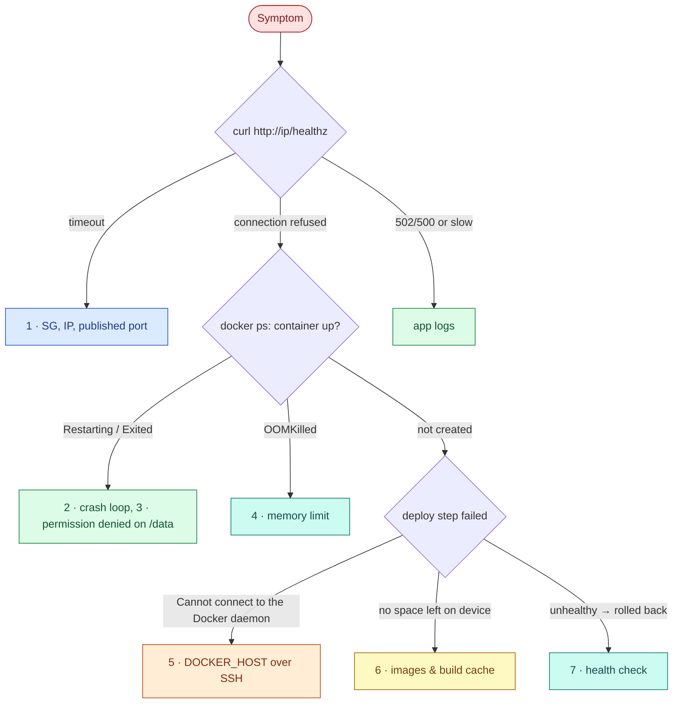

# AWS 02 — Troubleshooting playbook



## 1. `curl http://<ip>` times out

**Symptoms:** browser spins, `curl` times out; SSH works.

**Likely causes:** your IP is not in `allowed_http_cidrs` (defaults to the SSH CIDRs); the container is not
publishing port 80; you used `https://`.

**Diagnose:**

```bash
curl -v --max-time 5 http://<ip>/healthz
aws ec2 describe-security-groups --filters Name=group-name,Values=lab02-docker-host-sg \
  --query 'SecurityGroups[0].IpPermissions[].[FromPort,IpRanges[].CidrIp]' --output json
ssh ubuntu@<ip> 'docker ps --format "{{.Names}} {{.Ports}}"; sudo ss -tlnp | grep ":80 "'
```

**What the results mean:** no `0.0.0.0:80->8000/tcp` in `docker ps` → the container was run without
`-p`; port listed but timeout from outside → SG. Timeout (not refused) always means a filter dropped
packets.

**Resolve:** fix the CIDR and `terraform apply`; redeploy with `scripts/deploy.sh`.

**Prevent:** keep the run profile in one script (`taskboard-ctl.sh`) instead of ad-hoc `docker run`.

## 2. Container keeps restarting

**Symptoms:** `docker ps` shows `Restarting (1) 3 seconds ago`; `RestartCount` climbs.

**Likely causes:** the process exits at start — bad `DATABASE_URL`, missing module, wrong `CMD`.

**Diagnose:**

```bash
docker ps -a --filter name=taskboard
docker logs --tail 50 taskboard
docker inspect -f 'exit={{.State.ExitCode}} oom={{.State.OOMKilled}} restarts={{.RestartCount}} err={{.State.Error}}' taskboard
docker run --rm -it --entrypoint sh taskboard-api:<tag>     # inspect the image interactively
```

**What the results mean:** exit code 1 with a Python traceback → application/config; 137 → killed
(SIGKILL, often OOM); 126/127 → the `CMD` binary is not executable / not found.

**Resolve:** fix configuration and redeploy, or `taskboard-ctl.sh rollback`.

**Prevent:** health-gated deploys with automatic rollback (already in `taskboard-ctl.sh`); run
`local-test.sh` before every cloud deploy.

## 3. `sqlite3.OperationalError: unable to open database file` / `Permission denied` on `/data`

**Symptoms:** `/readyz` 503 or container exits after you switched to a bind mount.

**Likely causes:** a bind mount (`-v /srv/taskboard:/data`) creates the host directory as `root:root`,
and the container runs as UID 10001. Named volumes copy the image's `/data` ownership on first use;
bind mounts do not.

**Diagnose:**

```bash
docker inspect -f '{{json .Mounts}}' taskboard | jq
docker exec taskboard id
ssh ubuntu@<ip> 'sudo ls -ldn /srv/taskboard'
```

**Resolve:** `sudo chown 10001:10001 /srv/taskboard`, or return to the named volume.

**Prevent:** fixed UID/GID in the image (done: 10001) and documented volume ownership.

## 4. Container `OOMKilled`

**Symptoms:** restarts under load; `OOMKilled=true`; exit code 137.

**Likely causes:** the 256 MiB limit is too small for the workload, or a memory leak.

**Diagnose:**

```bash
docker inspect -f '{{.State.OOMKilled}} {{.HostConfig.Memory}}' taskboard
docker stats --no-stream taskboard
ssh ubuntu@<ip> 'sudo dmesg -T | grep -i "memory cgroup out of memory" | tail -n 3'
```

**What the results mean:** `memory cgroup out of memory` → the container's own limit; a host-level
OOM would also hit other processes.

**Resolve:** raise the limit only with data (`docker update --memory 384m --memory-swap 384m taskboard`
then make it permanent in `taskboard-ctl.sh`); fix the leak otherwise.

**Prevent:** memory metrics and alerts (project 11); load-test before raising limits.

## 5. `Cannot connect to the Docker daemon at ssh://...` or `permission denied ... docker.sock`

**Symptoms:** `deploy.sh` fails before building.

**Likely causes:** SSH itself fails (see AWS 01 playbook); `ubuntu` is not yet in the `docker` group
(cloud-init still running, or the session predates `usermod`); Docker not installed yet.

**Diagnose:**

```bash
ssh ubuntu@<ip> 'cloud-init status; id; systemctl is-active docker; docker version'
DOCKER_HOST=ssh://ubuntu@<ip> docker info 2>&1 | head -n 5
```

**What the results mean:** `id` without `docker` → group membership is evaluated at login; reconnect.
`cloud-init status: running` → wait; `docker: command not found` → check
`/var/log/cloud-init-output.log` for apt or GPG errors.

**Resolve:** wait for cloud-init; reconnect; re-run cloud-init's failed step by hand.

**Prevent:** `deploy.sh` waits for `cloud-init status --wait` before touching Docker.

## 6. `no space left on device` during build

**Symptoms:** build fails at `pip install` or `exporting layers`.

**Likely causes:** old images and build cache on a 20 GB disk (swap file takes 1 GB).

**Diagnose:**

```bash
DOCKER_HOST=ssh://ubuntu@<ip> docker system df -v | head -n 30
ssh ubuntu@<ip> 'df -h /; sudo du -sh /var/lib/docker/* | sort -h | tail'
```

**Resolve:** `docker builder prune -f`; `docker image prune -f`. Never `docker system prune --volumes`
unless you mean to delete the database.

**Prevent:** `taskboard-ctl.sh` keeps only current + previous images; a disk alert at 80%.

## 7. Deploy says "unhealthy" and rolls back

**Symptoms:** `FAIL taskboard version X did not become healthy` then `rolled back to Y`.

**Likely causes:** the new version fails `/healthz`, starts slower than the health window (10 s start
period + 30 × 2 s polling), or crashes.

**Diagnose:**

```bash
export DOCKER_HOST=ssh://ubuntu@<ip>
docker image ls taskboard-api
docker run -d --name probe taskboard-api:<bad-tag>
sleep 30; docker inspect -f '{{json .State.Health.Log}}' probe | jq '.[-1]'
docker logs probe; docker rm -f probe
```

**Resolve:** fix the code, `local-test.sh`, redeploy. The service is already restored by the rollback.

**Prevent:** the same health check runs in `local-test.sh`; CI runs it on every change (project 06).
