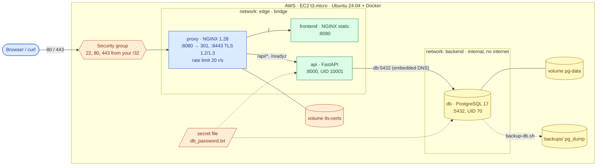
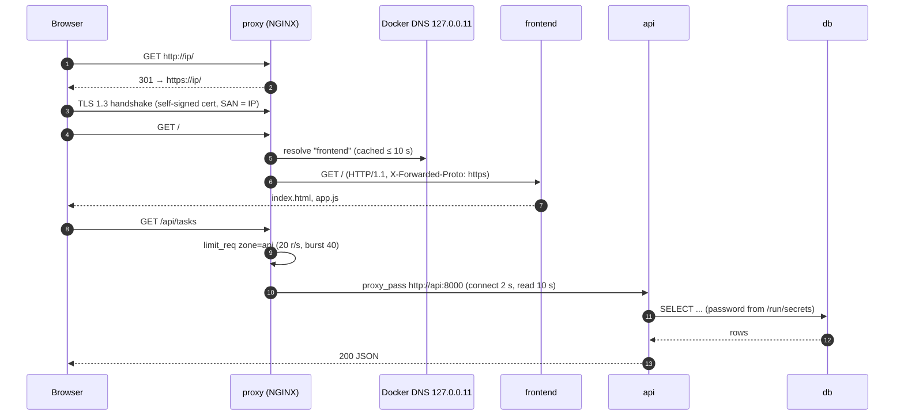
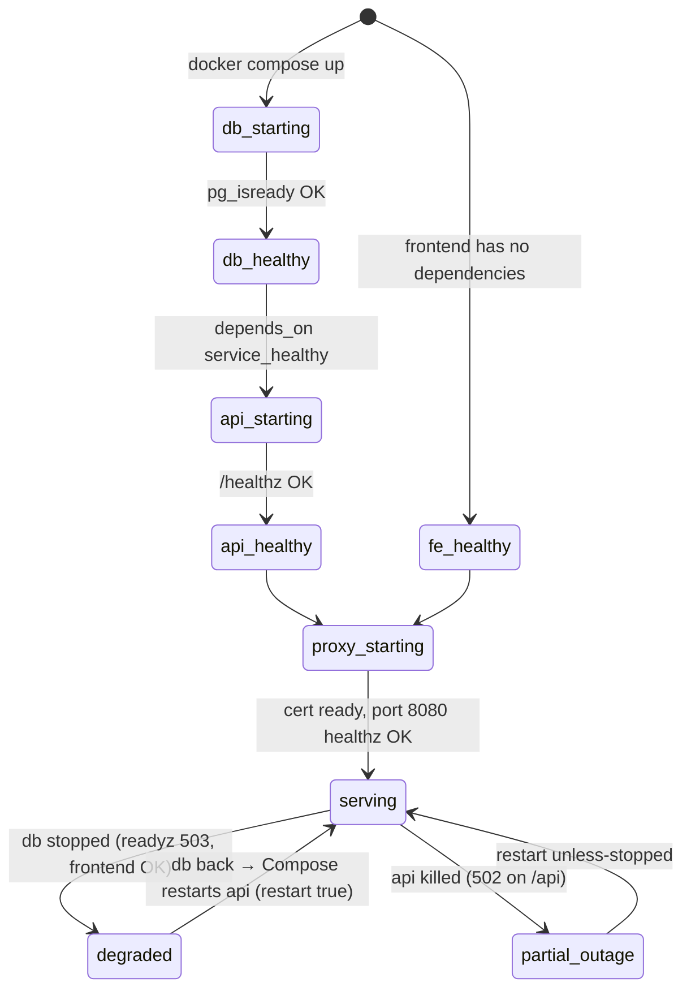

# AWS 03 — Multi-Service Docker Application

| | |
|---|---|
| **Project ID** | `aws-03` |
| **Cloud** | AWS (EC2, VPC, IAM, Systems Manager) |
| **Difficulty** | Beginner → Intermediate |
| **Build time** | 3–4 h first attempt (including [exercises](docs/exercises.md)) |
| **Rebuild time** | 20–25 min |
| **Free tier** | Fits: one `t3.micro`, 20 GB gp3, one public IPv4 — see [cost](docs/cost.md) |
| **Depends on** | [AWS 02](../02-dockerized-app-on-vm/) (images, volumes, hardening) |
| **Status** | Implemented · static checks passed · local stack test passed (19 checks) · deployment **not tested** ([tracker](../../../docs/progress/implementation-tracker.md)) |

## The problem this lab solves

Real applications are several processes with different jobs: something terminates TLS and routes
requests, something serves static files, something runs business logic, something stores data. Each
needs its own lifecycle, resource limits and network exposure, and they must start in the right order
and recover when one of them fails. Running them as hand-typed `docker run` commands does not scale past
two containers.

This lab runs Taskboard as four services declared in one Compose file: an NGINX reverse proxy with TLS,
the static frontend, the API, and PostgreSQL. Only the proxy is reachable from outside; the database
sits on an internal network with no route to the internet. You will test start-up ordering, health-based
dependencies, secret files, backups and restores, and recovery from failures of each tier.

**Skills learned:** Compose services, networks, volumes and secrets · reverse proxying and TLS
termination · Docker embedded DNS and service discovery · health-gated dependencies · network
segmentation between tiers · rate limiting and timeouts · PostgreSQL backups with `pg_dump` and restore
· failure recovery per tier.

**Expected outcome:** `https://<public-ip>/` serves Taskboard over TLS; HTTP redirects to HTTPS; ports
5432/8000/8080 are closed; a database outage returns 503 from `/readyz` while the frontend stays up; a
backup can be restored.

## Architecture



| Component | Responsibility | Exposure | Defined in |
|---|---|---|---|
| `proxy` | TLS termination, HTTP→HTTPS redirect, routing, rate limiting, timeouts, JSON access logs | Host ports 80, 443 | [proxy/](stack/proxy/) |
| `frontend` | Static HTML/JS/CSS with security headers | `edge` network only | [shared frontend](../../../shared/sample-apps/taskboard/frontend/) |
| `api` | Business logic, `/healthz`, `/readyz`, `/metrics` | `edge` + `backend` | [shared API](../../../shared/sample-apps/taskboard/api/) |
| `db` | PostgreSQL 17, data on `pg-data` | `backend` (internal) only | [compose.yaml](stack/compose.yaml) |
| `edge` network | Proxy ↔ frontend ↔ api | Bridge with internet egress | [compose.yaml](stack/compose.yaml) |
| `backend` network | api ↔ db | `internal: true` — no gateway | [compose.yaml](stack/compose.yaml) |
| Secret file | DB password, generated on the host | Mounted at `/run/secrets/db_password` | [init-secrets.sh](stack/init-secrets.sh) |
| Backup / restore | Logical dumps with integrity check, 7 kept | Host directory `backups/` | [backup-db.sh](stack/backup-db.sh), [restore-db.sh](stack/restore-db.sh) |

Every service also gets `read_only: true`, `cap_drop: [ALL]`, `no-new-privileges`, a `/tmp` tmpfs and
CPU/memory/PID limits from one shared YAML anchor (`x-hardening`).

### Request flow



### Start-up ordering and recovery



## Concepts used

| Concept | Where in this lab | Guide |
|---|---|---|
| Compose model: services, networks, volumes, secrets, `depends_on` | `compose.yaml` | [docker-compose](../../../docs/concepts/docker-compose.md) |
| Reverse proxy, TLS termination, certificates | `proxy/` | [reverse-proxy-and-tls](../../../docs/concepts/reverse-proxy-and-tls.md) |
| Container networks, embedded DNS, volumes | `edge` / `backend` | [docker-networking-and-storage](../../../docs/concepts/docker-networking-and-storage.md) |
| Liveness vs readiness, dependency health | `/healthz`, `/readyz`, healthchecks | [health-checks](../../../docs/concepts/health-checks.md) |
| Container hardening | `x-hardening` anchor, `user: 70:70` | [container-security](../../../docs/concepts/container-security.md) |
| Images and builds | Three locally built images | [docker-images-and-builds](../../../docs/concepts/docker-images-and-builds.md) |

Architecture decisions: [ADR-0001 Compose on one VM](docs/adr/0001-compose-on-single-vm.md) ·
[ADR-0002 TLS at an NGINX proxy with a self-signed certificate](docs/adr/0002-nginx-tls-self-signed.md) ·
[ADR-0003 PostgreSQL in a container with logical backups](docs/adr/0003-postgres-container-logical-backups.md).

## Deploy

### 1. Test locally first (free)

```bash
cd projects/aws/03-multi-service-docker-app
scripts/local-test.sh        # full stack on ports 18080/18443, 19 checks, then removes everything
```

### 2. Preflight, configure, apply

```bash
../../../shared/scripts/aws-preflight.sh
cp terraform/terraform.tfvars.example terraform/terraform.tfvars    # set allowed_ssh_cidrs
terraform -chdir=terraform init
terraform -chdir=terraform plan -out=lab03.tfplan                    # expect 18 resources to add
terraform -chdir=terraform apply lab03.tfplan
```

| Variable | Default | Notes |
|---|---|---|
| `allowed_ssh_cidrs` | — (required) | Your `/32` |
| `allowed_http_cidrs` | `[]` (= SSH CIDRs) | Who may reach 80/443 |
| `instance_type` | `t3.micro` | 4 services fit in 1 GiB with the limits set here (≈ 600 MiB worst case) plus swap |
| `root_volume_gb` | `20` | Images, database, backups |

### 3. Deploy and verify

```bash
scripts/deploy.sh            # rsync stack + source, secrets generated on the VM, compose up --wait
scripts/verify.sh
```

| Check | Expected |
|---|---|
| `http://<ip>/` | `301` to HTTPS |
| `https://<ip>/` | Taskboard page (certificate warning: self-signed) |
| `https://<ip>/readyz` | `{"status":"ready","backend":"postgresql"}` |
| Certificate SAN | contains the public IP |
| Ports 5432, 8000, 8080 | not reachable |
| `docker compose ps` | 4 services `healthy` |
| Secrets | directory `700`, file `644` |

### 4. Operate

```bash
ssh ubuntu@<ip>
cd /opt/lab03
docker compose ps
docker compose logs -f proxy | jq -c 'select(.status >= 400)'
./backup-db.sh                       # writes backups/taskboard-<UTC>.dump
./failure-drill.sh list
```

### 5. Exercises

[docs/exercises.md](docs/exercises.md): Compose model, DNS-based discovery, network isolation, TLS
inspection, secrets, start-up ordering, backups, failure drills per tier, resource limits.

### 6. Clean up

```bash
ssh ubuntu@<ip> 'cd /opt/lab03 && ./backup-db.sh' && scp ubuntu@<ip>:'/opt/lab03/backups/*.dump' .   # optional: keep data
terraform -chdir=terraform destroy
../../../shared/scripts/aws-find-lab-resources.sh
```

## Troubleshooting, cost and interview material

- [Troubleshooting playbook](docs/troubleshooting.md) — 8 incidents
- [Cost estimate](docs/cost.md)
- [Interview preparation](docs/interview.md) — 7 questions

## Repeat practice

| Attempt | Goal | Guidance |
|---|---|---|
| 1 | Guided build | Follow this README and the exercises |
| 2 | Reduced guidance | Deploy, then reproduce the request-flow diagram from `docker compose config`, `docker network inspect` and proxy logs only |
| 3 | Rebuild from objectives | Write your own `compose.yaml` from the component table: two networks, healthchecks, secrets, hardening. Pass `local-test.sh` with it |
| 4 | Failure drills | Someone runs a `failure-drill.sh` scenario without telling you; restore service and explain the cause |
| 5 | Defend the design | Answer the [interview questions](docs/interview.md); argue for RDS and an ALB against the [ADRs](docs/adr/) |

### Self-assessment

- [ ] I can explain how `proxy` finds `api` and why it uses `resolver 127.0.0.11` with variables.
- [ ] I can prove the database cannot reach the internet and cannot be reached from `edge`.
- [ ] I can explain why the password is a file and how it reaches both containers.
- [ ] I can describe what `depends_on: condition: service_healthy, restart: true` does and does not guarantee.
- [ ] I restored a backup and can state the recovery point and recovery time I achieved.
- [ ] I can inspect the certificate with `openssl` and explain the browser warning.
- [ ] I can say which tier failed from the HTTP status codes alone (301, 429, 502, 503, 504).

**Done when:** `local-test.sh` and `verify.sh` pass, you restored a backup on the VM, ran every
`failure-drill.sh` scenario and recovered, the self-assessment is complete, and cleanup shows no tagged
resources.

## References

- [Compose file reference](https://docs.docker.com/reference/compose-file/)
- [Compose: control startup order](https://docs.docker.com/compose/how-tos/startup-order/)
- [Compose secrets](https://docs.docker.com/compose/how-tos/use-secrets/)
- [NGINX `ngx_http_proxy_module`](https://nginx.org/en/docs/http/ngx_http_proxy_module.html)
- [Mozilla SSL configuration guidance](https://ssl-config.mozilla.org/)
- [PostgreSQL `pg_dump`](https://www.postgresql.org/docs/17/app-pgdump.html) and [`pg_restore`](https://www.postgresql.org/docs/17/app-pgrestore.html)
- [Docker official image `postgres`](https://hub.docker.com/_/postgres)
