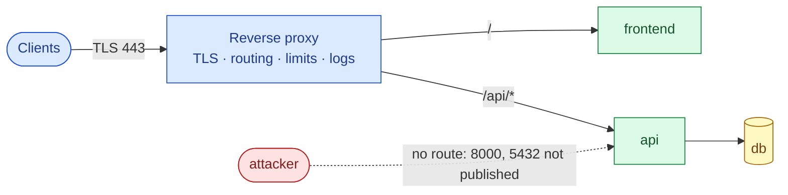
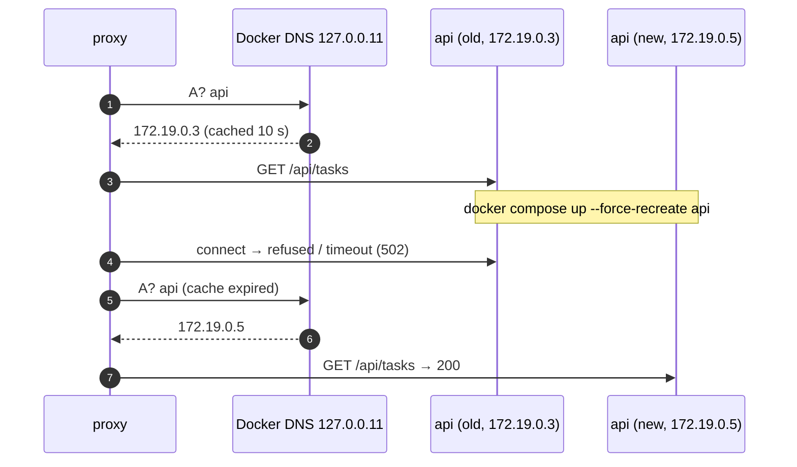
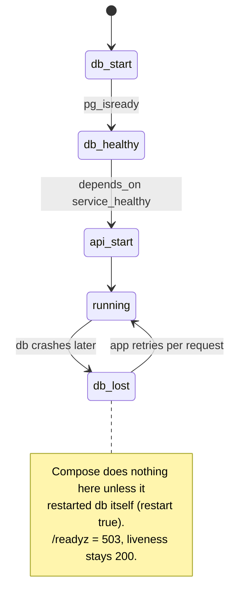
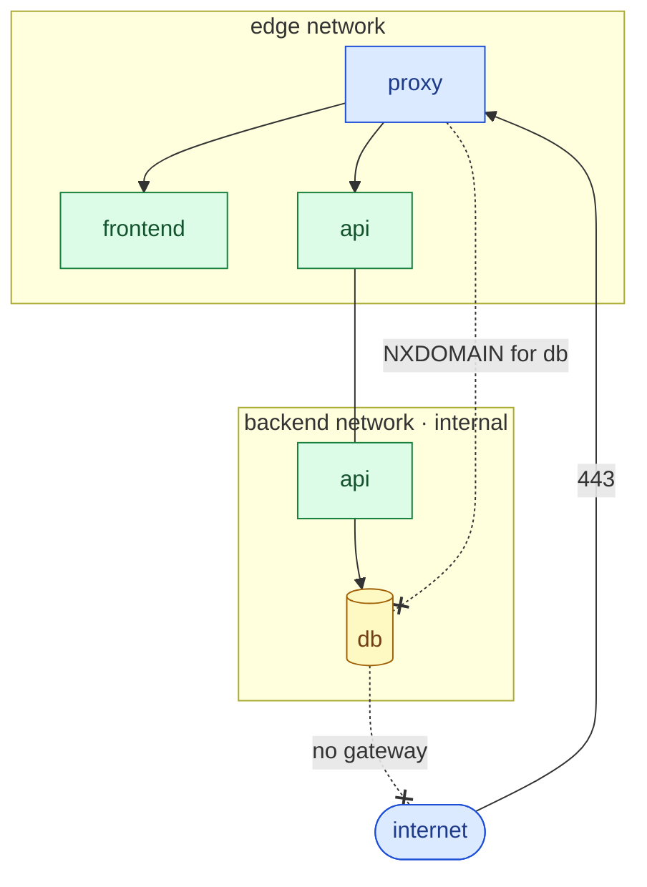
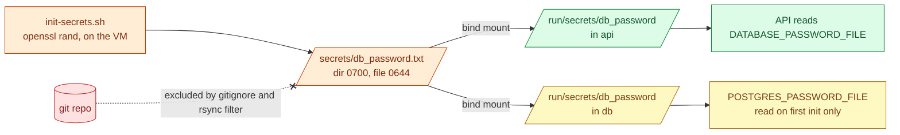
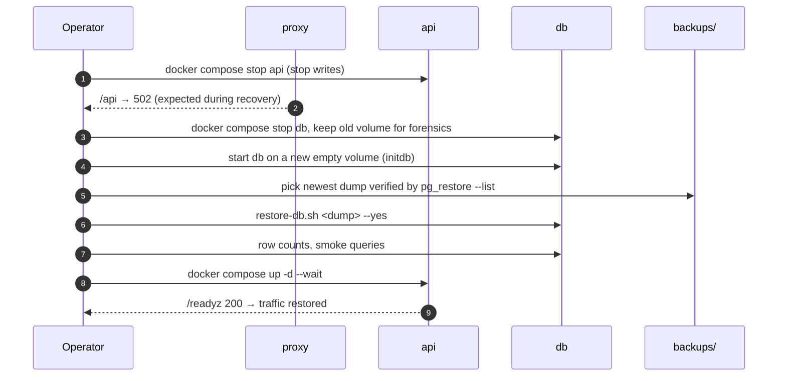
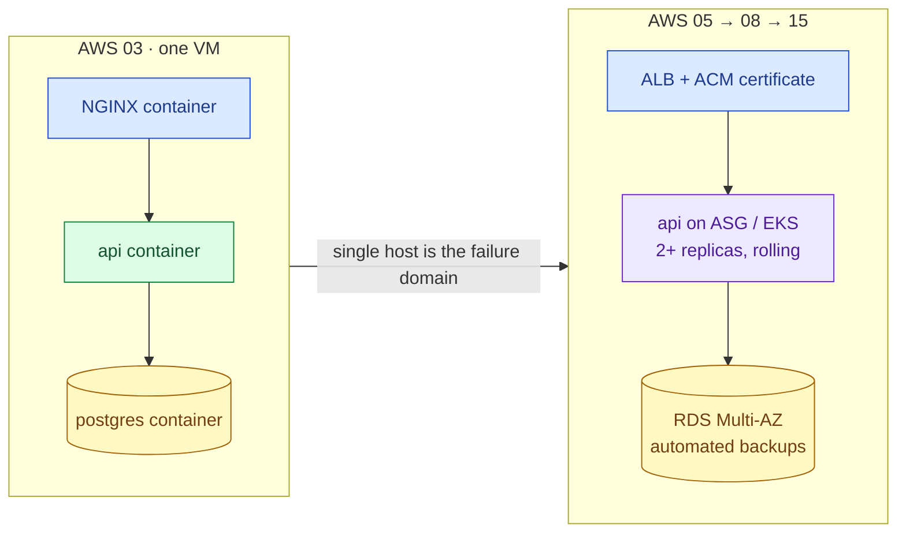

# AWS 03 — Interview preparation

Index of all questions: [interview index](../../../../docs/interview-preparation/README.md).

---

## Q1 (Beginner) — What does a reverse proxy do, and why put one in front of the API?

**Interview answer:** A reverse proxy is the single entry point that receives client connections and
forwards them to internal services. It terminates TLS so backends speak plain HTTP on a private
network, routes by path or host, and enforces cross-cutting policy — redirects, rate limits, timeouts,
body-size limits, security headers and access logs — in one place instead of in every service.

**Walkthrough:** only the proxy has a published port. The browser sees one origin, so the frontend's
relative `/api/*` calls need no CORS configuration.

**Depth:** the proxy must tell the backend who the real client is (`X-Forwarded-For`,
`X-Forwarded-Proto`); the backend must only trust those headers from the proxy (`--forwarded-allow-ips`
in uvicorn). Forward proxy = client side (egress control); reverse proxy = server side.

**Follow-ups:** What changes when an AWS ALB sits in front (AWS 05)? Where do you terminate TLS if you
need end-to-end encryption?

---

## Q2 (Intermediate) — How do containers in a Compose project find each other?

**Interview answer:** Compose creates user-defined bridge networks; Docker runs an embedded DNS server at
`127.0.0.11` in every container on them, which resolves service names to container IPs on networks the
caller shares. Containers are ephemeral, so IPs change on recreate — which is why clients should resolve
names at connection time, and why the NGINX config uses a `resolver` and variables.

**Walkthrough:** the local test reproduces this exactly: it forces a new IP and checks that the proxy
follows within 10 s without a reload. With a static `proxy_pass http://api:8000;` nginx would keep the
first IP until restarted.

**Depth:** names resolve only within shared networks — `proxy` gets `NXDOMAIN` for `db` (verified
locally). The default `bridge` network has no embedded DNS by name, which is why Compose never uses it.

**Follow-ups:** How does Kubernetes do the same (CoreDNS + Service virtual IPs, AWS 07)? What is
`ndots` and why does it matter?

---

## Q3 (Intermediate) — Why does `depends_on` not guarantee the database is available?

**Interview answer:** `depends_on` with `condition: service_healthy` only orders **start-up**: Compose
waits for the database's healthcheck before starting the API. After that, nothing stops the database
from failing, restarting or becoming slow. The application must handle that itself — retry, time out,
and report readiness — which is why the API connects per request with a 3 s timeout and exposes
`/readyz`.

**Walkthrough:** the only edge Compose controls is the initial `db_healthy → api_start`. The `db_lost`
state is the application's problem.

**Depth:** `restart: true` in `depends_on` restarts the API when *Compose* restarts the database
(`docker compose restart db` — verified locally); it does not react to a crash. In Kubernetes there is no
start-up ordering between Deployments at all; readiness probes and retries are the only mechanism.

**Follow-ups:** How would you run database migrations safely at start-up? What is a circuit breaker?

---

## Q4 (Advanced) — How did you isolate the database, and how would you prove it?

**Interview answer:** The database sits only on a network marked `internal: true`, which has no gateway
— so it cannot reach the internet — and only the API shares that network with it. It publishes no host
port, so nothing outside Docker can connect. I prove it with negative tests: a container on the edge
network cannot even resolve `db`; a container on the backend network cannot reach the internet; `ss`
shows no socket on 5432; and an external scan of 5432 times out.

**Walkthrough:** `api` and `api2` are the same container attached to both networks — it is the only
bridge between tiers, so compromising the proxy alone does not give network access to the database.

**Security concerns:** the database still trusts any client that knows the password on its network;
production adds TLS to the database connection and per-service credentials. On AWS the equivalent is
private subnets plus security groups that reference each other (AWS 04).

**Follow-ups:** What would a cloud-native version look like (RDS in private subnets, SG referencing the
app SG)? How do you allow the database to fetch extensions or time sync if it has no internet?

---

## Q5 (Intermediate) — How do you handle secrets in a Compose deployment?

**Interview answer:** Generate them on the host that uses them, store them as files with restricted
permissions, mount them through Compose `secrets` so they appear under `/run/secrets/`, and make the
application read a `*_FILE` variable. Never put them in the image, in `compose.yaml`, in git, or in
environment variables — environment is visible through `docker inspect`, `/proc/<pid>/environ` and
crash reports.

**Walkthrough:** without Swarm, Compose secrets are bind mounts, so host file permissions apply inside
the container. The file must be readable by UID 10001 and UID 70, hence 0644 inside a 0700 directory.

**Tradeoffs:** no rotation, no audit trail, plaintext on disk (on an encrypted EBS volume). A secret
manager (AWS Secrets Manager / SSM Parameter Store, AWS 15) adds those. A rotation gotcha:
`POSTGRES_PASSWORD_FILE` is only used when the data directory is first initialised.

**Follow-ups:** How do you rotate the DB password without downtime? How do Kubernetes Secrets differ
(base64 is not encryption; enable encryption at rest)?

---

## Q6 (Scenario) — The database volume is corrupted. Walk through recovery and what RPO/RTO you can promise.

**Interview answer:** Stop writes (stop the API or put the proxy in maintenance), preserve the corrupted
volume for analysis, create a fresh volume, start PostgreSQL, restore the newest verified dump, validate
the data, then reopen traffic. With nightly `pg_dump` the RPO is up to 24 h; RTO is minutes for a small
database. If those numbers are not acceptable, you need continuous WAL archiving (point-in-time
recovery) or a managed database with automated backups and replicas.

**Walkthrough:** step 6 depends on the integrity check done at backup time (`backup-db.sh` runs
`pg_restore --list` on every dump and writes to a `.partial` file first, so a failed dump never looks
like a good one).

**Depth:** logical dumps are consistent snapshots but restore time grows with data size; physical
backups + WAL give PITR. Backups on the same disk do not survive losing the VM — copy them off-host
(S3 with versioning and lifecycle, AWS 10). An untested backup is not a backup: exercise 7 tests it.

**Follow-ups:** How would you test restores automatically? What changes with RDS?

---

## Q7 (Advanced) — When would you move this stack off Compose, and to what?

**Interview answer:** Compose is the right tool for one host: simple, declarative, easy to debug. It
stops being enough when you need more than one host for availability or capacity, zero-downtime
rolling updates, automatic rescheduling after a host failure, or autoscaling. Then the proxy becomes a
cloud load balancer, the database becomes a managed service, and the stateless tiers move to an
orchestrator — ECS or Kubernetes.

**Tradeoffs:** managed services cost money (an ALB and RDS are outside the always-free allowance on many
plans), add IAM and networking complexity, and reduce what you can see. The single VM is cheaper and
fully inspectable but has no redundancy: one instance failure is a full outage.

**Follow-ups:** What would you keep from this design when moving to Kubernetes (healthchecks, two
networks → NetworkPolicy, secret files → mounted Secrets)? When is Compose acceptable in production?
