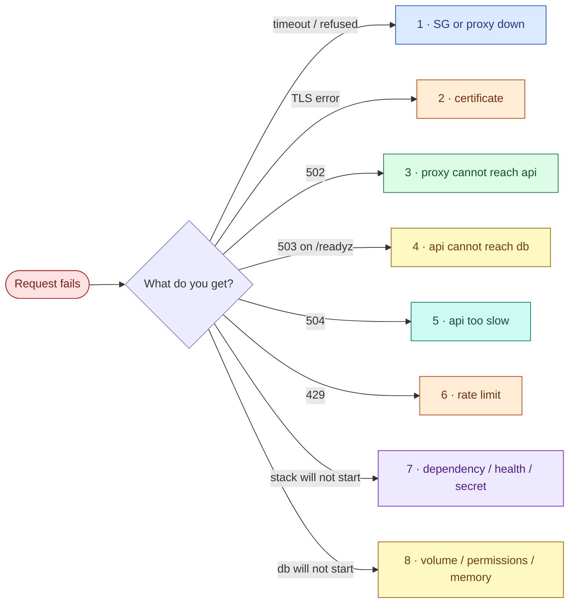

# AWS 03 — Troubleshooting playbook

Read the HTTP status code first — in this stack it tells you which tier failed.



## 1. Connection refused or timeout on 443

**Symptoms:** `curl: (7) Failed to connect` (refused) or a timeout.

**Likely causes:** refused → nothing listens on 443 (proxy stopped or crashed); timeout → security group
or your IP changed.

**Diagnose:**

```bash
docker compose ps proxy
docker compose logs --tail 30 proxy
sudo ss -tlnp | grep -E ':(80|443)\b'
curl -s https://checkip.amazonaws.com    # from the laptop: still in allowed_http_cidrs?
```

**What the results mean:** `nginx: [emerg]` in logs → configuration error (test with `docker compose
run --rm --no-deps proxy nginx -t`); proxy `Exited` with no logs → check `docker compose ps -a` for
OOM.

**Resolve:** `docker compose up -d proxy`; fix the config or SG.

**Prevent:** `nginx -t` in CI (project 06); healthcheck + restart policy (present).

## 2. TLS errors: `certificate is not trusted`, `no alternative certificate subject name matches`

**Symptoms:** browser warning (expected here) or curl `SSL: no alternative certificate subject name
matches target host name`.

**Likely causes:** the public IP changed after stop/start, so the SAN no longer matches; the
certificate expired (30 days); you are using a hostname that is not in the SAN.

**Diagnose:**

```bash
echo | openssl s_client -connect <ip>:443 2>/dev/null | openssl x509 -noout -dates -ext subjectAltName
docker compose exec proxy cat /etc/nginx/certs/san.txt
grep TLS_SAN .env
```

**Resolve:** re-run `scripts/deploy.sh` (writes the new IP to `.env`; the cert script regenerates when
the SAN changes). For expiry: `docker compose exec proxy rm /etc/nginx/certs/tls.crt` then
`docker compose restart proxy`. (Removing only `san.txt` makes the script treat the certificate as
your own and keep it.)

**Prevent:** a real domain with ACME renewal, or ACM on a load balancer (AWS 05).

## 3. `502 Bad Gateway`

**Symptoms:** `/api/*` returns 502; `/` may still work.

**Likely causes:** the api container is down or restarting; proxy and api not on the same network; DNS
cached an old IP (only if someone removed the `resolver`/variable pattern).

**Diagnose:**

```bash
docker compose ps api
docker compose logs --tail 20 proxy | jq -c 'select(.status==502)'
docker compose logs --tail 30 api
docker compose exec proxy wget -qO- http://api:8000/healthz
docker inspect "$(docker compose ps -q api)" --format '{{json .NetworkSettings.Networks}}' | jq 'keys'
```

**What the results mean:** `upstream` field empty in the access log → name did not resolve; a
connection-refused `upstream` IP → container restarting; `wget` works from proxy but users get 502 → look
at nginx error log lines for `upstream prematurely closed`.

**Resolve:** `docker compose up -d api`; reconnect networks with `./failure-drill.sh recover`.

**Prevent:** keep runtime DNS resolution in nginx; alert on 5xx ratio (project 11).

## 4. `/readyz` returns 503

**Symptoms:** `{"status":"not-ready","error":"OperationalError"}`; creating tasks fails; frontend loads.

**Likely causes:** db stopped or unhealthy; api lost its `backend` network attachment; password mismatch
(secret file regenerated after the database volume was initialised).

**Diagnose:**

```bash
docker compose ps db
docker compose logs --tail 30 api | jq -c 'select(.level=="WARNING" or .level=="ERROR")'
docker compose exec db pg_isready -U taskboard
docker compose exec api python -c "import socket; print(socket.gethostbyname('db'))"
docker compose logs db | grep -i 'password authentication failed'
```

**What the results mean:** `Name or service not known` → network attachment; `password authentication
failed` → the volume was initialised with an older password (PostgreSQL only reads
`POSTGRES_PASSWORD_FILE` on first initialisation); `connection refused` → db down.

**Resolve:** `./failure-drill.sh recover`. For a password mismatch either restore the original
`secrets/db_password.txt` or set it inside PostgreSQL:
`docker compose exec db psql -U taskboard -c "ALTER USER taskboard PASSWORD '...'"`.

**Prevent:** `init-secrets.sh` never overwrites an existing secret; back up `secrets/` with the data.

## 5. `504 Gateway Timeout`

**Symptoms:** slow requests end in 504 after 10 s.

**Likely causes:** the api is CPU-throttled (0.5 CPU limit, T3 credits), blocked on the database, or
swapping. A less obvious one: when `db` is stopped, its name no longer exists in Docker's DNS, which then
forwards the query to the host's upstream resolvers. If that lookup stalls, the API waits on
`getaddrinfo` — which `DB_CONNECT_TIMEOUT` does **not** cover — and the proxy gives up at 10 s. Locally
the lookup usually failed in ~0.2 s (fast 500), but one run in testing produced a 504.

**Diagnose:**

```bash
docker compose logs proxy --since 10m | jq -c 'select(.status==504) | {uri, rt, urt}'
docker stats --no-stream
docker compose exec db psql -U taskboard -c "select pid, state, wait_event_type, now()-query_start as age, left(query,60) from pg_stat_activity where state <> 'idle';"
mpstat 1 3; vmstat 1 3
```

**Resolve:** remove the bottleneck (kill the long query, wait for credits, raise the CPU limit with
evidence).

**Prevent:** latency SLOs and alerts (project 11); timeouts on every hop (present: 2 s connect, 10 s read);
an overall request deadline in the application, not only a connect timeout.

## 6. `429 Too Many Requests`

**Symptoms:** some clients get 429 under load.

**Likely causes:** traffic above 20 r/s per client IP plus a burst of 40 — intentional — or many users
behind one NAT IP sharing the limit.

**Diagnose:**

```bash
docker compose logs proxy --since 5m | jq -r 'select(.status==429) | .remote' | sort | uniq -c | sort -rn | head
```

**Resolve:** if legitimate, raise `rate`/`burst` in [nginx.conf](../stack/proxy/nginx.conf) and redeploy.

**Prevent:** size limits from measured traffic; behind a load balancer, key the limit on the real client
IP (`real_ip_header X-Forwarded-For` with trusted proxies only).

## 7. `docker compose up` fails or hangs

**Symptoms:** `dependency failed to start: container taskboard-db-1 is unhealthy`, `secret file not
found`, or `--wait` times out.

**Likely causes:** `secrets/db_password.txt` missing (init script not run); db slow on first start
(initdb on a t3.micro); build failure; port 80/443 already used on the host.

**Diagnose:**

```bash
ls -l secrets/
docker compose ps -a
docker compose logs db | tail -n 30
docker inspect --format '{{json .State.Health}}' "$(docker compose ps -aq db)" | jq '.Log[-1]'
sudo ss -tlnp | grep -E ':(80|443)\b'
```

**Resolve:** `./init-secrets.sh`; rerun `docker compose up -d --wait`; stop whatever holds the port.

**Prevent:** `deploy.sh` runs `init-secrets.sh` first and waits with a 300 s timeout.

## 8. PostgreSQL will not start

**Symptoms:** db restarts; logs show `could not open file ... Permission denied`, `FATAL: data
directory has wrong ownership`, or the container is `OOMKilled`.

**Likely causes:** the `pg-data` volume was created by a different image or as root (e.g. you
replaced the named volume with a bind mount); memory limit too small during recovery; disk full.

**Diagnose:**

```bash
docker compose logs db | tail -n 30
docker run --rm -v taskboard_pg-data:/v alpine:3.22 ls -lan /v /v/pgdata | head
docker inspect -f '{{.State.OOMKilled}}' "$(docker compose ps -aq db)"
df -h /
```

**Resolve:** fix ownership `docker run --rm -v taskboard_pg-data:/v alpine:3.22 chown -R 70:70 /v`;
free disk; restore from backup into a fresh volume if the data directory is corrupt.

**Prevent:** named volumes, fixed UID, disk alerts, tested restores (exercise 7).
