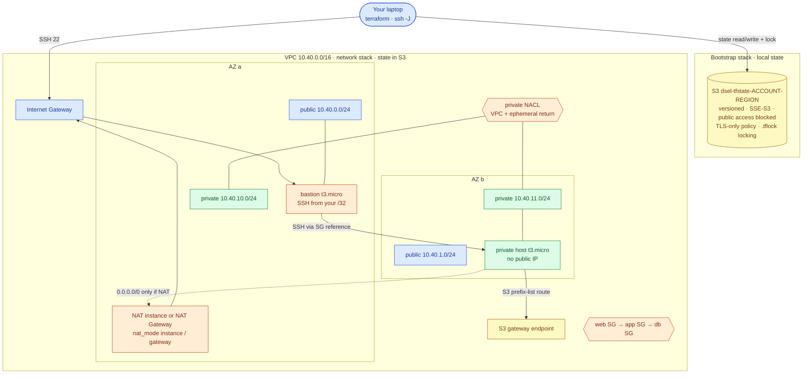
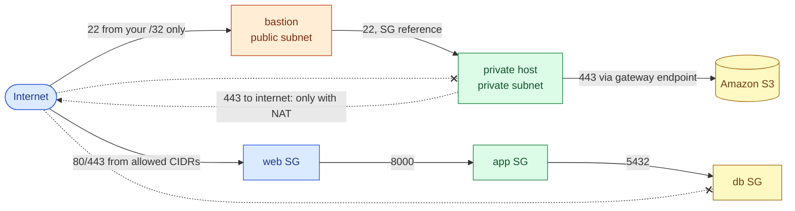
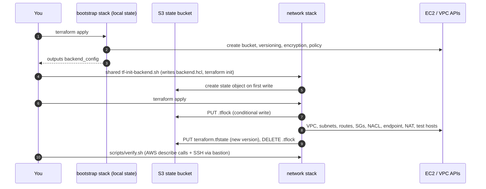

# AWS 04 — Terraform Networking Foundations

| | |
|---|---|
| **Project ID** | `aws-04` |
| **Cloud** | AWS (VPC, subnets, route tables, IGW, NAT, gateway endpoint, NACL, security groups, S3, IAM) |
| **Difficulty** | Intermediate |
| **Build time** | 4–5 h first attempt (including [exercises](docs/exercises.md)) |
| **Rebuild time** | 15 min |
| **Free tier** | Default (`nat_mode = "none"`) fits; `instance` uses free-tier hours; `gateway` is **billed** — see [cost](docs/cost.md) |
| **Depends on** | [AWS 01](../01-linux-server-engineering/) (SSH, routing basics) |
| **Status** | Implemented · static checks passed · deployment **not tested** ([tracker](../../../docs/progress/implementation-tracker.md)) |

## The problem this lab solves

AWS 01–03 each built a throwaway one-subnet network with local Terraform state. That breaks as soon as
there is more than one AZ, more than one tier, or more than one person: a single subnet is a single
failure domain, everything is reachable from everything, and nobody else can safely run `terraform
apply` because the state lives on one laptop.

This lab builds the network foundation the remaining AWS labs use — two AZs, public and private
subnets, tiered security groups, a stateless NACL, an S3 gateway endpoint and a selectable NAT
strategy — as a **reusable module**, managed with **remote state in S3 with native locking**. Then it
proves every routing claim with real packets: a bastion in AZ a, a private host in AZ b, and a test of
what that private host can and cannot reach in each NAT mode.

**Skills learned:** Terraform modules, variables with validation, outputs, `count` · remote state,
partial backend configuration, S3 native locking, state versioning · CIDR planning · route tables,
IGW, NAT Gateway vs NAT instance · gateway endpoints · security-group references vs CIDR rules ·
stateless NACLs and ephemeral ports · bastion access with `ProxyJump` · drift detection.

**Expected outcome:** `scripts/verify.sh` passes: state in a versioned, encrypted, non-public bucket
with locking; subnets in two AZs; the private host reachable only through the bastion; S3 reachable
from the private subnet without internet access; internet egress exactly as the NAT mode says.

## Architecture



| Component | Why it is there | Defined in |
|---|---|---|
| State bucket | Shared, durable, versioned state for AWS 04+; created by a tiny local-state stack | [bootstrap/main.tf](terraform/bootstrap/main.tf) |
| S3 native lock file | Stops two applies from writing the same state | `use_lockfile = true` in `backend.hcl` |
| VPC module | Reusable layout: per-AZ public/private subnets and route tables | [shared vpc module](../../../shared/terraform-modules/aws/vpc/main.tf) |
| Public route table | `0.0.0.0/0 → IGW` for the public subnets | vpc module |
| Private route tables (one per AZ) | No default route unless NAT is enabled; ready for one NAT per AZ | vpc module |
| S3 gateway endpoint | Free private path to S3 (packages, artefacts, backups) without NAT | vpc module |
| NAT (optional) | `none` / `instance` / `gateway` — cost vs availability tradeoff | vpc module, [nat-instance.yaml.tftpl](../../../shared/terraform-modules/aws/vpc/nat-instance.yaml.tftpl) |
| Private NACL | Stateless subnet filter: VPC traffic + ephemeral-port returns only | vpc module |
| Tiered SGs | `web` ← clients, `app` ← web SG, `db` ← app SG; used by AWS 05 | vpc module |
| Bastion + private host | Test hosts that prove the routing (optional, `enable_test_hosts`) | [network/main.tf](terraform/network/main.tf) |

### Who can reach what



### Deployment and state flow



## Concepts used

| Concept | Where in this lab | Guide |
|---|---|---|
| VPC layout, routing, NAT, endpoints, SG vs NACL | Network stack | [aws-vpc-design](../../../docs/concepts/aws-vpc-design.md) |
| Remote state, locking, bootstrap, versioning | Both stacks | [terraform-state-and-locking](../../../docs/concepts/terraform-state-and-locking.md) |
| Terraform modules, variables, validation, outputs | vpc module | [terraform-fundamentals](../../../docs/concepts/terraform-fundamentals.md) |
| Firewalls, timeout vs refused | Packet-path tests | [linux-networking-firewalls](../../../docs/concepts/linux-networking-firewalls.md) |
| SSH jump hosts | `ssh -J` | [linux-ssh](../../../docs/concepts/linux-ssh.md) |

Architecture decisions: [ADR-0001 S3 remote state with native locking](docs/adr/0001-remote-state-s3-native-locking.md) ·
[ADR-0002 NAT strategy](docs/adr/0002-nat-strategy.md) ·
[ADR-0003 security-group references plus a stateless NACL](docs/adr/0003-tiered-security-groups-and-nacl.md).

## Deploy

### 1. Preflight

```bash
cd projects/aws/04-terraform-networking-foundations
../../../shared/scripts/aws-preflight.sh
terraform version          # 1.10 or newer (S3 native locking)
```

### 2. Bootstrap the state bucket

```bash
cp terraform/bootstrap/terraform.tfvars.example terraform/bootstrap/terraform.tfvars
terraform -chdir=terraform/bootstrap init
terraform -chdir=terraform/bootstrap plan -out=boot.tfplan      # expect 7 resources
terraform -chdir=terraform/bootstrap apply boot.tfplan
```

### 3. Configure and initialise the network stack

```bash
cp terraform/network/terraform.tfvars.example terraform/network/terraform.tfvars   # set allowed_ssh_cidrs
../../../shared/scripts/tf-init-backend.sh terraform/network
```

| Variable | Default | Notes |
|---|---|---|
| `allowed_ssh_cidrs` | — (required) | Your `/32`; also the web tier's allowed clients |
| `nat_mode` | `none` | `instance` (free-tier hours, single point of failure) or `gateway` (billed) |
| `az_count` | `2` | 2 or 3 |
| `vpc_cidr` | `10.40.0.0/16` | /24 subnets: public `.0–.2`, private `.10–.12` |
| `enable_test_hosts` | `true` | Bastion + private host; set `false` to keep only the network |

### 4. Apply

```bash
terraform -chdir=terraform/network plan -out=net.tfplan     # 49 resources with test hosts and nat_mode=none
terraform -chdir=terraform/network apply net.tfplan
```

### 5. Verify

```bash
scripts/verify.sh
```

| Check | Expected (`nat_mode = none`) |
|---|---|
| Bucket versioning, encryption, public access block | Enabled, AES256, all four blocks true |
| Network state object and lock setting | present, `use_lockfile = true`, no stale `.tflock` |
| Anonymous HTTP read of the state object | `403` |
| Subnets | 2 public + 2 private across 2 AZs, none auto-assigning public IPs |
| Private route tables | no `0.0.0.0/0` route; S3 prefix-list route present |
| SG chain | app accepts only web SG; db accepts only app SG |
| `terraform plan -detailed-exitcode` | no drift |
| SSH laptop → bastion → private host | works |
| Private host → S3 | HTTP status returned (via endpoint) |
| Private host → internet | no response |
| Private host public IP | none |

Switch NAT mode and verify again — the egress check then expects the NAT's public IP:

```bash
terraform -chdir=terraform/network apply -var nat_mode=instance
scripts/verify.sh
```

### 6. Exercises

[docs/exercises.md](docs/exercises.md): CIDR planning, route tables, NAT modes, the NACL ephemeral-port
trap, SG references, state commands, lock contention, drift, and restoring a previous state version.

### 7. Clean up

```bash
scripts/destroy.sh          # network first, then (on confirmation) the bucket with all state versions
../../../shared/scripts/aws-find-lab-resources.sh
```

Keep the bucket if you continue with AWS 05 — it stores its state there too.

## Troubleshooting, cost and interview material

- [Troubleshooting playbook](docs/troubleshooting.md) — 7 incidents
- [Cost estimate](docs/cost.md) — per NAT mode
- [Interview preparation](docs/interview.md) — 7 questions

## Repeat practice

| Attempt | Goal | Guidance |
|---|---|---|
| 1 | Guided build | Follow this README and the exercises with `nat_mode = none`, then `instance` |
| 2 | Reduced guidance | Rebuild from the command blocks only; predict every `verify.sh` result before running it |
| 3 | Rebuild from objectives | Write your own VPC module from the component table (two AZs, tiers, NACL, endpoint) and pass `verify.sh` with it |
| 4 | Failure drills | Exercises 4, 6 and 7 deliberately break routing, NACLs and locking; diagnose with the [playbook](docs/troubleshooting.md) |
| 5 | Defend the design | Answer the [interview questions](docs/interview.md); argue for one NAT Gateway per AZ against [ADR-0002](docs/adr/0002-nat-strategy.md) |

### Self-assessment

- [ ] I can explain what makes a subnet public, without mentioning public IPs.
- [ ] I can draw the packet path from the private host to S3 and to the internet in each NAT mode.
- [ ] I can explain why the NACL needs an inbound rule for ports 1024–65535.
- [ ] I can explain why the db SG references the app SG instead of a CIDR.
- [ ] I can explain how S3 native locking works and when `force-unlock` is safe.
- [ ] I restored a previous version of the network state from S3.
- [ ] I can state the cost and availability difference between NAT instance and NAT Gateway per AZ.

**Done when:** `verify.sh` passes in at least two NAT modes, the drills in exercises 4–8 were diagnosed,
the self-assessment is complete, and cleanup shows no tagged resources (or only the bucket, kept on
purpose for AWS 05).

## References

- [Amazon VPC User Guide](https://docs.aws.amazon.com/vpc/latest/userguide/)
- [Terraform S3 backend](https://developer.hashicorp.com/terraform/language/backend/s3)
- [Terraform modules](https://developer.hashicorp.com/terraform/language/modules)
- [VPC design — AWS Well-Architected reliability pillar](https://docs.aws.amazon.com/wellarchitected/latest/reliability-pillar/plan-your-network-topology.html)
