# AWS 04 — Hands-on exercises

Run from `projects/aws/04-terraform-networking-foundations` after the deploy steps in the README.
Shortcuts used below:

```bash
NET=terraform/network
BASTION=$(terraform -chdir=$NET output -raw bastion_public_ip)
PRIV=$(terraform -chdir=$NET output -raw private_host_ip)
hop() { ssh -J ubuntu@$BASTION ubuntu@$PRIV "$@"; }
```



```mermaid
flowchart LR
    e1[1 CIDR plan]:::net --> e2[2 Route tables]:::net --> e3[3 NAT modes]:::sec --> e4[4 NACL trap]:::risk
    e4 --> e5[5 SG references]:::sec --> e6[6 State & locking]:::data --> e7[7 Drift]:::risk --> e8[8 State rollback]:::data
    classDef net fill:#dbeafe,stroke:#1d4ed8,color:#1e3a8a
    classDef sec fill:#ffedd5,stroke:#c2410c,color:#7c2d12
    classDef risk fill:#fee2e2,stroke:#b91c1c,color:#7f1d1d
    classDef data fill:#fef9c3,stroke:#a16207,color:#713f12
```

## 1. CIDR planning

```bash
terraform -chdir=$NET console <<< 'cidrsubnet("10.40.0.0/16", 8, 10)'
terraform -chdir=$NET console <<< '[for i in range(3) : cidrsubnet("10.40.0.0/16", 8, i)]'
aws ec2 describe-subnets --filters Name=vpc-id,Values=$(terraform -chdir=$NET output -raw vpc_id) \
  --query 'Subnets[].[Tags[?Key==`Name`]|[0].Value,CidrBlock,AvailabilityZone,AvailableIpAddressCount]' --output table
```

**Expected:** private subnets at `10.40.10.0/24` and `10.40.11.0/24`; each /24 shows 251 available
addresses, not 256. Explain the five reserved addresses (network, VPC router, DNS, future use,
broadcast) and why the module leaves a gap between public (`.0–.2`) and private (`.10–.12`) ranges.

## 2. Route tables

```bash
aws ec2 describe-route-tables --filters Name=vpc-id,Values=$(terraform -chdir=$NET output -raw vpc_id) \
  --query 'RouteTables[].{name:Tags[?Key==`Name`]|[0].Value,routes:Routes[].[DestinationCidrBlock||DestinationPrefixListId,GatewayId||NatGatewayId||NetworkInterfaceId]}'
hop 'ip route; ip -br addr'
```

**Expected:** the public table has `0.0.0.0/0 → igw-…`; each private table has only `local` and the S3
prefix list (`pl-…` → `vpce-…`). Inside the private host the default route still points at the VPC
router (`10.40.11.1`) — the route *table* decides what the router does with it. Explain why "private"
is a property of the route table, not of the instance.

## 3. NAT modes

```bash
hop 'curl -s -m 5 https://checkip.amazonaws.com || echo "no internet"'
terraform -chdir=$NET apply -var nat_mode=instance        # adds a t3.micro NAT and routes
hop 'curl -s -m 5 https://checkip.amazonaws.com'           # = output nat_public_ip
ssh ubuntu@$(terraform -chdir=$NET output -raw nat_public_ip) 'sudo nft list table ip nat; sysctl net.ipv4.ip_forward' 2>/dev/null \
  || echo "the NAT has no SSH key or rule by design: inspect it with: aws ec2 get-console-output"
terraform -chdir=$NET apply -var nat_mode=none            # back to free
```

**Expected:** `no internet` → NAT public IP → `no internet`. Look at the NAT instance in the console:
**Change source/destination check = stopped**. Explain why a NAT must not drop packets addressed to
others, and why one NAT instance is a single point of failure for every AZ. Only try
`nat_mode=gateway` if you accept the hourly charge (see [cost](cost.md)).

## 4. The NACL ephemeral-port trap (break and fix)

```bash
NACL=$(aws ec2 describe-network-acls --filters Name=tag:Name,Values=lab04-net-private-nacl --query 'NetworkAcls[0].NetworkAclId' --output text)
aws ec2 delete-network-acl-entry --network-acl-id $NACL --rule-number 200 --ingress
hop 'curl -s -o /dev/null -m 8 -w "%{http_code}\n" https://s3.us-east-1.amazonaws.com/ || echo timeout'
terraform -chdir=$NET plan                                  # Terraform sees the missing rule
terraform -chdir=$NET apply                                 # restores it
```

**Expected:** SSH through the bastion still works (VPC traffic is rule 100), but S3 times out: the
request leaves, the reply on an ephemeral port is dropped by the stateless NACL. Explain why a security
group would not have this problem.

## 5. Security-group references

```bash
SG=$(terraform -chdir=$NET output -json security_groups)
aws ec2 describe-security-group-rules --filters Name=group-id,Values=$(jq -r .db <<<"$SG") --output table
aws ec2 describe-security-groups --group-ids $(jq -r .app <<<"$SG") --query 'SecurityGroups[0].IpPermissions'
```

**Expected:** the db SG's only inbound rule has `ReferencedGroupInfo` = the app SG and no CIDR. Answer:
when AWS 05's Auto Scaling group launches a new app instance with a new IP, what has to change for it to
reach the database? (Nothing — membership in the app SG is the permission.)

## 6. State and locking

```bash
BUCKET=$(terraform -chdir=terraform/bootstrap output -raw bucket)
terraform -chdir=$NET state list | head
terraform -chdir=$NET state show 'module.vpc.aws_vpc.this'
# Terminal 1:
terraform -chdir=$NET apply -var nat_mode=none        # leave it waiting at the "Enter a value" prompt
# Terminal 2:
aws s3 ls s3://$BUCKET/aws-04/network/                # terraform.tfstate.tflock is present
terraform -chdir=$NET plan                            # Error acquiring the state lock
```

**Expected:** terminal 2 shows `Error acquiring the state lock` with the lock ID, who holds it and
since when. Answer `no` in terminal 1; the `.tflock` disappears. Explain when `terraform force-unlock
<ID>` is safe (the holder crashed and will never return) and when it corrupts state (the holder is still
writing).

## 7. Drift

```bash
VPC=$(terraform -chdir=$NET output -raw vpc_id)
aws ec2 create-tags --resources $VPC --tags Key=Owner,Value=someone-in-the-console
terraform -chdir=$NET plan -detailed-exitcode; echo "exit=$?"
terraform -chdir=$NET apply
```

**Expected:** exit code `2` and a plan that changes the `Owner` tag back. Explain the difference between
drift Terraform can see (attributes it manages) and drift it cannot (resources created outside it).

## 8. Roll back a state file

```bash
aws s3api list-object-versions --bucket $BUCKET --prefix aws-04/network/terraform.tfstate \
  --query 'Versions[].[VersionId,LastModified,IsLatest]' --output table
aws s3api get-object --bucket $BUCKET --key aws-04/network/terraform.tfstate --version-id <older-id> /tmp/old.tfstate
jq '.serial, .resources | length' /tmp/old.tfstate
```

**Expected:** one version per apply. Do **not** push an old state blindly: compare `serial` and resource
counts, then decide. The safe recovery is usually `terraform plan` against the current state plus
`import`/`state rm` for the difference. Explain what versioning protects against (a corrupted or deleted
state object) and what it does not (resources changed in AWS after that version).
