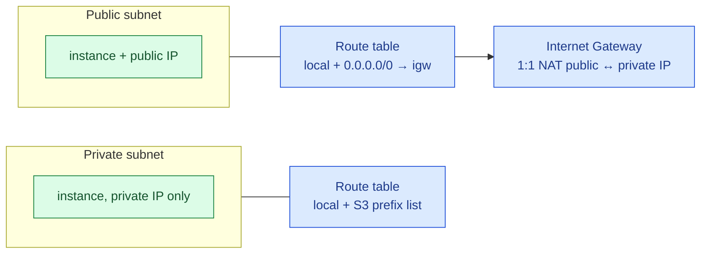
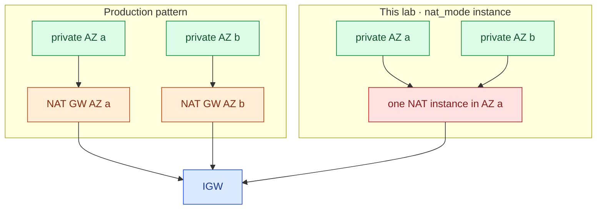
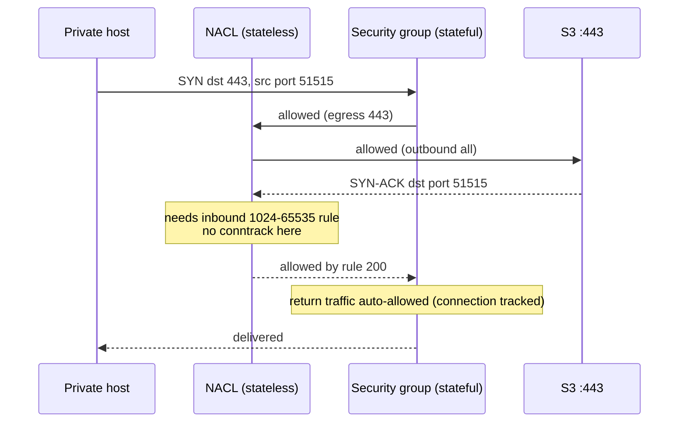
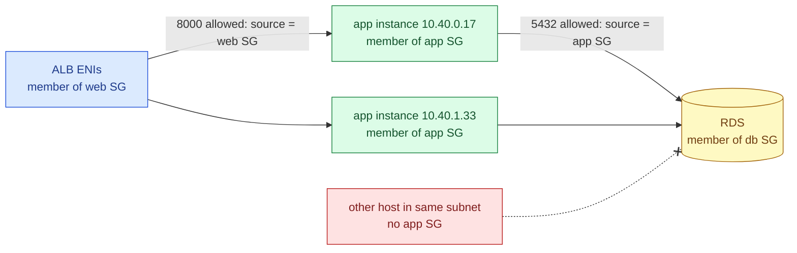
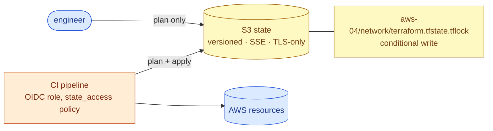
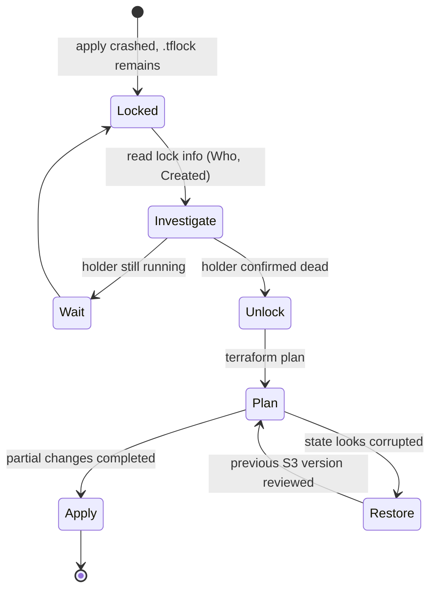
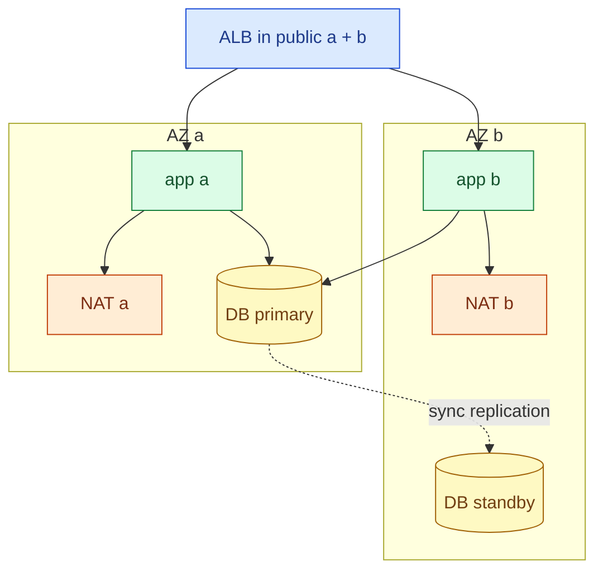

# AWS 04 — Interview preparation

Index of all questions: [interview index](../../../../docs/interview-preparation/README.md).

---

## Q1 (Beginner) — What makes a subnet public or private in AWS?

**Interview answer:** Its route table. A public subnet's route table sends `0.0.0.0/0` to an Internet
Gateway; a private subnet's does not. A public IP on an instance is necessary for direct internet
traffic but not sufficient — without the IGW route it goes nowhere — and an instance in a public subnet
with no public IP cannot be reached from the internet either.

**Walkthrough:** the IGW performs one-to-one translation between an instance's public and private
address; it only does so for subnets whose route table points at it.

**Depth:** the instance itself always routes to the VPC router (`.1` of its subnet); the route table
associated with the subnet decides what happens next. Every subnet must have exactly one route table
(explicit association or the VPC main table) — an unassociated subnet silently uses the main table,
which is a common accidental exposure.

**Follow-ups:** What is the main route table and why leave it without an IGW route? How does IPv6
change this (egress-only IGW)?

---

## Q2 (Intermediate) — NAT Gateway or NAT instance? How many?

**Interview answer:** In production, a managed NAT Gateway per AZ, with each AZ's private route table
pointing at its own AZ's gateway — that keeps an AZ failure contained and avoids cross-AZ data charges.
A NAT instance is cheaper and fully inspectable, but it is a single instance you must patch, size and
make highly available yourself. For private subnets that only need AWS services, gateway and interface
endpoints can remove the need for NAT altogether.

**Walkthrough:** in the lab pattern, losing AZ a removes egress for AZ b too, and AZ b's traffic crosses
AZs (billed per GB). The production pattern costs one NAT Gateway hour per AZ instead.

**Tradeoffs:** NAT Gateway: managed, scales to tens of Gbps, billed hourly and per GB processed. NAT
instance: free-tier hours, `source_dest_check = false`, your bandwidth limit is the instance type's.
Endpoints: S3/DynamoDB gateway endpoints are free; interface endpoints cost per hour per AZ.

**Follow-ups:** How do you find what is driving NAT data charges (VPC flow logs, Cost Explorer usage type
`NatGateway-Bytes`)? What breaks if you route S3 traffic through NAT instead of the endpoint?

---

## Q3 (Intermediate) — Security groups vs network ACLs

**Interview answer:** Security groups are stateful, allow-only, attached to network interfaces, and can
reference other security groups. NACLs are stateless, ordered allow/deny lists attached to subnets, so
return traffic must be explicitly allowed. I use security groups as the primary control and keep NACLs
coarse — for example, a subnet-wide deny for a known bad range — because stateless rules are easy to
get wrong.

**Walkthrough:** the reply arrives on the client's ephemeral port. The security group remembers the
connection; the NACL does not. Exercise 4 deletes rule 200 and shows the timeout.

**Follow-ups:** What ephemeral range do Linux clients use (`net.ipv4.ip_local_port_range`, 32768–60999)?
When is a NACL deny the right tool?

---

## Q4 (Intermediate) — Why does the database security group reference the app security group instead of a CIDR?

**Interview answer:** Because membership is the permission. Any interface carrying the app SG may reach
5432, whatever its IP — so Auto Scaling can replace instances, subnets can grow, and nothing in the
database rules changes. A CIDR rule would either be too wide (the whole subnet, including unrelated
hosts) or constantly out of date.

**Walkthrough:** the "other host" shares the subnet and could pass a CIDR rule, but not the SG
reference. AWS 05 uses exactly these three groups.

**Security concern:** SG references work across peered VPCs only in the same region; across accounts
they need the full `account/sg-id` form; and anyone who can attach the app SG to an instance inherits
its access — restrict `ec2:ModifyInstanceAttribute` / `ModifyNetworkInterfaceAttribute` by IAM.

**Follow-ups:** How would you audit which instances can reach the database?

---

## Q5 (Intermediate) — How do you share Terraform state safely between people and pipelines?

**Interview answer:** Remote state in a versioned, encrypted bucket with public access blocked and
least-privilege IAM, plus locking so only one run writes at a time — with S3 that is now the native lock
file, no DynamoDB table. One state per stack or component to limit blast radius, partial backend config
so the same code targets different environments, and changes applied from CI rather than laptops.

**Walkthrough:** the bootstrap stack outputs a policy scoped to the `aws-*` keys, ready for a CI role
(AWS 06). Engineers keep read access for plans.

**Depth:** state may contain secrets — another reason for encryption and tight IAM, and for write-only
arguments (AWS 05) that keep secrets out of state entirely.

**Follow-ups:** How do you bootstrap the state bucket itself? Workspaces or separate directories for
environments?

---

## Q6 (Scenario) — `terraform apply` failed halfway and now everyone gets "Error acquiring the state lock". What do you do?

**Interview answer:** First find out whether the holder is really gone: the lock records who and when;
check that machine or CI job. If it crashed, run `terraform force-unlock <id>`, then `terraform plan` to
see what was half-applied — Terraform records each resource as it is created, so the plan shows what
remains. Apply again from one place. If the state object itself looks wrong, compare with the previous
S3 version before touching anything.

**Walkthrough:** the dangerous transition is Investigate → Unlock while the holder is still writing;
two writers can produce a state that matches neither run.

**Follow-ups:** How would you prevent laptop applies entirely? What happens to resources created by
the crashed run that never reached state?

---

## Q7 (Advanced) — Design the network for a three-tier app that must survive an AZ failure

**Interview answer:** A VPC with non-overlapping CIDR sized for growth; for each of at least two AZs a
public subnet (load balancer, NAT), a private app subnet and a private data subnet, each with its own
route table; one NAT Gateway per AZ or endpoints instead; tiered security groups by reference;
the database Multi-AZ; and nothing in the private tiers with a public IP. Then I test it: kill an AZ's
instances, check that traffic and egress continue.

**Walkthrough:** every component is duplicated per AZ, and each AZ's dependencies stay in that AZ
(its NAT) except the database primary, which fails over to the standby.

**Tradeoffs:** this lab deliberately ships the cheaper variant (no NAT, or one NAT instance) and says
so; AWS 05 adds the load balancer and a single-AZ database (Multi-AZ is not free).

**Follow-ups:** How large should the VPC be if EKS pods get VPC IPs (AWS 07)? How would you connect 20
VPCs (Transit Gateway vs peering)?
