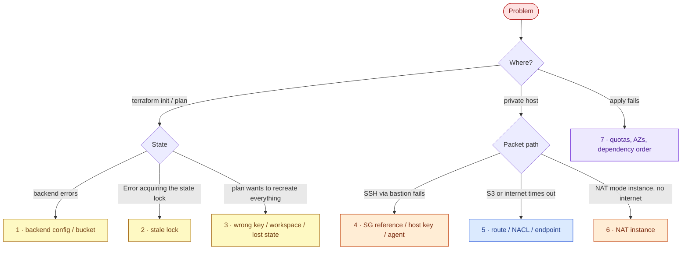

# AWS 04 — Troubleshooting playbook



## 1. `terraform init` fails: `Backend configuration changed`, `NoSuchBucket`, `AccessDenied`

**Symptoms:** init stops before any plan.

**Likely causes:** `backend.hcl` missing or stale (bootstrap destroyed and recreated); bucket in a
different region than `region` in `backend.hcl`; credentials for a different account; Terraform older
than 1.10 (`use_lockfile` unknown).

**Diagnose:**

```bash
cat terraform/network/backend.hcl
terraform -chdir=terraform/bootstrap output bucket
aws sts get-caller-identity --query Account
aws s3api get-bucket-location --bucket <bucket>
terraform version
```

**What the results mean:** an account ID mismatch between the bucket name and `get-caller-identity`
means the wrong profile; `Backend configuration changed` means the backend settings differ from
`.terraform/terraform.tfstate`'s cached copy.

**Resolve:** `../../../shared/scripts/tf-init-backend.sh terraform/network -reconfigure` (new backend, no state move) or
`../../../shared/scripts/tf-init-backend.sh terraform/network -migrate-state` (copy existing state to the new backend).

**Prevent:** generate `backend.hcl` from outputs (as the script does), never by hand.

## 2. `Error acquiring the state lock`

**Symptoms:** plan/apply refuses to run; message shows a lock ID, `Who`, `Created`.

**Likely causes:** another run is active (another terminal, CI); a previous run was killed
(Ctrl-C twice, laptop sleep) and left `terraform.tfstate.tflock` behind.

**Diagnose:**

```bash
aws s3api head-object --bucket <bucket> --key aws-04/network/terraform.tfstate.tflock
aws s3 cp s3://<bucket>/aws-04/network/terraform.tfstate.tflock - | jq
ps -ef | grep '[t]erraform'
```

**What the results mean:** the lock body names the holder and start time. A lock from hours ago with no
running process on that machine is stale.

**Resolve:** if — and only if — the holder is dead: `terraform -chdir=terraform/network force-unlock <ID>`.

**Prevent:** run applies from one place (CI in AWS 06); never kill Terraform mid-apply.

## 3. Plan wants to create everything again

**Symptoms:** `Plan: 49 to add` although the VPC exists.

**Likely causes:** initialised against a different backend/key (e.g. forgot `shared/scripts/tf-init-backend.sh`, so it
used an empty local state); a non-default workspace; state object deleted.

**Diagnose:**

```bash
terraform -chdir=terraform/network workspace show
cat terraform/network/.terraform/terraform.tfstate | jq '.backend.config | {bucket,key}'
aws s3api list-object-versions --bucket <bucket> --prefix aws-04/network/ --query 'Versions[].[Key,IsLatest,LastModified]'
```

**Resolve:** point at the right backend (`tf-init-backend.sh terraform/network -reconfigure`); restore the latest good state
version (exercise 8); as a last resort `terraform import` the existing resources.

**Prevent:** versioned bucket (enabled), one key per stack, never apply when the plan count surprises you.

## 4. SSH to the private host through the bastion fails

**Symptoms:** `ssh -J ubuntu@bastion ubuntu@10.40.11.x` times out or says `Permission denied`.

**Likely causes:** timeout → the private host SG does not reference the bastion SG, or the NACL lacks the
VPC rule; `Permission denied` → key not available for the second hop (the jump re-authenticates from
your laptop, so the key must be loaded or given with `-i`); the private host is still booting.

**Diagnose:**

```bash
ssh -v -J ubuntu@<bastion> ubuntu@<private-ip> true 2>&1 | grep -E 'Authenticating|Offering|denied|timed out'
aws ec2 describe-security-group-rules --filters Name=group-id,Values=<private-host-sg> --query 'SecurityGroupRules[?!IsEgress]'
aws ec2 get-console-output --instance-id <private-instance> --latest --output text | tail -n 20
```

**Resolve:** `terraform apply` to restore SG/NACL rules; `ssh-add` your key or set `LAB_SSH_KEY`.

**Prevent:** use `-J` (keys stay on your laptop) instead of copying keys to the bastion or agent forwarding.

## 5. Private host: S3 or internet requests time out

**Symptoms:** `curl https://s3.<region>.amazonaws.com` hangs from the private host.

**Likely causes:** S3 endpoint route missing from that subnet's route table; NACL ephemeral rule deleted
(exercise 4); requesting S3 in **another region** (gateway endpoints are same-region only); expecting
internet with `nat_mode = none`.

**Diagnose:**

```bash
hop 'ip route get 52.216.0.1'                    # still the VPC router; routing happens in the route table
aws ec2 describe-route-tables --route-table-ids <private-rt> --query 'RouteTables[0].Routes'
aws ec2 describe-network-acls --network-acl-ids <nacl> --query 'NetworkAcls[0].Entries[?!Egress]'
aws ec2 describe-vpc-endpoints --vpc-endpoint-ids <vpce> --query 'VpcEndpoints[0].RouteTableIds'
```

**Resolve:** `terraform apply` (restores routes and rules); use the region's own S3 endpoint.

**Prevent:** `verify.sh` after every network change; keep NACLs simple and documented.

## 6. `nat_mode = instance` but the private host still has no internet

**Symptoms:** egress check fails right after switching modes.

**Likely causes:** the NAT instance is still installing `nftables` (cloud-init takes a minute or two);
source/destination check enabled; masquerade rule not loaded; NAT SG missing the private CIDRs.

**Diagnose:**

```bash
aws ec2 describe-instances --filters Name=tag:Name,Values=lab04-net-nat-instance \
  --query 'Reservations[0].Instances[0].[State.Name,SourceDestCheck,PublicIpAddress]'
aws ec2 get-console-output --instance-id <nat-id> --latest --output text | grep -iE 'cloud-init|nft|error' | tail
```

**What the results mean:** `SourceDestCheck: true` → EC2 drops forwarded packets; cloud-init errors →
the masquerade service never started.

**Resolve:** wait for cloud-init; `terraform apply -replace='module.vpc.aws_instance.nat[0]'`.

**Prevent:** for anything beyond a lab, use NAT Gateways per AZ ([ADR-0002](adr/0002-nat-strategy.md)).

## 7. `apply` fails on AZs, quotas or ordering

**Symptoms:** `InvalidParameterValue: ... availability zone`, `VpcLimitExceeded`,
`AddressLimitExceeded`, `DependencyViolation` on destroy.

**Likely causes:** `az_count = 3` in a region/account with only two usable AZs; 5-VPC or 5-EIP default
quotas reached by earlier labs; destroying the bucket stack before the network stack, or ENIs still
attached (an instance terminating) during subnet deletion.

**Diagnose:**

```bash
aws ec2 describe-availability-zones --query 'AvailabilityZones[?OptInStatus==`opt-in-not-required`].ZoneName'
aws ec2 describe-vpcs --query 'length(Vpcs)'; aws ec2 describe-addresses --query 'length(Addresses)'
aws ec2 describe-network-interfaces --filters Name=vpc-id,Values=<vpc> --query 'NetworkInterfaces[].[NetworkInterfaceId,Status,Description]'
```

**Resolve:** lower `az_count`; destroy unused lab VPCs; re-run destroy after ENIs detach (a minute).

**Prevent:** `scripts/destroy.sh` enforces network-then-bucket order; run the cleanup finder after each lab.
