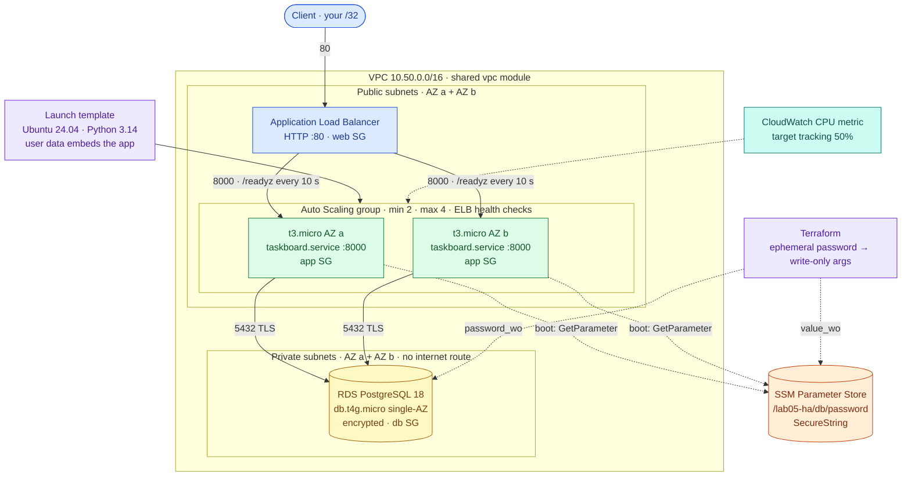
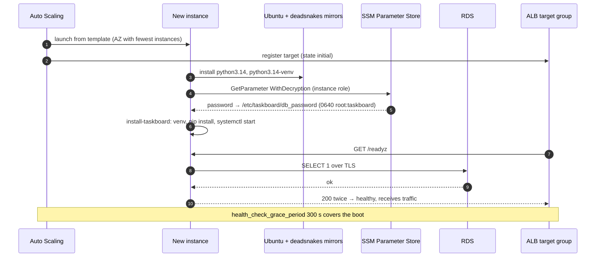
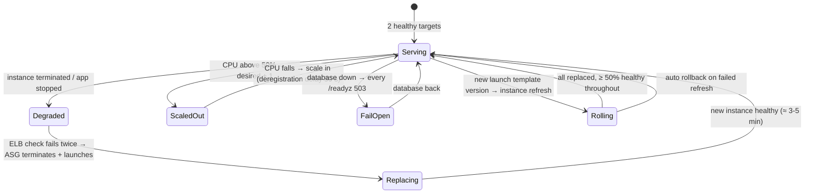

# AWS 05 — Highly Available Server Application

| | |
|---|---|
| **Project ID** | `aws-05` |
| **Cloud** | AWS (ALB, EC2 Auto Scaling, launch templates, RDS for PostgreSQL, SSM Parameter Store, IAM, VPC) |
| **Difficulty** | Intermediate |
| **Build time** | 4–5 h first attempt (including [exercises](docs/exercises.md)) |
| **Rebuild time** | 20–25 min (RDS creation takes 5–10 min) |
| **Free tier** | Partial: ALB, 2 × t3.micro and db.t4g.micro are free-tier eligible on legacy accounts but use hours fast — see [cost](docs/cost.md) |
| **Depends on** | [AWS 04](../04-terraform-networking-foundations/) (state bucket, VPC module), [AWS 01](../01-linux-server-engineering/) (systemd service) |
| **Status** | Implemented · static checks passed · deployment **not tested** ([tracker](../../../docs/progress/implementation-tracker.md)) |

## The problem this lab solves

Every lab so far ran on one instance. Patching it, a crash, an AZ problem or a bad release meant an
outage — AWS 02's health-gated rollout still had seconds of downtime. Real services need to lose
instances without users noticing, and to grow when load grows.

This lab runs the Taskboard API on an Auto Scaling group spread over two AZs behind an Application Load
Balancer, with state moved off the instances into RDS PostgreSQL. Instances are **immutable**: they boot
entirely from a launch template (Python 3.14, the shared systemd service, the DB password fetched from
SSM at boot) and are replaced — never repaired. You then terminate instances, break the app, burn CPU,
reboot the database and roll out a new version while a probe measures what users would see.

**Skills learned:** high availability vs fault tolerance · ALB listeners, target groups, health
checks, fail-open · Auto Scaling groups, launch templates, ELB health checks, target tracking, instance
refresh · stateless app tiers · RDS in private subnets · secrets with Terraform write-only arguments and
SSM Parameter Store · IAM instance roles scoped to one parameter · Session Manager instead of SSH.

**Expected outcome:** `scripts/verify.sh` passes — two healthy targets in two AZs, requests served by
different instances, the same data from every instance, no direct access to instances or the database,
and no password in Terraform state. `scripts/probe.sh` shows ≥ 99% success while an instance is
terminated and during a rolling deploy.

## Architecture



| Component | Why it is there | Defined in |
|---|---|---|
| VPC (2 AZs, no NAT) | Same module as AWS 04; web/app/db security groups reused as-is | [main.tf](terraform/main.tf), [shared vpc module](../../../shared/terraform-modules/aws/vpc/main.tf) |
| ALB + listener + target group | Single entry point; routes only to targets whose `/readyz` passes | [alb.tf](terraform/alb.tf) |
| Launch template | The complete, immutable definition of an app instance | [asg.tf](terraform/asg.tf), [user-data.yaml.tftpl](terraform/user-data.yaml.tftpl) |
| Auto Scaling group | Keeps ≥ 2 instances across AZs, replaces unhealthy ones, scales on CPU, rolls new versions | [asg.tf](terraform/asg.tf) |
| RDS PostgreSQL | Shared state, so instances are disposable; private subnets, db SG only | [rds.tf](terraform/rds.tf) |
| Ephemeral password + SSM parameter | Password generated at apply time, written to RDS and SSM via write-only arguments, never stored in state | [secrets.tf](terraform/secrets.tf) |
| Instance role | SSM Session Manager + read of exactly one parameter | [iam.tf](terraform/iam.tf) |
| Shared systemd service | Same hardened unit as AWS 01, configured by `/etc/taskboard/taskboard.env` | [shared/linux-service](../../../shared/linux-service/) |

### Instance boot and registration



### What happens when things fail



## Concepts used

| Concept | Where in this lab | Guide |
|---|---|---|
| Load balancers, ASGs, scaling, instance refresh | ALB + ASG | [load-balancing-and-autoscaling](../../../docs/concepts/load-balancing-and-autoscaling.md) |
| Liveness vs readiness | Target group checks `/readyz` | [health-checks](../../../docs/concepts/health-checks.md) |
| Tiered SGs, private subnets, endpoints | Shared vpc module | [aws-vpc-design](../../../docs/concepts/aws-vpc-design.md) |
| Remote state; write-only secrets | S3 backend, `password_wo` | [terraform-state-and-locking](../../../docs/concepts/terraform-state-and-locking.md) |
| systemd service, sandboxing | `taskboard.service` | [linux-systemd](../../../docs/concepts/linux-systemd.md) |
| EC2 launch, IMDSv2, credits | Launch template | [aws-ec2-fundamentals](../../../docs/concepts/aws-ec2-fundamentals.md) |

Architecture decisions: [ADR-0001 public app subnets without NAT](docs/adr/0001-public-app-subnets-without-nat.md) ·
[ADR-0002 single-AZ RDS](docs/adr/0002-single-az-rds-free-tier.md) ·
[ADR-0003 write-only secrets via SSM](docs/adr/0003-write-only-secrets-ssm.md).

## Deploy

### 1. Preflight

```bash
cd projects/aws/05-highly-available-server-app
../../../shared/scripts/aws-preflight.sh
terraform version                                        # 1.11 or newer (write-only arguments)
terraform -chdir=../04-terraform-networking-foundations/terraform/bootstrap output bucket   # AWS 04 bootstrap must exist
```

If the state bucket does not exist yet, run only AWS 04's [bootstrap step](../04-terraform-networking-foundations/README.md#2-bootstrap-the-state-bucket).

### 2. Configure and initialise

```bash
cp terraform/terraform.tfvars.example terraform/terraform.tfvars        # set allowed_http_cidrs
../../../shared/scripts/tf-init-backend.sh terraform
```

| Variable | Default | Notes |
|---|---|---|
| `allowed_http_cidrs` | — (required) | Who may reach the ALB |
| `app_version` | `v1` | Change it to roll out a new version |
| `asg_min` / `asg_max` | 2 / 4 | `asg_min` < 2 is rejected |
| `cpu_target_percent` | 50 | Target tracking |
| `db_engine_version` | `18` | Use `17` if your region does not offer 18 yet |
| `db_password_version` | 1 | Increment to rotate the password |

### 3. Apply

```bash
terraform -chdir=terraform plan -out=lab05.tfplan        # 44 resources; RDS takes 5-10 minutes
terraform -chdir=terraform apply lab05.tfplan
```

### 4. Verify

```bash
scripts/verify.sh
scripts/probe.sh 60          # 120 requests in 60 s; prints which instances answered
```

| Check | Expected |
|---|---|
| Target health | ≥ 2 healthy |
| In-service instances | 2 AZs; ASG health check type `ELB` |
| 20 requests to `/api/info` | ≥ 2 different hostnames |
| `/readyz` | `"backend":"postgresql"` |
| Task written once, read 6 times | visible every time (state in RDS) |
| `http://<instance-ip>:8000` | not reachable |
| RDS | not public, encrypted, single-AZ |
| Terraform state | contains no password value |

### 5. Exercises and failure drills

[docs/exercises.md](docs/exercises.md): health checks, fail-open, instance failure, ELB-driven
replacement, scale-out, rolling deploy with instance refresh, password rotation, and why state must
leave the instances. Drills: `scripts/failure-drill.sh list`.

### 6. Clean up

```bash
terraform -chdir=terraform destroy           # RDS deletion takes several minutes
../../../shared/scripts/aws-find-lab-resources.sh
```

The AWS 04 state bucket is kept; destroy it with AWS 04's `scripts/destroy.sh` when you are done with all labs.

**Production step not included:** HTTPS needs a domain and an ACM certificate on an HTTPS listener (plus
an HTTP → HTTPS redirect). The listener here is HTTP only, restricted to your IP.

## Troubleshooting, cost and interview material

- [Troubleshooting playbook](docs/troubleshooting.md) — 7 incidents
- [Cost estimate](docs/cost.md)
- [Interview preparation](docs/interview.md) — 7 questions

## Repeat practice

| Attempt | Goal | Guidance |
|---|---|---|
| 1 | Guided build | Follow this README and the exercises |
| 2 | Reduced guidance | Run every drill with `probe.sh` and predict the failed-request count before each one |
| 3 | Rebuild from objectives | Write `alb.tf` and `asg.tf` yourself from the component table; pass `verify.sh` |
| 4 | Failure drills | Someone else runs a drill without telling you which; identify it from probe output, target health and scaling activities |
| 5 | Defend the design | Answer the [interview questions](docs/interview.md); argue for private app subnets with NAT per AZ and Multi-AZ RDS against the ADRs, with costs |

### Self-assessment

- [ ] I can explain why the target group checks `/readyz` and what fail-open means.
- [ ] I can explain the difference between ASG health check types `EC2` and `ELB`.
- [ ] I measured the failed requests when one instance was terminated and can explain where they came from.
- [ ] I rolled out a new `app_version` with zero failed requests and can explain why.
- [ ] I can explain how the DB password reaches the instance without ever being in Terraform state.
- [ ] I can list what would have to change for this to survive an AZ outage completely (RDS Multi-AZ).

**Done when:** `verify.sh` passes, every drill ran with `probe.sh` and its result is recorded, a rolling
deploy completed with ≥ 99% success, the self-assessment is complete, and cleanup shows only the AWS 04
state bucket.

## References

- [Elastic Load Balancing — ALB](https://docs.aws.amazon.com/elasticloadbalancing/latest/application/)
- [EC2 Auto Scaling](https://docs.aws.amazon.com/autoscaling/ec2/userguide/)
- [Amazon RDS for PostgreSQL](https://docs.aws.amazon.com/AmazonRDS/latest/UserGuide/CHAP_PostgreSQL.html)
- [Terraform write-only arguments](https://developer.hashicorp.com/terraform/language/manage-sensitive-data/write-only)
- [AWS Well-Architected reliability pillar](https://docs.aws.amazon.com/wellarchitected/latest/reliability-pillar/welcome.html)
