# AWS 05 — Hands-on exercises

Run from `projects/aws/05-highly-available-server-app`. Keep a second terminal with
`scripts/probe.sh 600` running during exercises 3–7 and note the failed-request count for each.

```bash
TF=terraform
ASG=$(terraform -chdir=$TF output -raw asg_name)
TG=$(terraform -chdir=$TF output -raw target_group_arn)
health() { aws elbv2 describe-target-health --target-group-arn $TG --query 'TargetHealthDescriptions[].[Target.Id,TargetHealth.State,TargetHealth.Reason]' --output table; }
activity() { aws autoscaling describe-scaling-activities --auto-scaling-group-name $ASG --max-items 4 --query 'Activities[].[StartTime,StatusCode,Description]' --output table; }
```



```mermaid
flowchart LR
    e1[1 Health checks]:::obs --> e2[2 Statelessness]:::data --> e3[3 Instance failure]:::risk --> e4[4 App failure]:::risk
    e4 --> e5[5 Scale out]:::k8s --> e6[6 Rolling deploy]:::app --> e7[7 DB outage / fail open]:::risk --> e8[8 Secret rotation]:::sec
    classDef obs fill:#ccfbf1,stroke:#0f766e,color:#134e4a
    classDef data fill:#fef9c3,stroke:#a16207,color:#713f12
    classDef risk fill:#fee2e2,stroke:#b91c1c,color:#7f1d1d
    classDef k8s fill:#ede9fe,stroke:#6d28d9,color:#4c1d95
    classDef app fill:#dcfce7,stroke:#15803d,color:#14532d
    classDef sec fill:#ffedd5,stroke:#c2410c,color:#7c2d12
```

## 1. Health checks and target states

```bash
health
aws elbv2 describe-target-groups --target-group-arns $TG --query 'TargetGroups[0].{path:HealthCheckPath,interval:HealthCheckIntervalSeconds,healthy:HealthyThresholdCount,unhealthy:UnhealthyThresholdCount}'
ID=$(aws autoscaling describe-auto-scaling-groups --auto-scaling-group-names $ASG --query 'AutoScalingGroups[0].Instances[0].InstanceId' --output text)
aws ssm start-session --target $ID       # then: journalctl -u taskboard -n 5 -o cat | jq -c .
```

**Expected:** every target `healthy`. Calculate the fastest time to mark a target unhealthy (2 × 10 s)
and healthy again (2 × 10 s). Explain why there is no SSH: the app SG allows only port 8000 from the web
SG, and Session Manager needs no inbound port.

## 2. Why state must leave the instance

```bash
for i in $(seq 1 6); do curl -s http://$(terraform -chdir=$TF output -raw alb_dns_name)/api/info | jq -r .hostname; done
curl -s -X POST http://$(terraform -chdir=$TF output -raw alb_dns_name)/api/tasks -H 'content-type: application/json' -d '{"title":"shared"}'
```

**Expected:** hostnames alternate; the task appears on every instance. Thought experiment: with AWS 02's
SQLite-on-a-volume design, what would users see behind this load balancer? (Each instance its own
data; scale-in deletes some of it.)

## 3. Instance failure

```bash
scripts/failure-drill.sh terminate
watch -n 5 "aws autoscaling describe-auto-scaling-groups --auto-scaling-group-names $ASG --query 'AutoScalingGroups[0].Instances[].[InstanceId,AvailabilityZone,LifecycleState,HealthStatus]' --output text"
activity
```

**Expected:** the probe shows 0 to a handful of failures; the ASG launches a replacement within a minute
and it turns healthy 3–5 minutes later. Explain where the few failures come from (requests in flight on
the terminated instance before the ALB notices) and what would reduce them (lifecycle hooks, connection
draining before termination).

## 4. App failure → replacement driven by the load balancer

```bash
scripts/failure-drill.sh stop-app
watch -n 5 health
activity
```

**Expected:** the target becomes `unhealthy` (`Target.ResponseCodeMismatch` or `Target.FailedHealthChecks`)
in about 20 s and stops receiving traffic; because the ASG uses `ELB` health checks, it then terminates
and replaces the instance. Answer: with `health_check_type = "EC2"`, what would happen? (The instance
would stay, unhealthy and useless, until someone noticed.)

## 5. Scale out on CPU

```bash
scripts/failure-drill.sh cpu
aws cloudwatch describe-alarms --alarm-name-prefix TargetTracking-$ASG --query 'MetricAlarms[].[AlarmName,StateValue]' --output table
activity
```

**Expected:** after 3–5 minutes of CPU above 50%, the AlarmHigh alarm fires and desired capacity
increases (up to `asg_max = 4`); after the burn stops, scale-in follows more slowly (by design). With
`cpu_credits = standard`, sustained load also drains credits — check `CPUCreditBalance`.

## 6. Rolling deploy with instance refresh

```bash
terraform -chdir=$TF apply -var app_version=v2      # new launch template version → instance refresh
aws autoscaling describe-instance-refreshes --auto-scaling-group-name $ASG --query 'InstanceRefreshes[0].[Status,PercentageComplete,StatusReason]'
```

**Expected:** `/api/info` gradually returns `v2`; the probe shows zero (or near-zero) failures; at no
point are fewer than 50% of instances healthy. Compare with AWS 02's single-host rollout. Then deploy a
broken version (temporarily make `/readyz` return 503 in `shared/sample-apps/taskboard/api/app/main.py`,
apply `-var app_version=broken`) and watch `auto_rollback` restore the previous version. Revert the code.

## 7. Database outage and fail-open

```bash
scripts/failure-drill.sh db-reboot
watch -n 5 health
curl -s -w ' %{http_code}\n' http://$(terraform -chdir=$TF output -raw alb_dns_name)/readyz
```

**Expected:** every target turns unhealthy, yet the ALB keeps routing to all of them (fail open):
`/readyz` returns 503 and writes fail, rather than the ALB returning its own 503 with no targets. After
1–3 minutes everything recovers. Two questions: should the ASG replace instances during a DB outage? (It
may start to after the grace period — discuss why replacing healthy instances for a dependency failure
is harmful.) What would Multi-AZ RDS change? (Failover in ~1–2 minutes instead of an outage during
maintenance or AZ loss.)

## 8. Rotate the database password

```bash
terraform -chdir=$TF apply -var db_password_version=2
terraform -chdir=$TF show -json | jq '[.. | objects | select(has("password_wo"))] | .[0] | {password, password_wo, password_wo_version}'
scripts/failure-drill.sh refresh                     # instances must re-read the new password
```

**Expected:** state shows `password: null`, `password_wo: null`, `password_wo_version: 2` — the secret
itself never appears. Running instances keep using the old password until replaced, so existing DB
connections continue but new ones fail until the refresh completes: note the probe failures and design
a zero-downtime rotation (two users or dual passwords, then switch).
