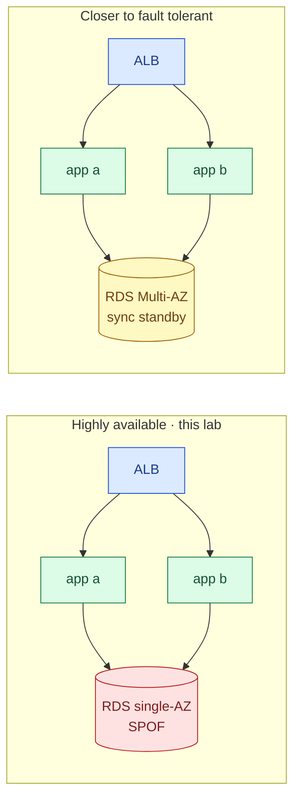
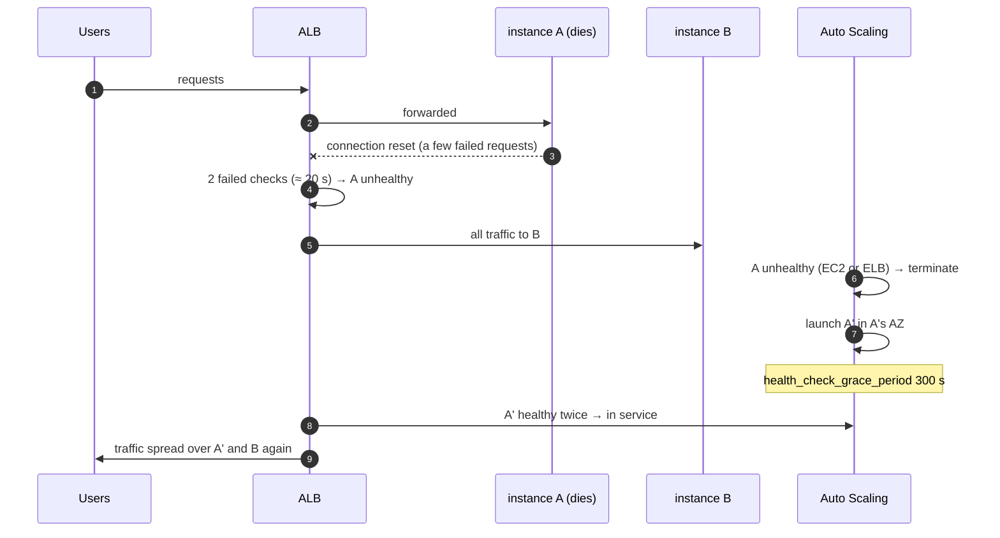
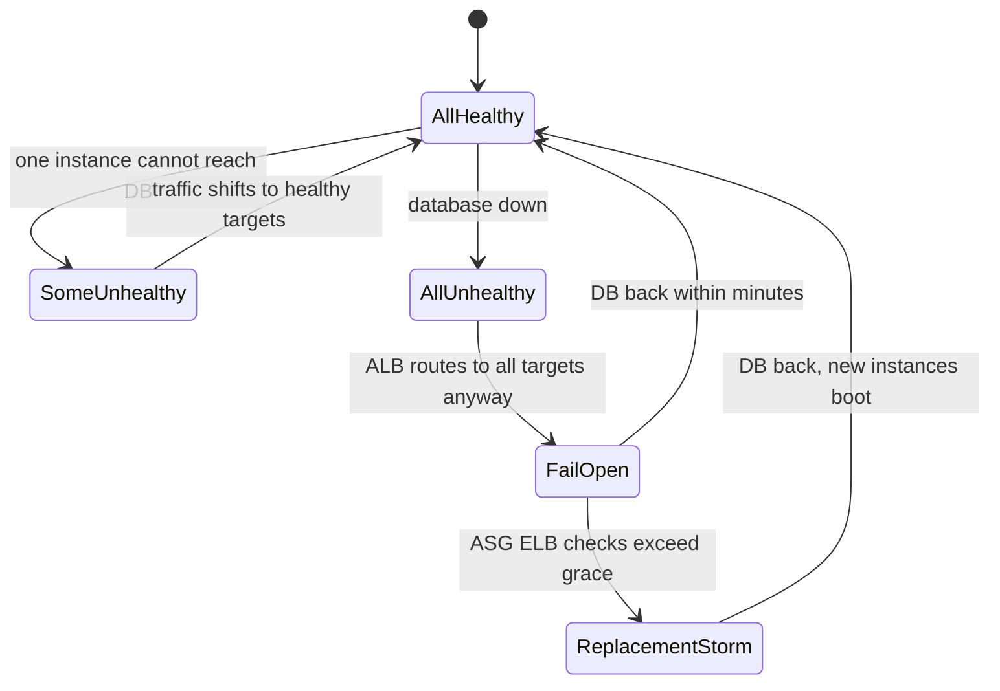
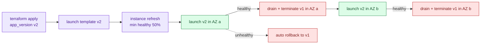
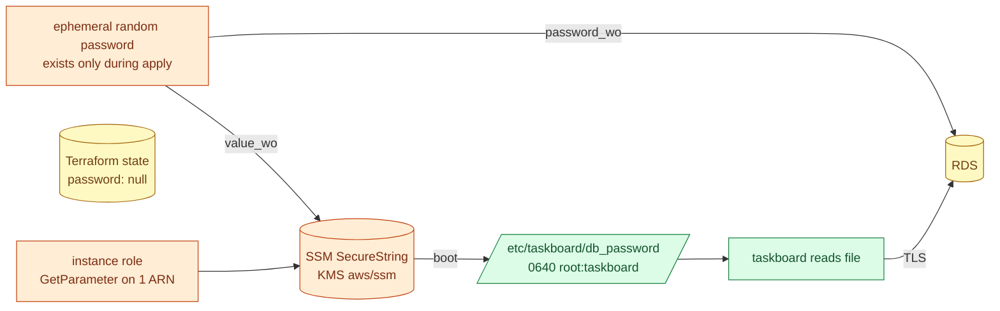
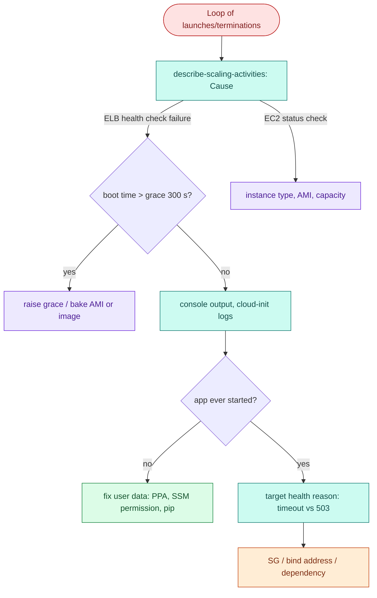
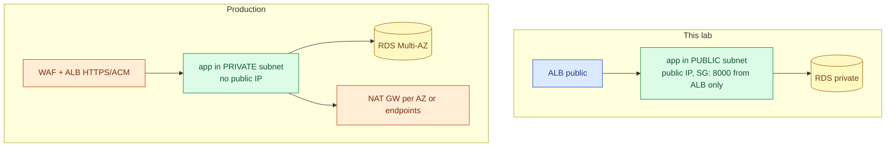

# AWS 05 — Interview preparation

Index of all questions: [interview index](../../../../docs/interview-preparation/README.md).

---

## Q1 (Beginner) — What is the difference between high availability and fault tolerance?

**Interview answer:** High availability means the service keeps working with a short, acceptable
disruption when a component fails — redundant components and fast, automatic recovery. Fault tolerance
means no disruption at all: every component has a live duplicate and failover is invisible. This lab is
highly available: losing an instance costs a handful of failed requests and a few minutes of reduced
capacity; it is not fault tolerant because the single-AZ database is still a single point of failure.

**Walkthrough:** the left design survives instance and AZ loss for the app tier, not for the database.
The right one survives a database AZ failure with a 1–2 minute failover — still not zero, which is why
true fault tolerance is rare and expensive.

**Depth:** availability is measured, not declared: 99.9% allows ~43 minutes of downtime per month. Each
redundant tier multiplies cost; you buy redundancy where the SLO needs it.

**Follow-ups:** What is the availability of two independent 99% instances behind a perfect load
balancer? What is a single point of failure in your current system?

---

## Q2 (Intermediate) — Walk through what happens when an instance in the Auto Scaling group dies.

**Interview answer:** The ALB's health checks fail on that target and it stops routing to it after the
unhealthy threshold; in-flight requests to it may fail. The ASG learns the instance is unhealthy — from
EC2 status for a dead instance, or from the ALB because the health check type is `ELB` — terminates it,
and launches a replacement from the launch template in the AZ that now has fewer instances. The new
instance boots, passes the health check twice, and receives traffic again.

**Walkthrough:** the probe in exercise 3 measures exactly steps 3–5: the only user-visible errors are
in-flight requests before the ALB marks the target unhealthy.

**Depth:** to remove even those, terminate gracefully: lifecycle hooks or instance refresh deregister
the target first and let the 30 s deregistration delay drain connections.

**Follow-ups:** Why is the remaining instance at risk during those minutes (capacity, CPU credits)?
How would you size `min` for N+1?

---

## Q3 (Advanced) — The database goes down. Your load balancer health check is `/readyz`. What happens, and is that what you want?

**Interview answer:** Every target's `/readyz` fails, so all targets become unhealthy — and the ALB then
fails open: with no healthy targets it routes to all of them anyway. Users get the app's 503 instead of
the ALB's. That is the right behaviour: removing every instance would not help, and the frontend or
cached reads might still work. The dangerous part is the ASG: with `ELB` health checks it may start
replacing perfectly healthy instances because of a dependency failure, adding churn during recovery.

**Walkthrough:** readiness checks are great at isolating one bad instance (top branch) and harmful when
the problem is shared (bottom branch).

**Tradeoffs and mitigations:** keep the LB check on readiness but make the ASG less trigger-happy
(longer grace, or `EC2` health checks plus an alarm); or split checks — the ASG uses liveness via a
custom health check, the LB uses readiness. Kubernetes separates these as liveness vs readiness probes.

**Follow-ups:** How do you design a dependency-aware readiness check? What about partial dependencies
(cache down, DB up)?

---

## Q4 (Intermediate) — How do you deploy a new version to an Auto Scaling group without downtime?

**Interview answer:** Make instances immutable: a new version is a new launch template version. Then
replace instances gradually — an instance refresh with a minimum healthy percentage — so new instances
pass health checks before old ones are terminated and drained. If new instances fail, roll back
automatically to the previous template version. Blue/green with two target groups is the alternative
when you need instant rollback.

**Walkthrough:** capacity never drops below half because each wave waits for health checks; draining
(30 s deregistration delay) lets in-flight requests finish.

**Depth:** this lab boots from source at launch, so a rollout takes minutes per wave; building an AMI or
container image in CI (AWS 06) makes waves faster and guarantees every instance runs the same artefact.
Schema changes must be backward compatible because v1 and v2 run side by side.

**Follow-ups:** Rolling vs blue/green vs canary — when each? How do you roll back a database migration?

---

## Q5 (Advanced) — How does the database password get to the instances, and where can it leak?

**Interview answer:** Terraform generates it with an ephemeral resource and passes it only to
write-only arguments — `password_wo` on RDS and `value_wo` on an SSM SecureString parameter — so it is
never stored in the plan or state. Each instance's role may read exactly that one parameter; at boot it
fetches it into a root-owned file readable by the service group, and the app reads it through
`DATABASE_PASSWORD_FILE`, never via environment variables. Leak points that remain: the instance disk
and memory, anyone with `ssm:GetParameter` on it, and the RDS master user being shared by every
instance.

**Walkthrough:** `verify.sh` proves the state part by searching the state for password values.

**Improvements:** a non-master application user with least privilege; Secrets Manager rotation or RDS
IAM authentication (short-lived tokens, no static password); `sslmode=verify-full` with the RDS CA
bundle to authenticate the server.

**Follow-ups:** How do you rotate without downtime? What do write-only arguments not protect against?

---

## Q6 (Scenario) — Instances keep being replaced every few minutes and the service never stabilises. How do you debug it?

**Interview answer:** That is a replacement loop: instances are judged unhealthy before they finish
booting, or they never become healthy. I check scaling activities for the cause, compare boot time
with the health-check grace period, read the console output or cloud-init logs of a dying instance, and
suspend `ReplaceUnhealthy` so I can inspect one instance live. Then fix the user data or raise the grace
period, and resume processes.

**Commands:** `aws autoscaling suspend-processes --scaling-processes ReplaceUnhealthy`,
`aws ec2 get-console-output --latest`, `cloud-init status --long`, `aws elbv2 describe-target-health`.

**Follow-ups:** How do you prevent this class of bug before rollout (test the launch template in CI,
canary instance)?

---

## Q7 (Advanced) — This design keeps app instances in public subnets. Defend it, then describe the production version.

**Interview answer:** It is a cost decision with compensating controls: instances need outbound access
for packages, and a NAT Gateway per AZ is never free. Inbound is limited to port 8000 from the load
balancer's security group, there is no SSH (Session Manager instead), IMDSv2 is enforced, and the
database is in private subnets with no internet route. In production I would put instances in private
subnets with a NAT Gateway per AZ or VPC endpoints, boot from a pre-built image so they need little or
no outbound access, add HTTPS with ACM and WAF on the ALB, and make the database Multi-AZ.

**Tradeoffs:** a public IP is an attack surface even with a tight SG (one misconfigured rule exposes the
instance) and costs $0.005/h each; NAT Gateways cost ~$33/month each before data. The ADR records the
choice and when to revisit it.

**Follow-ups:** What would you monitor to detect an SG misconfiguration (AWS Config rules)? How do
endpoints reduce NAT cost?
