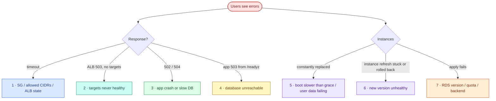

# AWS 05 — Troubleshooting playbook

Start from what the load balancer says; it tells you which layer is failing.



## 1. Requests to the ALB time out

**Symptoms:** `curl http://<alb-dns>/` hangs.

**Likely causes:** your IP changed and is no longer in `allowed_http_cidrs` (web SG); the ALB is still
`provisioning`; DNS not propagated yet.

**Diagnose:**

```bash
curl -s https://checkip.amazonaws.com
aws elbv2 describe-load-balancers --names lab05-ha-alb --query 'LoadBalancers[0].[State.Code,DNSName]'
aws ec2 describe-security-group-rules --filters Name=group-id,Values=<web-sg> --query 'SecurityGroupRules[?!IsEgress].[FromPort,CidrIpv4]'
dig +short <alb-dns>
```

**Resolve:** update `allowed_http_cidrs` and apply; wait for `active`.

**Prevent:** keep the web SG as the single place that defines who may reach the service.

## 2. ALB returns `503 Service Temporarily Unavailable` and no targets are healthy

**Symptoms:** the ALB's own 503 page; target health `unhealthy` or `initial`.

**Likely causes:** instances still booting (Python 3.14 install, pip); `taskboard` not starting; app SG
does not allow 8000 from the web SG; the app listens on loopback because the env file was not written.

**Diagnose:**

```bash
aws elbv2 describe-target-health --target-group-arn <tg> --query 'TargetHealthDescriptions[].[Target.Id,TargetHealth.State,TargetHealth.Reason,TargetHealth.Description]' --output table
aws ec2 get-console-output --instance-id <id> --latest --output text | grep -E 'cloud-init|taskboard|Error' | tail
aws ssm start-session --target <id>
#   cloud-init status --long; systemctl status taskboard; cat /etc/taskboard/taskboard.env; sudo ss -tlnp | grep 8000
```

**What the results mean:** `Target.Timeout` → nothing answers on 8000 from the ALB (SG or loopback
bind); `Target.ResponseCodeMismatch` → the app answers but `/readyz` is 503 (see #4);
`Elb.InitialHealthChecking` → still booting.

**Resolve:** fix the cause and let the ASG replace instances (or `failure-drill.sh refresh`).

**Prevent:** test user data offline (`scripts/validate.sh cloudinit`); keep the grace period above the
measured boot time.

## 3. `502 Bad Gateway` or `504 Gateway Timeout`

**Symptoms:** intermittent 502/504 while targets are healthy.

**Likely causes:** 502 → the app closed the connection (crash, restart, or idle keep-alive shorter than
the ALB's); 504 → the app did not answer within the ALB idle timeout (30 s), usually a slow database or
CPU throttling (credits exhausted).

**Diagnose:**

```bash
aws cloudwatch get-metric-statistics --namespace AWS/ApplicationELB --metric-name HTTPCode_ELB_502_Count \
  --dimensions Name=LoadBalancer,Value=<app/lab05-ha-alb/xxxx> --start-time $(date -u -d -30min +%FT%TZ) --end-time $(date -u +%FT%TZ) --period 60 --statistics Sum
aws cloudwatch get-metric-statistics --namespace AWS/EC2 --metric-name CPUCreditBalance --dimensions Name=AutoScalingGroupName,Value=<asg> \
  --start-time $(date -u -d -3h +%FT%TZ) --end-time $(date -u +%FT%TZ) --period 300 --statistics Minimum
# on an instance: journalctl -u taskboard --since -15min | grep -iE 'error|exception'
```

**Resolve:** fix the slow path; restore credits (scale out, or a larger type with evidence).

**Prevent:** latency alerts and access logs (AWS 11); uvicorn keep-alive above the ALB idle timeout for
long-lived connections.

## 4. `/readyz` returns 503 on every instance

**Symptoms:** app-generated 503 `{"status":"not-ready"}`; targets unhealthy; ALB fails open.

**Likely causes:** RDS rebooting, stopped, or in maintenance; db SG missing the app SG rule; password file
empty or wrong (rotation without instance refresh); TLS required but disabled in the URL.

**Diagnose:**

```bash
aws rds describe-db-instances --db-instance-identifier lab05-ha-db --query 'DBInstances[0].[DBInstanceStatus,Endpoint.Address]'
aws rds describe-events --source-type db-instance --source-identifier lab05-ha-db --duration 60
# on an instance:
sudo -u taskboard test -s /etc/taskboard/db_password && echo password-file-ok
journalctl -u taskboard -n 20 -o cat | jq -r 'select(.msg=="readiness failed") | .error'
```

**What the results mean:** `OperationalError ... password authentication failed` → stale password
(rotate + refresh); `timeout` → SG/routing; `connection refused` → DB rebooting.

**Resolve:** wait for `available`; `failure-drill.sh refresh` after a rotation; restore SG rules with
`terraform apply`.

**Prevent:** Multi-AZ for maintenance and failover; zero-downtime rotation design (exercise 8).

## 5. Instances are terminated and replaced in a loop

**Symptoms:** scaling activities show "an instance was taken out of service in response to an ELB
system health check failure" again and again.

**Likely causes:** boot takes longer than `health_check_grace_period` (300 s) — e.g. slow mirrors; user
data fails (PPA unreachable, SSM parameter not readable), so the app never starts.

**Diagnose:**

```bash
aws autoscaling describe-scaling-activities --auto-scaling-group-name <asg> --max-items 10 --query 'Activities[].[StartTime,Cause]' --output text
aws ec2 get-console-output --instance-id <id> --latest --output text | grep -E 'Cloud-init.*finished|ERROR|Failed' | tail
```

**Resolve:** fix the user data; temporarily raise the grace period; suspend replacement while debugging:
`aws autoscaling suspend-processes --auto-scaling-group-name <asg> --scaling-processes ReplaceUnhealthy`
(resume afterwards!).

**Prevent:** bake dependencies into an AMI (Packer) or a container image (AWS 06) so boot is seconds,
not minutes.

## 6. Instance refresh stuck, failed or rolled back

**Symptoms:** `describe-instance-refreshes` shows `InProgress` for a long time, or `RollbackSuccessful`.

**Likely causes:** the new version never passes health checks; `min_healthy_percentage` cannot be
satisfied with `asg_max` (no room to launch extra instances); scale-in protection.

**Diagnose:**

```bash
aws autoscaling describe-instance-refreshes --auto-scaling-group-name <asg> --query 'InstanceRefreshes[0].[Status,StatusReason,PercentageComplete]'
aws autoscaling describe-auto-scaling-groups --auto-scaling-group-names <asg> --query 'AutoScalingGroups[0].[DesiredCapacity,MaxSize]'
```

**Resolve:** fix the version and apply again; `aws autoscaling cancel-instance-refresh` if needed.

**Prevent:** run the image or app tests before rollout (AWS 06); keep `asg_max` > `asg_min`.

## 7. `terraform apply` fails: RDS engine version, quotas, or backend

**Symptoms:** `InvalidParameterCombination: Cannot find version 18...`, `InstanceQuotaExceeded`,
`Error loading state: NoSuchBucket`.

**Likely causes:** PostgreSQL 18 not yet offered in your region for db.t4g.micro; vCPU or EIP quotas;
AWS 04 bootstrap bucket destroyed or a different account.

**Diagnose:**

```bash
aws rds describe-db-engine-versions --engine postgres --query 'DBEngineVersions[?starts_with(EngineVersion, `18`)].EngineVersion'
aws rds describe-orderable-db-instance-options --engine postgres --db-instance-class db.t4g.micro --query 'OrderableDBInstanceOptions[].EngineVersion' --output text | tr '\t' '\n' | sort -V | tail -3
aws service-quotas get-service-quota --service-code ec2 --quota-code L-1216C47A
cat terraform/backend.hcl
```

**Resolve:** `-var db_engine_version=17`; request quota or lower `asg_max`; re-create the bootstrap
bucket and `tf-init-backend.sh terraform -reconfigure`.

**Prevent:** run `describe-orderable-db-instance-options` in preflight for new regions.
