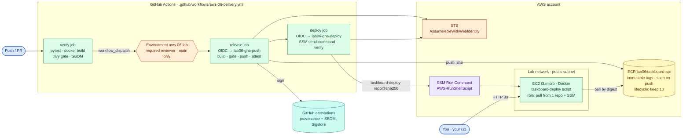
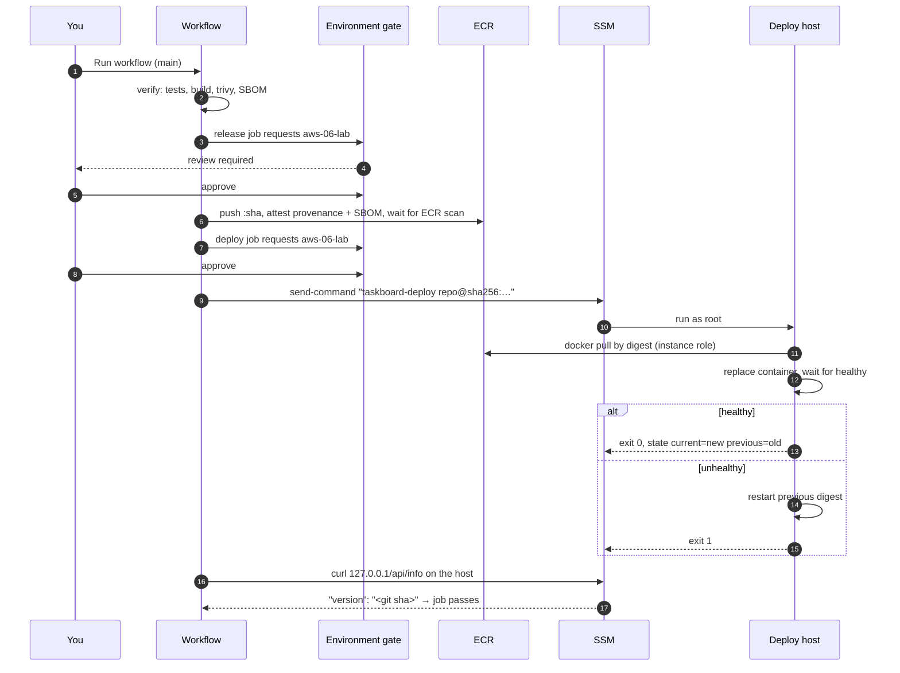
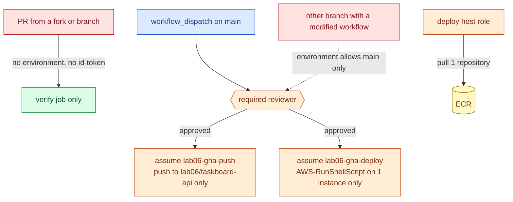

# AWS 06 — Secure CI/CD and Container Registry

| | |
|---|---|
| **Project ID** | `aws-06` |
| **Cloud** | AWS (ECR, IAM OIDC federation, Systems Manager Run Command, EC2) + GitHub Actions |
| **Difficulty** | Intermediate |
| **Build time** | 3–4 h first attempt (including [exercises](docs/exercises.md)) |
| **Rebuild time** | 15 min |
| **Free tier** | Fits: one `t3.micro`, ECR storage well under 500 MB, GitHub Actions free on public repositories — see [cost](docs/cost.md) |
| **Depends on** | [AWS 02](../02-dockerized-app-on-vm/) (container runtime profile), [AWS 04](../04-terraform-networking-foundations/) (state bucket) |
| **Status** | Implemented · static checks passed · local deploy-script test passed (10 checks) · pipeline and deployment **not tested** ([tracker](../../../docs/progress/implementation-tracker.md)) |

## The problem this lab solves

In AWS 02 a laptop built the image on the server over SSH: no tests in the path, no scan, no record of
what was deployed, and the deployer's SSH key was effectively root. Teams that move this into CI often
make it worse — an AWS access key pasted into CI secrets, `latest` tags, and a pipeline anyone with a
branch can trigger.

This lab builds a delivery pipeline with **no stored credentials at all**: GitHub Actions authenticates
to AWS with OIDC, can only do so inside an approval-gated environment, pushes to a private ECR repository
with immutable tags, scans and attaches an SBOM and signed build provenance, and deploys the **digest** —
never a tag — through SSM Run Command, so the deploy host needs no inbound SSH from CI. The host's deploy
script health-gates every rollout and rolls back by itself.

**Skills learned:** GitHub Actions jobs, environments and permissions · OIDC federation and trust-policy
`sub` claims · least-privilege IAM for push and deploy · ECR immutable tags, lifecycle policies, scan on
push · vulnerability gates that are actionable · SBOMs and SLSA provenance attestations · deploy by
digest · pull-based deployment via SSM · automatic and manual rollback · workflow linting.

**Expected outcome:** a manual workflow run, after your approval, pushes `lab06/taskboard-api:<git-sha>`,
deploys its digest, and the deploy job proves `/api/info` reports that commit. A broken release is rolled
back without human action; `gh attestation verify` confirms where the running image came from.

## Architecture



| Component | Why it is there | Defined in |
|---|---|---|
| `verify` job | Tests, build, vulnerability gate and SBOM on every PR and push that touches the app — no AWS needed | [aws-06-delivery.yml](../../../.github/workflows/aws-06-delivery.yml) |
| GitHub Environment `aws-06-lab` | Required reviewer + main-only branch policy; also part of the role trust | [configure-github.sh](scripts/configure-github.sh) |
| OIDC provider + trust policy | Roles assumable only by `repo:OWNER/REPO:environment:aws-06-lab` | [iam-github.tf](terraform/iam-github.tf) |
| `lab06-gha-push` | ECR login + push to one repository | [iam-github.tf](terraform/iam-github.tf) |
| `lab06-gha-deploy` | `ssm:SendCommand` with one document on one instance | [iam-github.tf](terraform/iam-github.tf) |
| ECR repository | Immutable tags, scan on push, lifecycle policy | [ecr.tf](terraform/ecr.tf) |
| Deploy host | Shared `lab-host` + Docker cloud-init + ECR pull policy | [main.tf](terraform/main.tf) |
| `taskboard-deploy` | Digest-only, health-gated deploy with automatic rollback and state | [taskboard-deploy.sh](files/taskboard-deploy.sh) |
| `ssm-run.sh` | Runs a command via SSM and returns its real exit status | [ssm-run.sh](scripts/ssm-run.sh) |

### Release sequence



### Who can do what



## Concepts used

| Concept | Where in this lab | Guide |
|---|---|---|
| OIDC, environments, digests, SBOM, provenance, scan gates | Workflow + IAM | [cicd-supply-chain-security](../../../docs/concepts/cicd-supply-chain-security.md) |
| Image layers, tags vs digests | Build and push | [docker-images-and-builds](../../../docs/concepts/docker-images-and-builds.md) |
| Container runtime hardening | `taskboard-deploy` run profile | [container-security](../../../docs/concepts/container-security.md) |
| Health-gated rollout | Deploy script | [health-checks](../../../docs/concepts/health-checks.md) |
| Remote state | S3 backend | [terraform-state-and-locking](../../../docs/concepts/terraform-state-and-locking.md) |

Architecture decisions: [ADR-0001 OIDC trust pinned to a GitHub Environment](docs/adr/0001-oidc-environment-scoped-trust.md) ·
[ADR-0002 deploy by digest through SSM](docs/adr/0002-deploy-by-digest-via-ssm.md) ·
[ADR-0003 two-layer vulnerability gating](docs/adr/0003-two-layer-vulnerability-gating.md).

## Deploy

### 1. Test locally first (free)

```bash
cd projects/aws/06-secure-cicd-container-registry
scripts/local-test.sh       # local registry stands in for ECR; 10 checks of the deploy script
```

### 2. Prerequisites

- A **fork** of this repository on GitHub (the roles trust one repository; use your fork's name).
- `gh auth login` with permission to change the fork's settings.
- AWS 04's state bucket (bootstrap stack).

### 3. Configure and apply

```bash
cp terraform/terraform.tfvars.example terraform/terraform.tfvars   # github_repository, CIDRs
../../../shared/scripts/tf-init-backend.sh terraform
terraform -chdir=terraform plan -out=lab06.tfplan                   # 25 resources
terraform -chdir=terraform apply lab06.tfplan
scripts/configure-github.sh                                         # environment + repository variables
```

| Variable | Default | Notes |
|---|---|---|
| `github_repository` | — (required) | `owner/name` of your fork |
| `github_environment` | `aws-06-lab` | Must match the workflow |
| `create_github_oidc_provider` | `true` | `false` if the account already has `token.actions.githubusercontent.com` |
| `allowed_ssh_cidrs`, `allowed_http_cidrs` | — (required) | Your `/32`; CI never needs inbound access |

### 4. Run the pipeline

GitHub → **Actions → aws-06-delivery → Run workflow** on `main`, approve the two environment requests.

| Job | Expected result |
|---|---|
| verify | tests pass, trivy gate passes, `sbom-<sha>` artifact |
| release | `Pushed …@sha256:…` in the summary; provenance and SBOM attested; ECR scan shows 0 CRITICAL |
| deploy | `taskboard-deploy: healthy: …`, then `"version":"<git sha>"` from the host |

Check from your laptop:

```bash
curl -s "$(terraform -chdir=terraform output -raw app_url)"
gh attestation verify "oci://$(terraform -chdir=terraform output -raw ecr_repository_url)@<digest>" --owner <your-github-user>
```

### 5. Exercises

[docs/exercises.md](docs/exercises.md): trust-policy experiments, the vulnerability gate, tag
immutability, a broken release, rollback, provenance verification and least-privilege probing.

### 6. Clean up

```bash
gh variable set AWS06_ENABLED --repo <owner/repo> --body false     # stop release/deploy jobs
terraform -chdir=terraform destroy                                  # also deletes images (force_delete)
../../../shared/scripts/aws-find-lab-resources.sh
```

Delete the `aws-06-lab` environment and `AWS06_*` variables in the fork's settings if you no longer need
them. Attestations stay on GitHub; they reference digests that no longer exist and cost nothing.

## Troubleshooting, cost and interview material

- [Troubleshooting playbook](docs/troubleshooting.md) — 7 incidents
- [Cost estimate](docs/cost.md)
- [Interview preparation](docs/interview.md) — 7 questions

## Repeat practice

| Attempt | Goal | Guidance |
|---|---|---|
| 1 | Guided build | Follow this README and the exercises |
| 2 | Reduced guidance | Re-create `iam-github.tf` from the "Who can do what" diagram only, then run the pipeline |
| 3 | Rebuild from objectives | Write your own workflow: OIDC, gate, digest deploy, verification. Pass actionlint and a real run |
| 4 | Failure drills | Exercises 3–6: break trust, ship a vulnerable or broken image, roll back |
| 5 | Defend the design | Answer the [interview questions](docs/interview.md); argue for push-based SSH deploys or mutable tags and lose |

### Self-assessment

- [ ] I can explain every condition in the OIDC trust policy and what breaks without each.
- [ ] I can explain why a fork's PR cannot push to ECR in this setup.
- [ ] I can explain why the pipeline deploys a digest and the host refuses tags.
- [ ] I made the vulnerability gate fail and fixed the cause instead of ignoring it.
- [ ] I verified the provenance of the running image with `gh attestation verify`.
- [ ] I rolled back with the workflow's `rollback` input and know what state the host keeps.

**Done when:** `local-test.sh` passes, a real pipeline run deployed a digest and verified its version, a
broken release rolled back automatically, the provenance check passed, the self-assessment is complete,
and cleanup shows no tagged resources.

## References

- [Configuring OIDC in AWS for GitHub Actions](https://docs.github.com/actions/security-for-github-actions/security-hardening-your-deployments/configuring-openid-connect-in-amazon-web-services)
- [aws-actions/configure-aws-credentials](https://github.com/aws-actions/configure-aws-credentials)
- [Amazon ECR User Guide](https://docs.aws.amazon.com/AmazonECR/latest/userguide/)
- [AWS Systems Manager Run Command](https://docs.aws.amazon.com/systems-manager/latest/userguide/run-command.html)
- [Security hardening for GitHub Actions](https://docs.github.com/actions/security-for-github-actions/security-guides/security-hardening-for-github-actions)
