# AWS 06 — Hands-on exercises

Run from `projects/aws/06-secure-cicd-container-registry` after the deploy steps. Shortcuts:

```bash
TF=terraform
REPO_URL=$(terraform -chdir=$TF output -raw ecr_repository_url)
INSTANCE=$(terraform -chdir=$TF output -raw instance_id)
GH_REPO=<your-github-user>/devops-sre-engineering-labs
```



```mermaid
flowchart LR
    e1[1 Read the token]:::sec --> e2[2 Break the trust]:::risk --> e3[3 Vulnerability gate]:::risk
    e3 --> e4[4 Immutable tags]:::data --> e5[5 Broken release]:::risk --> e6[6 Rollback]:::app
    e6 --> e7[7 Verify provenance]:::obs --> e8[8 Probe least privilege]:::sec
    classDef sec fill:#ffedd5,stroke:#c2410c,color:#7c2d12
    classDef risk fill:#fee2e2,stroke:#b91c1c,color:#7f1d1d
    classDef data fill:#fef9c3,stroke:#a16207,color:#713f12
    classDef app fill:#dcfce7,stroke:#15803d,color:#14532d
    classDef obs fill:#ccfbf1,stroke:#0f766e,color:#134e4a
```

## 1. What is inside the OIDC token

Add this temporary step to the `deploy` job (after checkout), run the workflow once, then remove it:

```yaml
      - name: Show OIDC claims (exercise 1 only)
        run: |
          t=$(curl -sS -H "Authorization: bearer $ACTIONS_ID_TOKEN_REQUEST_TOKEN" "$ACTIONS_ID_TOKEN_REQUEST_URL&audience=sts.amazonaws.com" | jq -r .value)
          cut -d. -f2 <<<"$t" | tr '_-' '/+' | base64 -d 2>/dev/null | jq '{iss,aud,sub,repository,ref,environment,job_workflow_ref}'
```

**Expected:** `sub` is `repo:<owner>/<repo>:environment:aws-06-lab`, `aud` is `sts.amazonaws.com`.
Compare with the trust policy: `aws iam get-role --role-name lab06-gha-deploy --query Role.AssumeRolePolicyDocument`.
Explain which claim prevents a fork's workflow from assuming the role (`sub` contains the repository).

## 2. Break the trust on purpose

```bash
terraform -chdir=$TF apply -var github_environment=wrong-env      # roles now trust another environment
```

Run the workflow. **Expected:** the release job fails at `configure-aws-credentials` with
`Not authorized to perform sts:AssumeRoleWithWebIdentity`. Restore with `terraform apply` (default
variable). Explain why the error does not say *which* condition failed (STS does not leak policy details).

## 3. The vulnerability gate

The gate fails on fixable HIGH/CRITICAL findings. Reproduce it locally by pinning an old library:

```bash
cp -r ../../../shared/sample-apps/taskboard/api /tmp/oldapi && echo "urllib3==2.7.0" >> /tmp/oldapi/requirements.txt
docker build -q -t tb:old /tmp/oldapi
docker run --rm -v /var/run/docker.sock:/var/run/docker.sock aquasec/trivy:0.76.2 \
  image --scanners vuln --severity HIGH,CRITICAL --ignore-unfixed --exit-code 1 tb:old; echo "exit=$?"
```

**Expected** (verified 2026-11-09): `urllib3 2.7.0` with two HIGH findings fixed in 2.8.0
(CVE-2026-97687, CVE-2026-97689) and exit code 1 — the pipeline would stop before pushing. The shared
Dockerfile passes today because it removes pip (whose *vendored* copies of `urllib3` and `msgpack` were
exactly these findings when this lab was built) and applies Debian security updates at build time.
Discuss when a `.trivyignore` entry is acceptable (not exploitable in this app, documented, with an
expiry date) and when it is not.

## 4. Immutable tags

```bash
aws ecr describe-images --repository-name lab06/taskboard-api --query 'imageDetails[].[imageTags[0],imageDigest]' --output table
aws ecr get-login-password | docker login --username AWS --password-stdin "${REPO_URL%%/*}"
docker pull "$REPO_URL:<existing-sha>" && docker tag busybox:latest "$REPO_URL:<existing-sha>" && docker push "$REPO_URL:<existing-sha>"
```

**Expected:** `tag invalid: The image tag '<sha>' already exists ... cannot be overwritten because the
repository is immutable`. (Your laptop credentials need ECR push for this; the pipeline role could not
do it either.) Explain why the pipeline still deploys digests even with immutable tags (repositories can
be recreated; another registry may not be immutable; digests are verifiable).

## 5. A broken release

Make `/healthz` fail on a branch: in `shared/sample-apps/taskboard/api/app/main.py` change `healthz()` to
`raise RuntimeError("drill")`, merge to `main` in your fork, run the workflow.

**Expected:** `verify` fails at the unit tests — the release never reaches ECR. Now skip the tests by
deleting the pytest step in the branch only (do not merge that), run on that branch and see the
environment refuse it (main-only branch policy). The host's own safety net — automatic rollback when a
new image never becomes healthy — is exercised by `scripts/local-test.sh` ("broken image rejected").
Revert everything afterwards.

## 6. Rollback

Run the workflow with **rollback = true**.

**Expected:** only the deploy job runs, executes `taskboard-deploy --rollback`, and the host serves the
previous digest. Then:

```bash
scripts/ssm-run.sh "$INSTANCE" "taskboard-deploy --status"
```

shows that `current` and `previous` swapped. Explain why a second rollback goes forward again, and what a
rollback cannot undo (database migrations, external side effects).

## 7. Verify provenance

```bash
DIGEST=$(aws ecr describe-images --repository-name lab06/taskboard-api --query 'sort_by(imageDetails,&imagePushedAt)[-1].imageDigest' --output text)
gh attestation verify "oci://$REPO_URL@$DIGEST" --owner "${GH_REPO%%/*}"
gh attestation verify "oci://$REPO_URL@$DIGEST" --owner "${GH_REPO%%/*}" --predicate-type https://cyclonedx.org/bom --format json | jq '.[0].verificationResult.statement.predicate.components | length'
```

**Expected:** `✓ Verification succeeded`, naming the workflow file and commit; the SBOM predicate lists
the image's packages. Try with a digest you pushed by hand in exercise 4 — verification fails, because no
trusted workflow built it. Explain how an admission controller could enforce this check before running
an image (Kubernetes, AWS 09).

## 8. Probe least privilege

```bash
aws iam simulate-principal-policy --policy-source-arn "$(terraform -chdir=$TF output -raw deploy_role_arn)" \
  --action-names ssm:SendCommand ec2:TerminateInstances ecr:PutImage \
  --resource-arns "arn:aws:ec2:us-east-1:$(aws sts get-caller-identity --query Account --output text):instance/$INSTANCE" \
  --query 'EvaluationResults[].[EvalActionName,EvalDecision]' --output table
```

**Expected:** `ssm:SendCommand` allowed (on the instance — the document ARN is a second required
resource, so a full simulation needs both), the others `implicitDeny`. Discuss the remaining risk:
`AWS-RunShellScript` runs *any* command as root on that host. A custom SSM document that only accepts a
digest parameter would narrow it further — sketch it.
