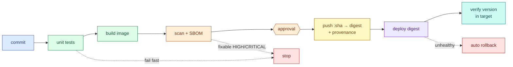
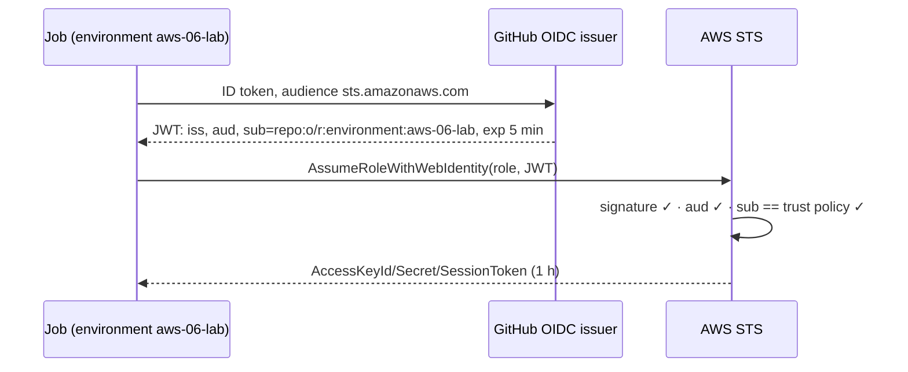
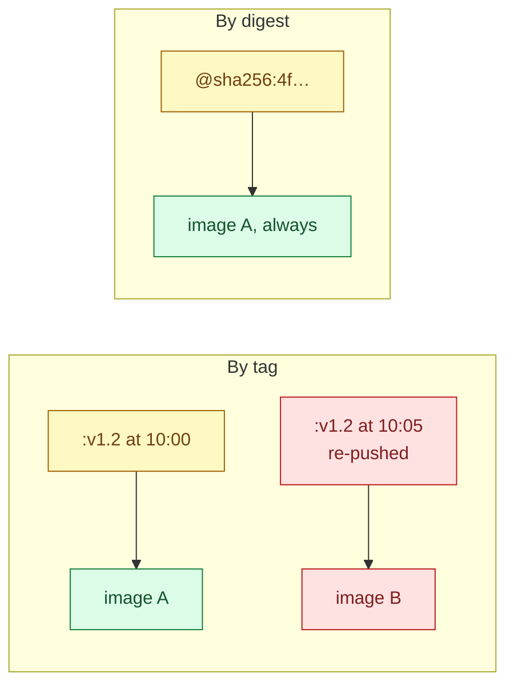
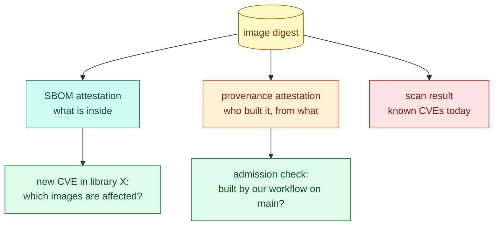
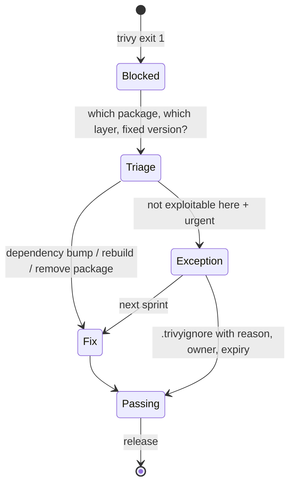
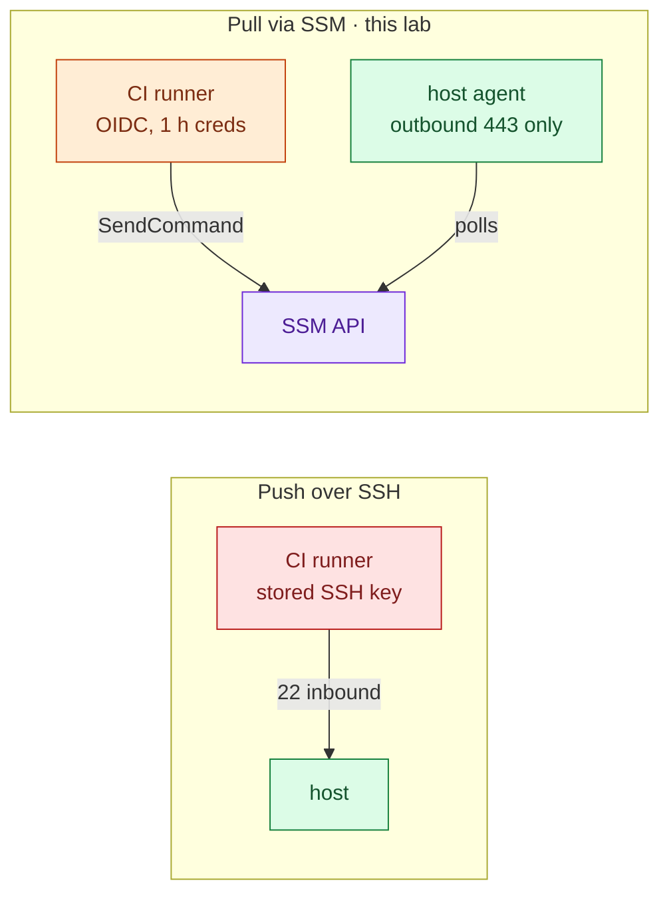
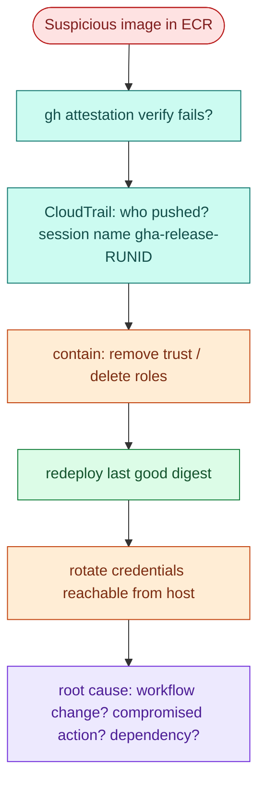

# AWS 06 — Interview preparation

Index of all questions: [interview index](../../../../docs/interview-preparation/README.md).

---

## Q1 (Beginner) — What are the stages of a CI/CD pipeline for a containerised service, and why in that order?

**Interview answer:** Test the code, build the image, scan it, publish it with an immutable identity,
then deploy that exact artefact and verify it in the target environment. Cheap, fast checks come first so
broken changes fail before anything is published; publishing comes before deployment so every
environment receives the same bytes; verification closes the loop by checking what is actually running.

**Walkthrough:** the lab's `verify` job is everything up to "scan" and runs on every PR; `release` and
`deploy` need approval and AWS.

**Depth:** "build once, deploy many" — later environments promote the same digest rather than rebuilding.
In this lab the release job rebuilds and **rescans** that rebuild, so the pushed bytes are the scanned
bytes.

**Follow-ups:** Where do integration tests go? How do you keep the pipeline under 10 minutes?

---

## Q2 (Intermediate) — How does GitHub Actions get AWS credentials without storing access keys?

**Interview answer:** With OIDC federation. The job requests a signed token from GitHub's OIDC issuer;
AWS STS validates the signature against the registered identity provider and checks the trust policy's
conditions on the token's claims — audience and, critically, `sub`, which encodes the repository and
environment. If they match, STS returns credentials that expire within an hour. Nothing long-lived exists
to leak.

**Walkthrough:** the `sub` match is what stops a fork, another repository, or a job outside the
environment.

**Security concerns:** wildcards such as `repo:o/*` or `repo:o/r:*` let any branch or pull request
assume the role; the `aud` check must exist; `pull_request_target` workflows must never get `id-token:
write` with untrusted code checked out.

**Follow-ups:** Branch-scoped vs environment-scoped `sub` — which and why? How would you do the same with
GitLab or Jenkins?

---

## Q3 (Intermediate) — Why deploy by digest instead of by tag?

**Interview answer:** A tag is a movable pointer; a digest is the content hash of the image manifest. If
you deploy `:v1.2`, whoever can push tags decides what runs, and two hosts can pull different content
under the same name minutes apart. Deploying `repo@sha256:…` guarantees every host runs exactly the bytes
that were tested, scanned and attested, and it makes rollback precise.

**Walkthrough:** immutable tags in ECR prevent the re-push here, but the host script still refuses tags —
defence in depth, and portable to registries without immutability.

**Follow-ups:** How do humans read digests (keep the tag for display, deploy the digest)? How does
Kubernetes resolve tags, and what does `imagePullPolicy` change?

---

## Q4 (Advanced) — What do an SBOM and a provenance attestation give you that a vulnerability scan does not?

**Interview answer:** A scan is a point-in-time judgement against today's CVE database. An SBOM is the
inventory: when a new CVE lands next month, you query SBOMs to find every affected image without
rebuilding or rescanning. Provenance answers a different question — where did this artefact come from:
which repository, commit, workflow and runner built it — signed so it can be verified before deployment.
Together they let you both find and trust what is running.

**Walkthrough:** the lab attaches both to the digest in ECR and in GitHub's attestation store;
`gh attestation verify` checks the Sigstore signature and the workflow identity (exercise 7).

**Follow-ups:** What are SLSA levels and which does this pipeline approach? How would you enforce
"only attested images" in Kubernetes (admission policies)?

---

## Q5 (Scenario) — The vulnerability gate blocks an urgent fix. What do you do?

**Interview answer:** First read what was found and where: is it fixable and in a package we actually
ship? Usually the fastest safe path is to fix it too — bump the pin, rebuild — because the gate only fails
on findings that have fixes. If it is not exploitable in this context and the fix is urgent, add a
time-boxed, documented exception reviewed by someone else, ship, and remove it next sprint. Never disable
the gate.

**Walkthrough:** while building this lab the gate found HIGH CVEs in pip's vendored `urllib3`/`msgpack`
— a package the app never uses at runtime. The right fix was to remove pip from the runtime image, not to
ignore the findings.

**Follow-ups:** Who owns the exceptions? How do you avoid alert fatigue from scanners?

---

## Q6 (Advanced) — Push-based deployment over SSH vs pull-based via an agent: which and why?

**Interview answer:** Pull-based. With push over SSH, CI needs network reachability to every host and a
key that is effectively root — a juicy secret and an open port. With SSM Run Command, the host's agent
holds an outbound connection to AWS; the pipeline only gets permission to send one document to one
instance, authenticated by short-lived OIDC credentials and audited in CloudTrail. GitOps (AWS 09) takes
pull further: the cluster pulls desired state from Git.

**Tradeoffs:** `AWS-RunShellScript` still allows any command as root on that host; a custom SSM document
with a single digest parameter narrows it. SSM adds a dependency on the agent being online.

**Follow-ups:** How do you deploy to 50 hosts safely (SSM rate control, Auto Scaling instance refresh,
AWS 05)?

---

## Q7 (Scenario) — A pipeline was compromised and pushed a malicious image. How would you detect it, limit the damage and recover?

**Interview answer:** Detection: provenance verification fails for images not built by the trusted
workflow, ECR push events in CloudTrail come from an unexpected session, and the running digest does not
match any approved release. Limitation: the push role can touch one repository and the deploy role one
instance; both need an approved environment run. Recovery: revoke by tightening the trust policy (or
deleting the roles), redeploy the last known-good digest, rotate anything the image could reach, and
review the workflow history and dependency changes.

**Depth:** third-party actions are code you run with your permissions; pin them by commit SHA (the
`role-session-name` in this workflow makes CloudTrail entries traceable to a run).

**Follow-ups:** How do you pin and update actions safely (SHA pins + Dependabot)? What is the blast
radius if the deploy host is compromised?
