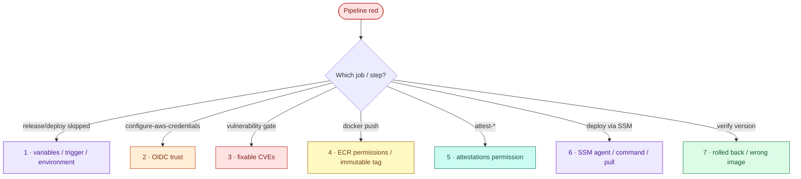

# AWS 06 — Troubleshooting playbook



## 1. Release and deploy jobs are skipped

**Symptoms:** only `verify` runs; release/deploy show "skipped".

**Likely causes:** the run was triggered by a push or PR (by design only `workflow_dispatch` releases);
`AWS06_ENABLED` is not exactly `true`; the `rollback` input was set (release is skipped on purpose).

**Diagnose:**

```bash
gh variable list --repo <owner/repo> | grep AWS06
gh run view <run-id> --repo <owner/repo> --json event,jobs --jq '.event, (.jobs[] | [.name,.conclusion])'
```

**Resolve:** `scripts/configure-github.sh`, then start the workflow from the Actions tab on `main`.

**Prevent:** keep the job conditions in one place (`if:` on each job) and document them (README).

## 2. `Not authorized to perform sts:AssumeRoleWithWebIdentity`

**Symptoms:** `configure-aws-credentials` fails.

**Likely causes:** the token's `sub` does not match the trust policy — different repository name (fork
renamed, case differs), different environment name, or the job does not declare `environment:`;
`id-token: write` missing; the OIDC provider is missing or a second one was expected
(`create_github_oidc_provider`).

**Diagnose:**

```bash
aws iam get-role --role-name lab06-gha-push --query 'Role.AssumeRolePolicyDocument.Statement[0].Condition'
aws iam list-open-id-connect-providers
gh api repos/<owner/repo>/environments --jq '.environments[].name'
```

**What the results mean:** compare `repo:<owner>/<repo>:environment:<env>` character by character with
the workflow's repository and the job's `environment:`. (Exercise 1 prints the real claims.)

**Resolve:** fix `github_repository` / `github_environment` and `terraform apply`, or the workflow.

**Prevent:** never widen the trust to wildcards to "make it work".

## 3. Vulnerability gate fails

**Symptoms:** trivy step exits 1 with a table of HIGH/CRITICAL findings.

**Likely causes:** a dependency pinned in `requirements.txt` has a fixed CVE; the Debian base has new
fixes not yet in the published image; a build tool left in the image.

**Diagnose:**

```bash
docker build -t tb:check ../../../shared/sample-apps/taskboard/api
docker run --rm -v /var/run/docker.sock:/var/run/docker.sock aquasec/trivy:0.76.2 image --severity HIGH,CRITICAL --ignore-unfixed --format json tb:check \
  | jq -r '.Results[] | .Target as $t | .Vulnerabilities[]? | [$t,.PkgName,.InstalledVersion,.FixedVersion,.VulnerabilityID] | @tsv'
```

**What the results mean:** the `Target` tells you the layer: an OS package (rebuild picks up Debian
fixes), a Python package in `/opt/venv` (bump the pin), or something you should not ship at all (as with
pip when this lab was built).

**Resolve:** bump the pin and run tests; rebuild; remove unneeded packages.

**Prevent:** Dependabot (configured for pip and Docker), small runtime images.

## 4. `docker push` denied or `tag ... already exists`

**Symptoms:** `denied: User ... is not authorized to perform: ecr:InitiateLayerUpload` or
`tag invalid ... cannot be overwritten`.

**Likely causes:** the push policy targets a different repository ARN (renamed repository); you re-ran a
release for the same commit SHA (immutable tag).

**Diagnose:**

```bash
aws iam get-role-policy --role-name lab06-gha-push --policy-name push-taskboard-image --query PolicyDocument.Statement[1].Resource
aws ecr describe-images --repository-name lab06/taskboard-api --image-ids imageTag=<sha>
```

**Resolve:** `terraform apply`; for a re-run, deploy the already-pushed digest (rollback-style) or make a
new commit.

**Prevent:** releases are one-per-commit by design; the digest is the release identity.

## 5. `attest-build-provenance` / `attest-sbom` fails

**Symptoms:** `Resource not accessible by integration` or `Failed to persist attestation`.

**Likely causes:** `attestations: write` or `id-token: write` missing from the job; a private repository
on a plan without artifact attestations; pushing the attestation to ECR without push permission for the
attestation manifest (it is stored in the same repository).

**Diagnose:** read the step log; `gh api repos/<owner/repo> --jq .visibility`.

**Resolve:** restore the job permissions; use a public fork; keep `ecr:PutImage` on the repository.

**Prevent:** actionlint (in `scripts/validate.sh workflows`) catches syntax, not missing permissions —
review `permissions:` blocks in every PR.

## 6. Deploy via SSM fails or times out

**Symptoms:** `status: Failed`, `InvalidInstanceId`, or `ssm-run.sh` loops until timeout.

**Likely causes:** the SSM agent is not online (instance still booting, no outbound 443); cloud-init has
not finished installing Docker or the AWS CLI; ECR login fails because the instance role lacks the pull
policy; the deploy script rolled back (exit 1).

**Diagnose:**

```bash
aws ssm describe-instance-information --filters Key=InstanceIds,Values=$INSTANCE --query 'InstanceInformationList[0].PingStatus'
scripts/ssm-run.sh $INSTANCE "cloud-init status; docker version --format {{.Server.Version}}; /snap/bin/aws --version"
scripts/ssm-run.sh $INSTANCE "taskboard-deploy --status; docker logs --tail 20 taskboard"
```

**What the results mean:** `PingStatus` other than `Online` → agent/network; `aws: not found` → cloud-init
still running; `no basic auth credentials` → ECR login/role; `rolling back` in the output → see #7.

**Resolve:** wait for cloud-init; `terraform apply` to restore the pull policy; fix the image.

**Prevent:** the deploy job only starts after `release`, by which time the host has been up for minutes.

## 7. Deploy "succeeds" but the version check fails

**Symptoms:** `running version is not <sha>`.

**Likely causes:** the new image was unhealthy and the script restored the previous one (the SSM step then
fails first — check both steps); a manual rollback ran in between; someone started a container by hand.

**Diagnose:**

```bash
scripts/ssm-run.sh $INSTANCE "taskboard-deploy --status; docker inspect -f '{{index .Config.Labels \"taskboard.image\"}}' taskboard"
```

**Resolve:** fix the release and re-run; never hand-deploy to a pipeline-owned host.

**Prevent:** the version check exists precisely to catch "green pipeline, old code".
