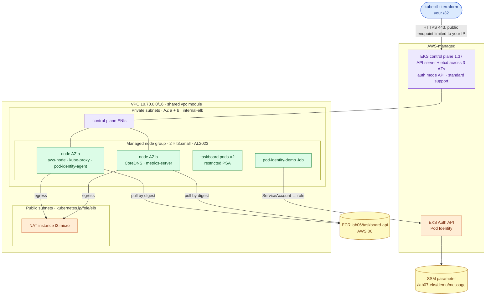
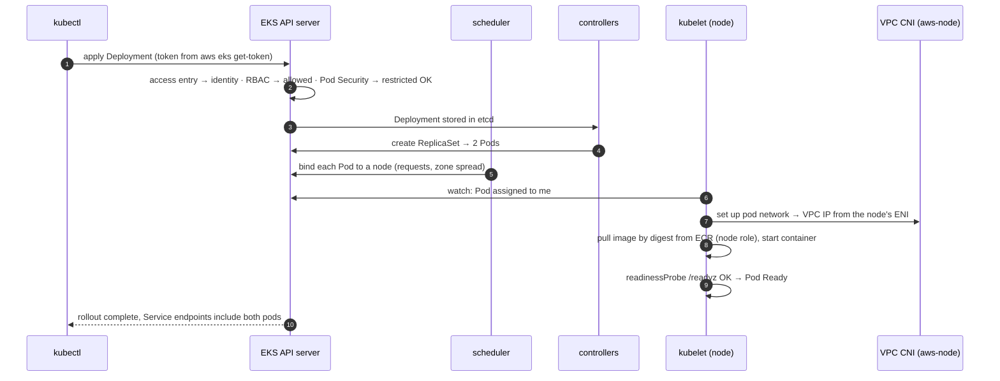
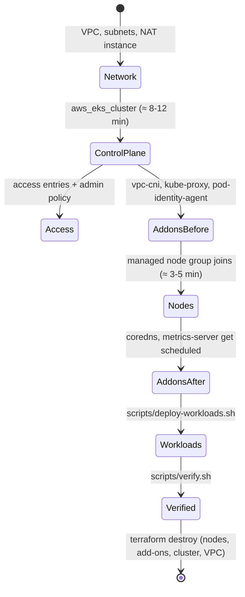

# AWS 07 — Managed Kubernetes Foundations (EKS)

| | |
|---|---|
| **Project ID** | `aws-07` |
| **Cloud** | AWS (EKS 1.37, managed node group, managed add-ons, access entries, Pod Identity, VPC, IAM) |
| **Difficulty** | Intermediate |
| **Build time** | 4–5 h first attempt (cluster creation ≈ 10–15 min) |
| **Rebuild time** | 25 min |
| **Free tier** | **No**: the EKS control plane costs $0.10/hour on every plan. Nodes use free-tier-eligible `t3.small`, NAT uses a free-tier `t3.micro` — see [cost](docs/cost.md) (≈ $0.49 per 3-hour session) |
| **Depends on** | [AWS 04](../04-terraform-networking-foundations/) (VPC module, state bucket), [AWS 06](../06-secure-cicd-container-registry/) (image in ECR) |
| **Status** | Implemented · static checks passed (Terraform, manifests vs Kubernetes 1.37 schemas) · deployment **not tested** ([tracker](../../../docs/progress/implementation-tracker.md)) |

## The problem this lab solves

AWS 05 achieved high availability by keeping identical instances behind a load balancer — for one app,
with minutes per rollout and a lot of AWS-specific plumbing. Running ten services that way means ten
Auto Scaling groups, ten deploy mechanisms and ten ways to fail. Kubernetes offers one API for
scheduling, self-healing, rollouts, service discovery and access control across all of them; EKS runs the
control plane (API server and etcd across three AZs) so you do not have to.

This lab builds an EKS cluster from raw Terraform resources so every moving part is visible: the cluster
IAM role, private node subnets with NAT, a managed node group, managed add-ons (VPC CNI, kube-proxy,
CoreDNS, Pod Identity agent, metrics-server), **access entries** instead of the `aws-auth` ConfigMap, a
developer role whose permissions come only from Kubernetes RBAC, and **EKS Pod Identity** so exactly one
pod can read one SSM parameter. Taskboard runs as a hardened Deployment in a namespace that enforces the
`restricted` Pod Security Standard.

**Skills learned:** control plane vs data plane · EKS cluster IAM, endpoint access, upgrade policy ·
managed node groups and AMI types · VPC CNI pod IP addressing and max-pods · CoreDNS and kube-proxy ·
access entries, access policies and RBAC · Pod Identity · Namespaces, Deployments, Services, ConfigMaps,
Jobs, probes, requests/limits, security contexts, topology spread · Pod Security Admission · cost
structure of managed Kubernetes.

**Expected outcome:** `scripts/verify.sh` passes — cluster `ACTIVE` with API-only authentication and
standard support, two Ready nodes in two AZs, all add-ons `ACTIVE`, two Taskboard replicas answering, a
privileged pod rejected, the developer role limited exactly as the Role says, and the Pod Identity demo
reading its parameter.

## Architecture



| Component | Why it is there | Defined in |
|---|---|---|
| VPC with NAT instance | Private node subnets need egress for image pulls; EKS subnet tags for later load balancers | [main.tf](terraform/main.tf), [shared vpc module](../../../shared/terraform-modules/aws/vpc/main.tf) |
| Cluster + IAM role | Managed control plane; endpoint public (your /32) + private; `upgrade_policy STANDARD` | [eks.tf](terraform/eks.tf) |
| Access entries | Admin (you) with `AmazonEKSClusterAdminPolicy`; developer role → group `lab07-developers` | [eks.tf](terraform/eks.tf) |
| Managed node group | 2 × `t3.small` AL2023, private subnets, rolling updates `max_unavailable 1`; launch template enforces IMDSv2 hop limit 1 and encrypted gp3 | [nodes.tf](terraform/nodes.tf) |
| Managed add-ons | vpc-cni, kube-proxy, eks-pod-identity-agent (before nodes); coredns, metrics-server (after) | [addons.tf](terraform/addons.tf) |
| Pod Identity | Role + association for `taskboard/pod-identity-demo`, one SSM parameter | [pod-identity.tf](terraform/pod-identity.tf) |
| Namespace + RBAC | PSA `restricted`; Role/RoleBinding for developers | [k8s/base](k8s/base/) |
| Taskboard | Deployment (2 replicas, probes, security context, AZ spread) + ClusterIP Service | [taskboard.yaml](k8s/base/taskboard.yaml) |

### What happens on `kubectl apply`



### Cluster creation order



## Concepts used

| Concept | Where in this lab | Guide |
|---|---|---|
| Control plane, nodes, core objects | Whole lab | [kubernetes-core-concepts](../../../docs/concepts/kubernetes-core-concepts.md) |
| Access entries, RBAC, Pod Identity | `eks.tf`, `pod-identity.tf`, `rbac-developer.yaml` | [eks-access-and-identity](../../../docs/concepts/eks-access-and-identity.md) |
| Probes | Deployment | [health-checks](../../../docs/concepts/health-checks.md) |
| Pod security context, PSA | Namespace + Deployment | [container-security](../../../docs/concepts/container-security.md) |
| VPC layout, NAT | Network | [aws-vpc-design](../../../docs/concepts/aws-vpc-design.md) |
| Digests from the pipeline | Image reference | [cicd-supply-chain-security](../../../docs/concepts/cicd-supply-chain-security.md) |

Architecture decisions: [ADR-0001 EKS from raw resources](docs/adr/0001-eks-raw-terraform-resources.md) ·
[ADR-0002 private nodes behind a NAT instance](docs/adr/0002-private-nodes-nat-instance.md) ·
[ADR-0003 access entries, Pod Identity, CNI on the node role](docs/adr/0003-access-entries-pod-identity.md).

## Deploy

> This lab is billed from the moment the cluster exists. Plan a session, then destroy.

### 1. Preflight

```bash
cd projects/aws/07-managed-kubernetes-foundations
../../../shared/scripts/aws-preflight.sh          # shows whether t3.small is free-tier eligible for you
kubectl version --client                          # within one minor version of 1.37
aws eks describe-cluster-versions --query 'clusterVersions[?defaultVersion].clusterVersion'
```

An image must exist in AWS 06's ECR repository (run its pipeline once), or set `IMAGE=<repo@sha256:…>`
for step 4.

### 2. Configure and apply

```bash
cp terraform/terraform.tfvars.example terraform/terraform.tfvars   # allowed_api_cidrs
../../../shared/scripts/tf-init-backend.sh terraform
terraform -chdir=terraform plan -out=lab07.tfplan                   # 60 resources
terraform -chdir=terraform apply lab07.tfplan                       # ≈ 15-20 minutes
```

| Variable | Default | Notes |
|---|---|---|
| `allowed_api_cidrs` | — (required) | Your `/32`; `0.0.0.0/0` rejected |
| `kubernetes_version` | `1.37` | Newest EKS standard-support version on 2026-11-09 |
| `nat_mode` | `instance` | `gateway` for the production pattern (billed) |
| `node_instance_type` | `t3.small` | 11 pods per node; `c7i-flex.large` for 29 |
| `node_capacity_type` | `ON_DEMAND` | `SPOT` to save more, with interruptions |
| `admin_principal_arn` | caller | The role ARN that gets cluster admin |
| `enable_network_policy` | `true` | VPC CNI enforces NetworkPolicy (used by AWS 08/09) |

Continuing with AWS 08 and 09 on the same cluster? Set `node_count = 3`: Argo CD (AWS 09) and the load
balancer controller (AWS 08) need room beyond the 11 pods a t3.small can hold.

### 3. Connect

```bash
$(terraform -chdir=terraform output -raw kubeconfig_command)
kubectl get nodes -L topology.kubernetes.io/zone,node.kubernetes.io/instance-type
kubectl get pods -n kube-system
```

### 4. Deploy workloads and verify

```bash
scripts/deploy-workloads.sh        # base manifests + Pod Identity demo, image pinned by digest
scripts/verify.sh
```

| Check | Expected |
|---|---|
| Cluster | `ACTIVE`, auth mode `API`, support `STANDARD`, endpoint limited to your CIDR |
| Nodes | ≥ 2 Ready, 2 AZs |
| Add-ons | 5 × `ACTIVE` with versions |
| kube-system | all pods Running; `kubectl top nodes` works |
| Taskboard | 2 available replicas; `/readyz` via port-forward |
| Pod Security | privileged pod rejected ("violates PodSecurity") |
| Developer role | can list pods in `taskboard`; cannot delete deployments, read `kube-system` or nodes |
| Pod Identity | demo logs show the demo role ARN and the parameter value |

### 5. Exercises

[docs/exercises.md](docs/exercises.md): control plane vs nodes, pod networking and max-pods, scheduling,
self-healing, rolling updates, RBAC, Pod Identity, Pod Security, node replacement, and cost.

### 6. Clean up

```bash
kubectl delete namespace taskboard --wait        # removes workloads first (no load balancers in this lab)
terraform -chdir=terraform destroy               # ≈ 10-15 minutes
../../../shared/scripts/aws-find-lab-resources.sh
```

## Troubleshooting, cost and interview material

- [Troubleshooting playbook](docs/troubleshooting.md) — 8 incidents
- [Cost estimate](docs/cost.md)
- [Interview preparation](docs/interview.md) — 7 questions

## Repeat practice

| Attempt | Goal | Guidance |
|---|---|---|
| 1 | Guided build | Follow this README and the exercises |
| 2 | Reduced guidance | Rebuild and explain each `kubectl get pods -n kube-system` pod before reading the docs |
| 3 | Rebuild from objectives | Write `eks.tf`/`nodes.tf` yourself from the component table; pass `verify.sh` |
| 4 | Failure drills | Exercises 4, 6 and 9, plus the playbook's scenarios (`Too many pods`, `ImagePullBackOff`, `Forbidden`) |
| 5 | Defend the design | Answer the [interview questions](docs/interview.md); argue EKS vs ECS vs self-managed with numbers |

### Self-assessment

- [ ] I can draw the control plane / node split and say what AWS manages.
- [ ] I can explain why a t3.small runs at most 11 pods.
- [ ] I can trace `kubectl get pods` from IAM to an access entry to RBAC.
- [ ] I can explain why only the demo pod can read the SSM parameter.
- [ ] I can explain what Pod Security `restricted` requires and show a rejection.
- [ ] I can name the hourly costs of this lab and which one never goes away while the cluster exists.

**Done when:** `verify.sh` passes, exercises 1–9 are done, the self-assessment is complete, and the
cluster is destroyed with no tagged resources left.

## References

- [Amazon EKS User Guide](https://docs.aws.amazon.com/eks/latest/userguide/)
- [EKS Best Practices Guide](https://docs.aws.amazon.com/eks/latest/best-practices/)
- [Kubernetes documentation](https://kubernetes.io/docs/home/)
- [Amazon VPC CNI](https://github.com/aws/amazon-vpc-cni-k8s)
- [EKS Kubernetes version lifecycle](https://docs.aws.amazon.com/eks/latest/userguide/kubernetes-versions.html)
